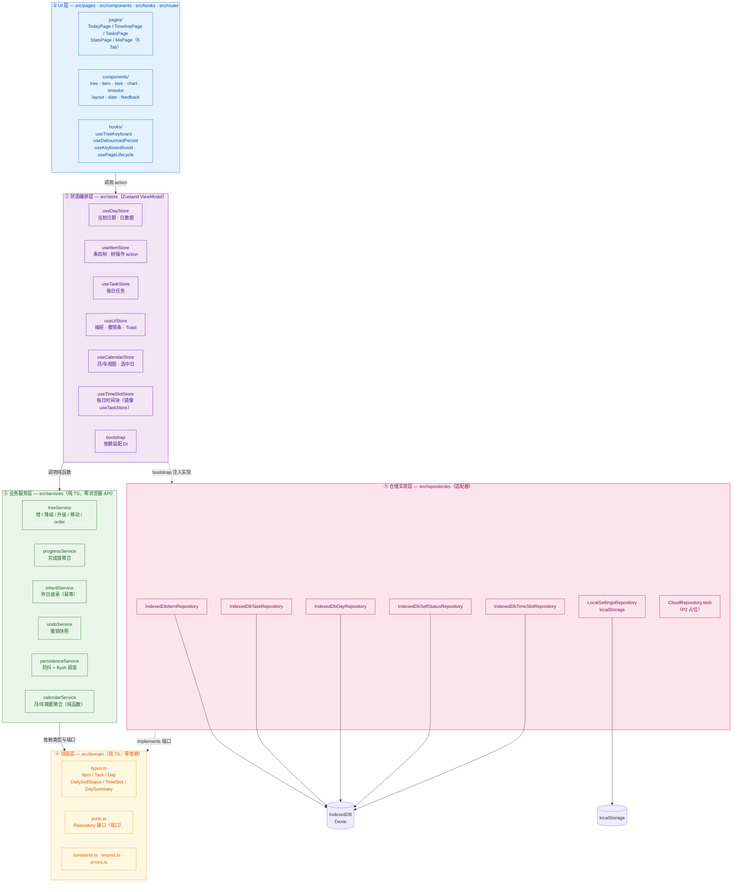
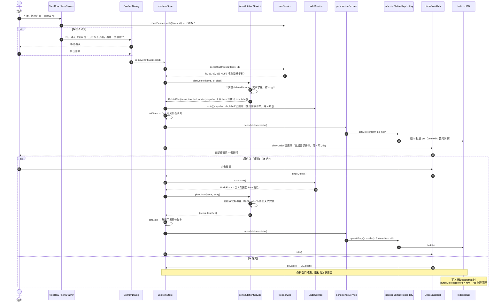
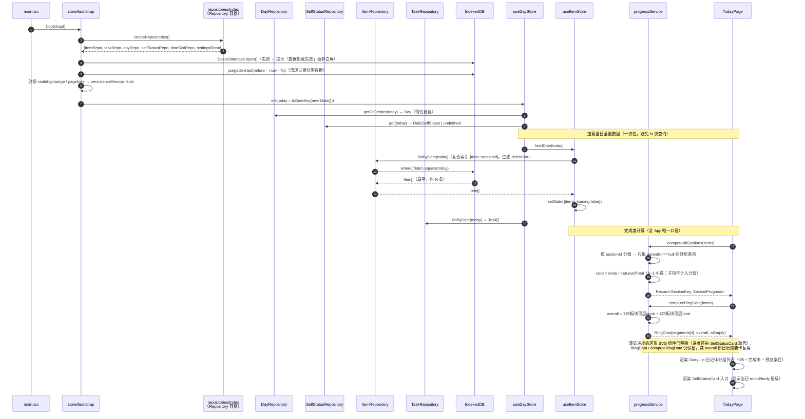
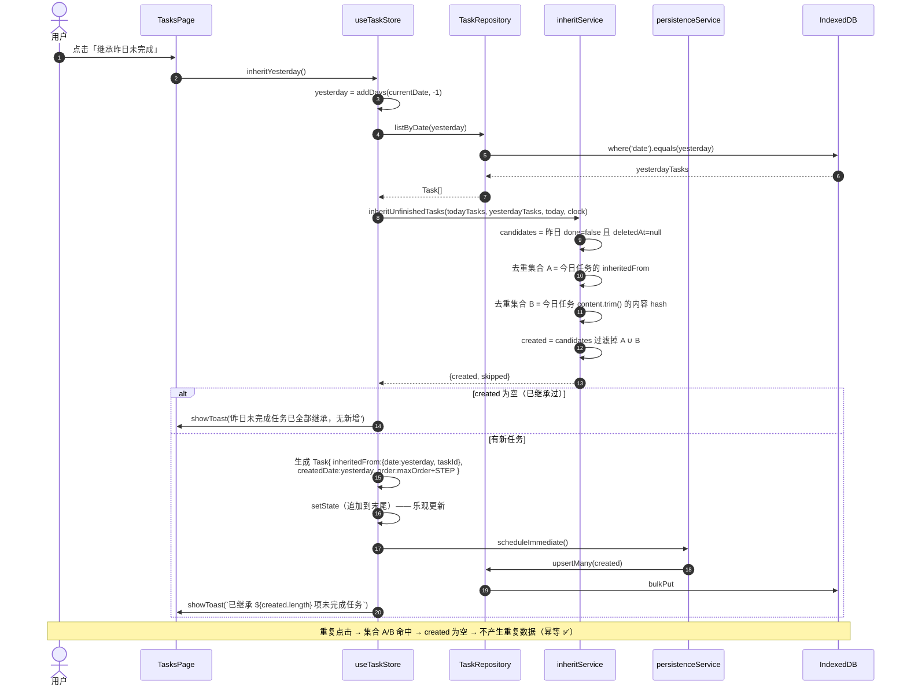
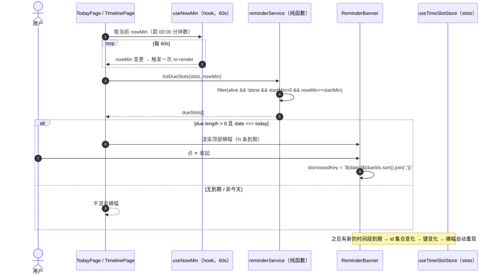

# 日程表软件 · 系统架构设计文档

| 项目信息 | 内容 |
| --- | --- |
| 项目名称 | `daily_schedule_app` |
| 文档版本 | v1.6（增量：R-040 农历 / 二十四节气 / 节日显示；承 v1.5 R-039 主页四板块组内联快速添加） |
| 撰写人 | 高见远（架构师） |
| 最近更新 | 追加 §9-F（R-040 农历 / 节气 / 节日显示）；附录 B 追溯矩阵补 R-040 / R-041（R-041 标注二期未实现）并扩覆盖范围至 **R-041**；**§4 文件清单重新对齐 `src/`（冻结快照 130 文件 / 15,788 行）**（arch-docs） |
| 上游输入 | `docs/PRD.md`（v1.0，许清楚） |
| 目标平台 | 移动端优先 H5（375–430px），二期可迁移微信小程序 |
| 架构主线 | **本地优先 + Repository 抽象 + 严格分层**（业务层零浏览器 API） |

---

## 〇、架构总纲（一句话）

> **把「树形编辑」这件最难的事做成纯函数内核（零 DOM、零存储 API），用 Repository 接口隔离存储，用 Zustand 做乐观更新编排；UI 层（MUI + Tailwind）与业务内核完全解耦，二期换 UI 框架 / 换存储实现均不动业务代码。**

三条不可妥协的架构红线：

| # | 红线 | 校验方式 |
| --- | --- | --- |
| R1 | 业务服务层（`src/services`、`src/domain`）**禁止出现** `window` / `document` / `localStorage` / `indexedDB` / `navigator` | ESLint `no-restricted-globals` + `no-restricted-properties`（按目录 overrides），CI 卡口 |
| R2 | UI 层与页面层**禁止直接 import** `src/repositories/**` 具体实现，只允许经 Store / Service 访问数据 | ESLint `no-restricted-imports` |
| R3 | 所有写操作**必须经过** `PersistenceScheduler`（防抖 500ms / 离散操作立即写 / 生命周期强制 flush） | Code Review + `persistenceService` 单一出口 |

---

## 一、实现方案概述

### 1.1 核心技术难点与对策

| # | 难点 | 对策 | 落入模块 |
| --- | --- | --- | --- |
| D1 | **无限层级树的编辑语义**（Enter / Tab / Shift+Tab / 折叠 / 移动）极易写成散落各处的 if-else | 把全部树操作收敛为**纯函数**：输入 `Item[]` 扁平数组 + 操作指令，输出「新数组 + 需要落库的 id 集合」。UI 只负责发指令 | `services/treeService.ts` |
| D2 | **移动端长列表性能**（单板块可能 100+ 节点，每次输入都重排整树会卡） | ① Store 中保留**扁平数组**（非嵌套树）；② 渲染前用 `buildVisibleRows()` 做一次 DFS 剪枝生成可见行，memo 化；③ 输入框用非受控 + 局部 state，防抖后才回写 Store | `services/treeService.ts`、`components/tree/TreeList.tsx` |
| D3 | **删除撤销要完整恢复层级/顺序/折叠态** | **软删除只写 `deletedAt`，不改任何其他字段**；撤销即「按快照原样 upsert」。这是「完整恢复」能成立的根本前提 | `services/itemMutationService.ts`、`undoService.ts` |
| D4 | **持久化时机**（防抖 / 离散立即 / 生命周期 flush）分散在各处会漏写 | 唯一出口 `PersistenceScheduler`：「脏实体 Map（按实体 id 去重）+ 500ms debounce + flush(reason)」，页面生命周期 hook 只调 `flush()` | `services/persistenceService.ts`、`hooks/usePageLifecycle.ts` |
| D5 | **完成度口径歧义**（子项是否计入分母、父条目勾选是否联动） | 口径收敛为纯函数 `progressService`，全 App 唯一来源；子项**不重复计入**板块分母（PRD 7.3） | `services/progressService.ts` |
| D6 | **二期迁移小程序**（无 IndexedDB / 无 MUI / 无 visualViewport） | ① Repository 接口化；② 业务层零浏览器 API；③ 键盘避让、存储、UI 三处差异点全部集中在可被替换的目录 | 全文「迁移约束」小节 |

### 1.2 架构模式

采用 **分层架构 + 端口与适配器（Ports & Adapters / 六边形）的轻量变体**，UI 侧为 **MVVM 雏形**：Store 承担 ViewModel，组件只做渲染与事件转发。

```
依赖方向严格单向（自上而下），禁止反向依赖：
UI → Store → Service → Domain(接口)
                          ↑ 实现
                     Repository 实现（由 bootstrap 注入）
```

---

## 二、框架选型（含备选对比）

### 2.1 主技术栈

| 层 | 选型 | 版本 | 理由 | 备选方案 | 未选原因 |
| --- | --- | --- | --- | --- | --- |
| 构建 | **Vite** | ^5.4 | 冷启动 <1s、HMR 极快；`vite-plugin-pwa` 生态成熟 | CRA / Webpack | CRA 已废弃；Webpack 配置成本高、HMR 慢 |
| 框架 | **React** | ^18.3 | 团队通用；`useSyncExternalStore` 让 Zustand 无撕裂 | Vue 3 | 团队栈与 PRD 已定 React |
| 语言 | **TypeScript** | ^5.5（strict） | 树形结构 + Repository 接口必须有类型契约兜底 | JS | 邻接表 `parentId`/`level` 极易出错，无类型不可控 |
| UI 组件 | **MUI** | ^5.16 | Drawer / Dialog / Snackbar / SwipeableDrawer 开箱即用，正是本 App 高频组件 | antd-mobile / 全手写 | antd-mobile 与 Tailwind 共存度一般；全手写成本高 |
| 样式 | **Tailwind CSS** | ^3.4 | 布局 / 间距 / 安全区（`env(safe-area-inset-*)`）写起来最快，移动端适配友好 | CSS Modules / Emotion 纯手写 | 与 MUI 混用需配置（见 §8.6），但单位成本仍最低 |
| 路由 | **React Router** | ^6.26 | 5 Tab（含 `/timeline`）+ 详情页 + `?date=` query 支持完善 | TanStack Router | 生态与迁移资料少 |
| 状态管理 | **Zustand** | ^4.5 | 见 §2.2 | Context + useReducer | 见 §2.2 |
| 存储 | **Dexie**（IndexedDB 封装） | ^4.0 | 见 §2.3 | `idb` / 原生 IndexedDB | 见 §2.3 |
| ID 生成 | **nanoid** | ^5.0 | 跨平台一致（小程序可用），21 字符，~1KB | `crypto.randomUUID` | 需 HTTPS/secure context，小程序无；调试环境易踩坑 |
| 日期 | **自写 `utils/date.ts`** | — | 只需「YYYY-MM-DD 键 / 加减天 / 周区间」约 60 行，零依赖最利于迁移 | dayjs(2KB) / date-fns | 需求极简，引入库反而增加迁移面 |
| 图表 | **手写 SVG 环形图** | — | 环形图 = 4 段 `stroke-dasharray`，约 140 行，零包体 | ECharts / recharts | ECharts ~300KB+，PRD 明确不引入 |
| 防抖/节流 | **自写 `utils/debounce.ts`** | — | 30 行 | lodash.debounce | 为一个函数引包不值 |
| 单元测试 | **Vitest** | ^2.0 | 与 Vite 同构，零配置跑纯函数内核单测 | Jest | 需额外 babel/ts 配置 |

### 2.2 状态管理：为什么选 Zustand（而非 Context + useReducer）

| 对比维度 | **Zustand（推荐）** | Context + useReducer |
| --- | --- | --- |
| 渲染粒度 | `useStore(selector)` **按选择器订阅**，勾选第 3 条只重渲染该行 | Provider value 变更 → **所有 consumer 全量重渲染**；100+ 节点的树会明显掉帧 |
| 树形长列表性能 | 可配合 `useShallow` 精准订阅，配合 React.memo 效果确定 | 必须手动拆多个 Context / memo 才能救，复杂度反超 |
| React 外调用 | `useItemStore.getState()` 可在 `persistenceService`、`pagehide` 回调中直接读写 | 拿不到，必须绕 |
| 样板代码 | 一个 `create()` 即 store + actions | reducer + dispatch + types + Provider 嵌套，文件更多 |
| 包体 | ~1.2KB | 0 |
| 迁移小程序 | Store 是纯 JS 模块，Taro/uni-app 可直接复用 | 依赖 React Context 树，迁移时需重搭 |
| 结论 | ✅ **选用**。零 Provider、细粒度订阅、可在 React 外访问，正好匹配「长树 + 防抖落盘 + 生命周期 flush」三个硬需求 | ❌ 仅在「极简应用」下更优，本项目不适用 |

### 2.3 存储：为什么选 Dexie（而非 idb / 原生）

| 对比维度 | **Dexie 4（推荐）** | `idb`（轻量 Promise 封装） | 原生 IndexedDB |
| --- | --- | --- | --- |
| 复合索引 `[date+sectionId]` | 声明式 `stores()`，一行搞定 | 需在 `upgrade` 中手写 `createIndex` | 全手写 |
| 批量写（递归软删整棵子树，一次可能 20+ 条） | `bulkPut` / `bulkGet` + 自动单事务 | 手写 transaction，逐个 `put` | 最繁琐 |
| 事务与原子性 | `.transaction('rw', ...)` 语义清晰 | 需手写 tx 生命周期 | 需手写 |
| 版本迁移 / schema 升级 | `db.version(n).stores(...)` 声明式链式迁移 | 手写 `upgrade` 回调 | 手写 |
| 软删除清理（`purgeDeleted`） | `where('deletedAt').above(...)` 直接查 | 需建索引 + 游标 | 需游标 |
| 调试 | Dexie DevTools、`Dexie.debug` | 无 | 无 |
| 未来云同步 | 官方 `dexie-cloud-addon` 可平滑上云（P2 加分项） | 需自研 | 需自研 |
| 包体 | ~25KB min / ~8KB gzip | ~2KB | 0 |
| 结论 | ✅ **选用**。一期是 H5 不是小程序，8KB gzip 完全可接受；换来的是「批量写 / 复合索引 / 迁移」三大刚需能力，开发效率与正确率显著提升 | ⚠️ 若后续强控包体可降级替换，**因有 Repository 接口隔离，替换成本 ≈ 只改 `src/repositories/` 一个目录** | ❌ 开发成本过高 |

### 2.4 与 PRD 的差异说明（架构侧主动优化，需产品确认）

| # | PRD 原文 | 架构决策 | 理由 |
| --- | --- | --- | --- |
| A1 | §7.1 ER 图中 `ITEM` 与 `ITEM_DETAIL` 为**两个实体** | **合并**：`description` / `rating` / `review` 内联进 `Item` | ① 邻接表 + KV 存储下，每次开抽屉都要 join 一条记录是纯浪费；② P0 描述为纯文本，无独立实体必要；③ 减少一次读写即减少一次 IndexedDB 事务 |
| A2 | §7.1 `SECTION` 为存储实体 | **不作为业务表**：四大板块为 `domain/constants.ts` 中的常量定义；仅「改名 / 排序 / 主题色」这类**用户偏好**落 `LocalSettingsRepository`（localStorage） | 板块实例本身无业务数据，存表只会产生每天 4 条垃圾记录；P1 改名需求由偏好配置满足（对应 R-022） |
| A3 | §7.1 `DAY_REVIEW` | 保留为独立实体 `DailySelfStatus`（**P0 增量由 `DailyReview` 更名扩展**，PK = `date`，新增 `mood`/`body` 双评分 + 两段文字） | 与「日」强绑定、一对一，独立表（`selfStatus`）便于月/年视图按日期区间批量拉取 |
| A4 | PRD §10.1 未定状态管理 | 定 **Zustand** | §2.2 |
| A5 | PRD §10.1 未定 IndexedDB 库 | 定 **Dexie 4** | §2.3 |

---

## 三、分层架构

### 3.1 分层与依赖方向（Mermaid）



### 3.2 各层浏览器 API 权限矩阵（**迁移约束核心**）

| 层 | 目录 | `window`/`document` | `localStorage` | `indexedDB` | `Date`/`setTimeout` | `visualViewport` | 迁移小程序时 |
| --- | --- | --- | --- | --- | --- | --- | --- |
| ① UI 层 | `src/pages` `src/components` | ✅ 允许 | ❌ 禁止（走 Store） | ❌ 禁止 | ✅ 允许 | ✅ 允许 | **需重写**（换 Taro/uni-app 组件） |
| ① hooks | `src/hooks` | ✅ 允许 | ❌ 禁止 | ❌ 禁止 | ✅ 允许 | ✅ 允许 | **需重写**（`adjust-position` 替代） |
| ② Store | `src/store` | ⚠️ 仅限 `bootstrap.ts` 注册生命周期 | ❌ 禁止 | ❌ 禁止 | ✅ 允许 | ❌ 禁止 | **可复用** |
| ③ Service | `src/services` | ❌ **禁止** | ❌ **禁止** | ❌ **禁止** | ✅ 允许（时间经 `Clock` 注入） | ❌ **禁止** | **✅ 零改动复用** |
| ④ Domain | `src/domain` | ❌ **禁止** | ❌ **禁止** | ❌ **禁止** | ⚠️ 仅类型层，不含运行时调用 | ❌ **禁止** | **✅ 零改动复用** |
| ⑤ Repository | `src/repositories` | ✅ 允许 | ✅ 允许 | ✅ 允许 | ✅ 允许 | ❌ | **需替换实现**（`WxStorageRepository`） |

> **结论**：二期迁移只需重写 ①（UI/hooks）+ ⑤（Repository），②③ 层代码 100% 复用 —— 这正是本架构的核心价值。

### 3.3 ESLint 强制分层（配置片段，落在 `.eslintrc.cjs`）

```js
// 伪代码示意，实际落地见 .eslintrc.cjs
overrides: [
  {
    // ③④ 层：业务内核，禁止一切浏览器 API
    files: ['src/domain/**/*.ts', 'src/services/**/*.ts'],
    rules: {
      'no-restricted-globals': ['error', 'window', 'document', 'navigator', 'localStorage', 'sessionStorage', 'indexedDB', 'visualViewport'],
      'no-restricted-properties': ['error',
        { object: 'window', property: 'localStorage' },
        { object: 'globalThis', property: 'indexedDB' },
      ],
      'no-restricted-imports': ['error', { patterns: ['**/repositories/**', '**/store/**', 'react*'] }],
    },
  },
  {
    // ①② 层：禁止穿透到仓储实现
    files: ['src/pages/**/*.tsx', 'src/components/**/*.tsx', 'src/hooks/**/*.ts'],
    rules: {
      'no-restricted-imports': ['error', { patterns: ['**/repositories/**', 'dexie'] }],
    },
  },
]
```

---

## 四、完整文件列表

> **本节为现状清单**，已与 `src/` 对齐（arch-docs 冻结快照 **2026-10-13**，`find src -type f \( -name '*.ts' -o -name '*.tsx' \)` 计数 **130**；`npm run check:layers` 交叉印证同为 130 个源文件）；**设计期规划名以附录 B.1 追溯矩阵为准**。行数为 `wc -l` 实际值（含注释与空行）。路径相对项目根 `D:/myProjects/日程表软件`。

### 4.1 根目录配置（10 个文件）+ `scripts/`（2 个）

| 路径 | 职责（一句话） | 行数 |
| --- | --- | --- |
| `package.json` | 依赖声明与 `dev/build/test/lint` 脚本 | 39 |
| `vite.config.ts` | Vite 配置：`@` 别名、React 插件、H5 端口 | 23 |
| `tsconfig.json` | TS strict 配置 + `@/*` 路径别名 | 29 |
| `tsconfig.node.json` | Vite/脚本侧的 Node TS 环境 | 12 |
| `tailwind.config.ts` | Tailwind 主题扩展（间距、安全区、板块色板、`--m-*` 动效令牌） | 120 |
| `postcss.config.js` | PostCSS（tailwindcss + autoprefixer） | 6 |
| `index.html` | H5 入口：`viewport` / `theme-color` / `apple-mobile-web-app` 元信息 + **首屏主题内联脚本**（React 挂载前打 `data-theme`，防闪烁） | 39 |
| `.prettierrc` | 格式化约定（无分号、单引号、printWidth 100） | 8 |
| `.gitignore` | 忽略 `node_modules` / `dist` / `.env` | 8 |
| `README.md` | 启动方式、目录说明、分层红线 | 125 |
| `scripts/check-layers.mjs` | **分层红线卡口**：扫描 `services/`、`domain/` 禁浏览器 API，UI 禁直连仓储 | 104 |
| `scripts/check-test-baseline.mjs` | 单测基线校验（用例数不减少） | 216 |

> 注：本项目**无独立 ESLint 配置文件**（无 `.eslintrc.*` / `eslint.config.*`）；§3.3 的分层红线由上述 `scripts/check-layers.mjs` 卡口实现。根目录配置与 `scripts/` **不计入 `src/` 源文件合计**（合计见 §4.12）。

### 4.2 `src/` 入口与路由（3 个文件）

| 路径 | 职责 | 行数 |
| --- | --- | --- |
| `src/main.tsx` | React 挂载入口，调用 `bootstrap()` 后再 render | 13 |
| `src/App.tsx` | 应用根组件：主题 Provider + 路由出口 + 全局 Toast/撤销条挂载点 | 8 |
| `src/router/AppRouter.tsx` | HashRouter 路由表（今日 / `section/:sectionId` / 任务 / 时间轴 / 日历 / 我的 + 404）；**无独立 `routes.ts`**，路径常量内联于此 | 33 |

### 4.3 `src/domain/` 领域层（6 个文件，零依赖）

| 路径 | 职责 | 行数 |
| --- | --- | --- |
| `src/domain/types.ts` | 核心实体类型：`Item` / `Task` / `Day` / `DailySelfStatus` / `TimeSlot`（含 `actualStartMin`/`actualEndMin`）/ `Inspiration` / `DaySummary` / `MonthMiniSummary` / `DiaryGroup` / `DiaryEntry` | 232 |
| `src/domain/enums.ts` | `SectionKey` 枚举、刷新原因等枚举（**不扩展**：灵感走独立实体，不污染四大板块口径） | 22 |
| `src/domain/constants.ts` | 四大板块定义、`ORDER_STEP`、`DEBOUNCE_MS`、`UNDO_WINDOW_MS`、`MAX_LEVEL` | 95 |
| `src/domain/ports.ts` | **Repository 接口（端口）**：`ItemRepository` / `TaskRepository` / `DayRepository` / `SelfStatusRepository` / `TimeSlotRepository` / `InspirationRepository` / `SettingsRepository` | 93 |
| `src/domain/errors.ts` | `AppError` 基类与 `StorageError` / `ValidationError` / `NotFoundError` | 48 |
| `src/domain/index.ts` | 领域层统一导出（barrel） | 5 |

### 4.4 `src/repositories/` 仓储实现层（11 个文件）

| 路径 | 职责 | 行数 |
| --- | --- | --- |
| `src/repositories/db/schema.ts` | Dexie 表结构声明（stores / 复合索引 / 版本迁移链 v1→v2→**v3**） | 41 |
| `src/repositories/db/DexieDatabase.ts` | Dexie 实例创建、open 失败降级处理 | 26 |
| `src/repositories/mappers.ts` | 存储记录 ↔ 领域实体映射（含 `deletedAt` 过滤与默认值兜底；**TimeSlot 旧记录补 `actual*` 默认 null**） | 28 |
| `src/repositories/IndexedDbItemRepository.ts` | `ItemRepository` 的 IndexedDB 实现（按 `date+sectionId` 查询、批量 upsert、软删/恢复/清理） | 110 |
| `src/repositories/IndexedDbTaskRepository.ts` | `TaskRepository` 实现（含按 `inheritedFrom` 幂等查询） | 74 |
| `src/repositories/IndexedDbDayRepository.ts` | `DayRepository` **与 `SelfStatusRepository`** 实现（同库同事务；**无独立 `IndexedDbSelfStatusRepository` 文件**） | 62 |
| `src/repositories/IndexedDbTimeSlotRepository.ts` | `TimeSlotRepository` 实现：按 `date` 查询、区间批量、`upsertMany`、物理删除；软删沿用 `deletedAt` | 89 |
| `src/repositories/IndexedDbInspirationRepository.ts` | `InspirationRepository` 实现：按 `date` 查询、区间批量、`upsertMany`、物理删除（**镜像 timeSlots 范式**） | 73 |
| `src/repositories/LocalSettingsRepository.ts` | `SettingsRepository` 实现：localStorage 读写板块偏好、主题、折叠态兜底 | 45 |
| `src/repositories/CloudRepository.stub.ts` | **P2 云端实现占位**：仅方法签名 + `throw new Error` + TODO 注释 | 30 |
| `src/repositories/index.ts` | **Repository 容器/工厂**：唯一装配点（新增仓储仅在 `createRepositories()` 注册） | 40 |

### 4.5 `src/services/` 业务服务层（16 个文件，纯 TS）

| 路径 | 职责 | 行数 |
| --- | --- | --- |
| `src/services/idService.ts` | ID 生成统一出口（nanoid），屏蔽具体实现 | 18 |
| `src/services/clock.ts` | `Clock` 接口 + 默认实现（`() => new Date()`），供 Service 注入取时间 | 17 |
| `src/services/treeService.ts` | **树形操作内核**：建树、可见行 DFS、新增同级/子项、Tab 降级、Shift+Tab 升级、移动、`order` 重排 | 465 |
| `src/services/itemMutationService.ts` | 条目增删改编排：**递归软删（`planDelete`）**、撤销计划（`planUndo`）、勾选、折叠、标题/描述/评价更新 | 52 |
| `src/services/progressService.ts` | 完成度聚合：板块完成率、父条目直系子项进度、总完成率、四板块分段数据（`computeRingData`） | 82 |
| `src/services/inheritService.ts` | 昨日未完成继承（**幂等**：`inheritedFrom` + 内容 hash 双重去重） | 78 |
| `src/services/undoService.ts` | 撤销标签/栈管理：`undoLabel`、快照入栈、5s 窗口倒计时、过期丢弃 | 67 |
| `src/services/persistenceService.ts` | 持久化调度器（`PersistenceService` 类）：脏实体 Map（按实体 id 去重）+ 500ms debounce + `flush(reason)`（**v1.2 增 `markInspiration` 防抖落盘**） | 131 |
| `src/services/calendarService.ts` | 月/年历聚合纯函数：`hasAnyData`（计入 inspirations）/ `buildDaySummary`（折叠 TimeSlot、读 mood/body）/ `buildMonthSummaries` / `buildYearSummaries`；**v1.4 增 `resolveCalendarSelection(monthKey, preferredDate, today)`** | 355 |
| `src/services/diaryService.ts` | **主页日记体聚合纯函数**：四板块 items + inspirations → 统一分组视图（`buildDiaryList` / `DIARY_GROUP_ORDER`）。**v1.4：四板块组恒显（空组也输出 `entries: []`）** | 61 |
| `src/services/reminderService.ts` | **应用内提醒纯函数**：`listDueSlots` 输出「已到计划开始时间（`startMin`）且未完成」的到期块（零浏览器 API，不用 Notification） | 22 |
| `src/services/festivalService.ts` | **节日聚合纯函数（R-040）**：`FestivalKind` / `Festival` / `getFestivals` / `getFestivalLine`；折行最多 2 个、`' · '` 连接、优先级 农历传统＞公历＞西方＞节气；除夕按当年腊月**实际天数** | 192 |
| `src/services/solarTermService.ts` | **二十四节气纯函数（R-040）**：`SOLAR_TERMS` / `solarTermOf` / `solarTermDayOfMonth`；Meeus 视黄经 + 牛顿迭代 + 纯整数 JDN 换算 + 北京时间（+8h）定日（**不用 `Date` 做时刻→日期换算**） | 223 |
| `src/services/lunar/lunarData.ts` | **压缩农历表 `LUNAR_INFO`（R-040）**：201 项、覆盖 1900–2100；高位 4 bit 存闰月序号；导出 `MIN_LUNAR_YEAR` / `MAX_LUNAR_YEAR` | 66 |
| `src/services/lunar/lunarService.ts` | **农历转换纯函数（R-040）**：`LunarDate` / `solarToLunar` / `lunarToSolar` / `formatLunarDay` / `formatLunarMonthDay` / `leapMonthOf` / `lunarMonthDays`；边界常量 `SUPPORTED_SOLAR_MIN` / `SUPPORTED_SOLAR_MAX` | 260 |
| `src/services/index.ts` | 服务层统一导出 | 9 |

### 4.6 `src/store/` 状态编排层（10 个文件）

| 路径 | 职责 | 行数 |
| --- | --- | --- |
| `src/store/bootstrap.ts` | **依赖装配 DI**：创建 Repository 实例 → 注入 Service → 注册生命周期 flush（`visibilitychange` / `pagehide`）→ 加载首日数据 | 84 |
| `src/store/helper.ts` | Store 通用工具：乐观更新辅助、`persistence` 单例访问等 | 37 |
| `src/store/useDayStore.ts` | 当前日期 `DateKey`、日维度数据（Day / DailySelfStatus，`loadSelfStatus`）、切换日期（先 flush 后加载） | 66 |
| `src/store/useItemStore.ts` | 条目树状态（`Item[]` 扁平数组）+ 全部树操作 action（乐观更新 + 调度落盘）。**R-039 扩展 `addSibling`**：新增**可选**第 4 参 `title?: string`（实现 `title ?? ''` 透传给 `createSiblingAfter`，该函数本就消费 `draft.title`）；**不新增 action**；`useTreeEditor.ts:41` / `SectionPage.tsx:53` 的三参调用保持兼容 | 183 |
| `src/store/useTaskStore.ts` | 每日任务状态与 action（增删改勾选排序 + 继承昨日） | 164 |
| `src/store/useCalendarStore.ts` | 月/年历状态：`monthKey` / `selectedDate` / `view('month'\|'year')` / `yearKey`，`loadMonth` / `loadYear` / `shiftMonth` / `shiftYear` / `setView` / `selectDate` / `refresh`（**v1.2 取数并入 inspirations 以判 hasData**） | 179 |
| `src/store/useTimeSlotStore.ts` | 每日时间块状态（**镜像 useTaskStore**）：`date` + `slots` + `add` / `update` / `toggleDone` / `softDelete`（**v1.2 支持 actual 时间记录**） | 113 |
| `src/store/useInspirationStore.ts` | 每日灵感状态（**镜像 useTimeSlotStore**）：`date` + `inspirations` + `add` / `update` / `remove` / `loadDate`（无 done，无勾选） | 96 |
| `src/store/useUiStore.ts` | UI 状态：抽屉开关、撤销条、Toast、加载/错误态 | 40 |
| `src/store/selectors.ts` | 派生选择器：可见行、板块统计、**日记体统一视图**、提醒到期列表（memo 化） | 23 |

### 4.7 `src/hooks/` 交互层（6 个文件）

| 路径 | 职责 | 行数 |
| --- | --- | --- |
| `src/hooks/useTreeEditor.ts` | 树编辑器键盘/焦点编排：Enter / Tab / Shift+Tab 映射为树操作指令、行内编辑中枢 | 76 |
| `src/hooks/useKeyboardAvoid.ts` | `visualViewport` 监听键盘高度，输出偏移量（**迁移点**：小程序改 `adjust-position`） | 31 |
| `src/hooks/useAutoResizeTextarea.ts` | textarea 随内容自动增高（描述框 / 标题框） | 20 |
| `src/hooks/useNowMin.ts` | 当前时间「距 00:00 分钟数」，每 60s 刷新一次（供提醒横幅 / 时间轴高亮）；时间在 UI 层取，服务层保持纯函数 | 24 |
| `src/hooks/useDayFestivals.ts` | **R-040 农历/节气/节日取用的 UI 层唯一入口**：返回 `{ festivalLine: string \| null; lunarLine: string }`；超出支持年份范围时 `lunarLine` 为 `''` | 24 |
| `src/hooks/useRecentlyChanged.ts` | 「刚刚变化过」开关：让微动效**只在状态真的变化那一刻**播放（规避 CSS animation 首挂载也跑导致的「整页抖动」） | 41 |

> 注：设计期的 `useDebouncedPersist` / `useTreeKeyboard` / `usePageLifecycle` / `useUndoToast` 未落地 —— 防抖与生命周期 flush 已内聚到 `services/persistenceService.ts`（`PersistenceService` 类）+ `store/bootstrap.ts`，撤销条逻辑内联在 `components/feedback/UndoBar.tsx`；键盘编排统一为 `useTreeEditor`。

### 4.8 `src/components/` 通用组件（23 个文件）

| 路径 | 职责 | 行数 |
| --- | --- | --- |
| `src/components/layout/AppShell.tsx` | 移动端外壳：视口约束、安全区 padding、滚动容器 + 生命周期 flush | 65 |
| `src/components/layout/BottomTabBar.tsx` | 底部 **5 Tab**（今日/任务/时间轴/日历/我的），激活态与路由联动（注：微信小程序 tabBar 支持 2–5 个，5 个完全合规，旧注释「4 个是上限」是错误的） | 109 |
| `src/components/layout/PageHeader.tsx` | 通用页头（返回 + 标题 + 右侧操作区） | 48 |
| `src/components/date/DateNavigator.tsx` | 日期栏 `‹ 日期 ›`；**v1.4 增可选 `onDateClick`**：提供时中心按钮改为「打开日历」（副标题「点击选择日期」，非今天时保留小「今天」按钮），未提供时行为不变（今日页）；**R-040 增可选 `subtitleText`**：有值时段落渲染节日/农历一行（`text-caption` 13px · `text-ink-faint`），**不传或空串时不产生多余 DOM、不追加多余 class（逐字节不变）** | 136 |
| `src/components/diary/DiaryList.tsx` | 主页日记体统一列表（四板块编号条目 + 缩进子项 + 灵感组；组头/条目点击跳板块详情、勾选、灵感✕软删）。**v1.4：四板块组恒显**；**R-039：四板块组底部常驻内联快速添加（输入框 + 「添加」，Enter 或按钮提交、空串禁用 → 调 `useItemStore.addSibling(null, date, sectionId, title)` 直接在主页新增该组顶层条目，提交后清空并保持聚焦；不再跳板块详情，空组以该录入区作入口）** | 315 |
| `src/components/calendar/DayCell.tsx` | 月历单元格：日期数字、选中/今天态、四色小点（`shouldShowDayDots`）。**R-040：不显示节日，格子高度不变** | 82 |
| `src/components/calendar/MonthGrid.tsx` | 月历网格：42 格排布 + 月份切换。**R-040：不显示节日** | 118 |
| `src/components/calendar/YearGrid.tsx` | 年视图：12 个月缩略网格 + `MonthMiniSummary` 提示。**R-040：不显示节日** | 81 |
| `src/components/calendar/DaySummaryCard.tsx` | 日历选中日摘要卡；**v1.4 把单一「去补记」改为三入口「当日 / 时间轴 / 任务」**（`onGo(target)`：先 `setDate(selectedDate)` 再跳路由）；**R-040 在标题行下方渲染 `useDayFestivals` 的一行（`data-testid="day-summary-festival"`）** | 105 |
| `src/components/reminder/ReminderBanner.tsx` | 应用内提醒顶部横幅（仅当天、按「日期 + 到期 id 集合」dismiss、新到期重现；今日页 / 时间轴页共用） | 61 |
| `src/components/selfstatus/SelfStatusCard.tsx` | 每日自我状态**紧凑横条**（一行显示 心情♥/身体★ 与分数，**点击展开再编辑**；数据模型 `DailySelfStatus` 不变） | 231 |
| `src/components/tree/TreeRow.tsx` | 单行渲染：勾选框 + 折叠箭头 + 标题输入 + 子项进度徽标 + 打开抽屉 | 116 |
| `src/components/tree/IndentGuides.tsx` | `├ └ │` 缩进引导线渲染（依据 `ancestorsIsLast[]`） | 17 |
| `src/components/item/ItemSheet.tsx` | 条目编辑抽屉（标题 + 描述 + 星级 + 子分支 + 删除，≤85vh；描述编辑内联于此） | 185 |
| `src/components/task/TaskRow.tsx` | 任务行（勾选 + 行内编辑 + 左滑删除 + 上/下移按钮） | 115 |
| `src/components/feedback/UndoBar.tsx` | 底部撤销条「已删除『X』等 4 项 · 撤销」+ 5s 倒计时 | 86 |
| `src/components/feedback/EmptyState.tsx` | 空状态引导卡片 | 34 |
| `src/components/ui/RatingStars.tsx` | 1–5 星评分组件（点击打分、半星只读展示） | 68 |
| `src/components/ui/Sheet.tsx` | 底部抽屉/浮层基础组件（承载编辑表单） | 244 |
| `src/components/ui/Toast.tsx` | 轻提示组件 | 26 |
| `src/components/ui/Icon.tsx` | **线性图标集**（24×24、`stroke: currentColor`）；自带矢量图标、**不引图标库**（零包体），避免 emoji 的跨平台字重/基线差异 | 204 |
| `src/components/ui/Tick.tsx` | 勾选控件（`useRecentlyChanged` 驱动「刚勾选弹一下」微动效；`size` / `shape` / `color` 可配，树/任务/日记体共用） | 66 |
| `src/components/ui/TimeRuler.tsx` | **时间刻度尺**（时间轴页用；替换原生 `<input type="time">`，指针拖选起止） | 242 |

> 注：设计期的 `components/section/SectionCard.tsx`、`section/SectionIcon.tsx`、`section/SectionProgressBar.tsx`、`tree/TreeList.tsx`、`tree/ItemTitleInput.tsx`、`item/ItemDrawer.tsx`、`item/ItemMetaRow.tsx`、`item/DescriptionEditor.tsx`、`feedback/UndoSnackbar.tsx`、`feedback/ConfirmDialog.tsx`、`date/DatePickerDialog.tsx` **均未落地**（已随实现被合并/改名/删除，见附录 B.1）。

### 4.9 `src/pages/` 页面层（6 个文件）

| 路径 | 职责 | 行数 |
| --- | --- | --- |
| `src/pages/TodayPage.tsx` | 今日首页：`DateNavigator` + `ReminderBanner` + 紧凑 `SelfStatusCard` + **日记体统一列表 `DiaryList`**（原四张 `SectionCard` 网格已移除）；**R-040：`useDayFestivals(date)` 合并农历/节日一行（`[lunarLine, festivalLine].filter(Boolean).join(' · ')`）传给 `DateNavigator.subtitleText`** | 47 |
| `src/pages/TimelinePage.tsx` | 时间轴页：当日/未来 `TimeSlot` 编排（计划 `startMin/endMin` + **实际 `actual*` 记录**）+ 勾选/编辑/删除 + `ReminderBanner` + 到期行高亮 + `TimeRuler` 刻度尺。**v1.4：日期栏传入 `onDateClick` → 打开日历选日**；**R-040：`DateNavigator` 未传 `subtitleText`，故时间轴页不显示节日** | 522 |
| `src/pages/CalendarPage.tsx` | 日历页：月/年切换 + 网格 + 选中日 `DaySummaryCard`。**v1.4：进入时用 `resolveCalendarSelection` 决定选中哪天；`onGo(target)` 三入口** | 201 |
| `src/pages/SectionPage.tsx` | 板块详情页：树形条目列表 + 头部完成度 + 展开/折叠全部（日期随全局日期，`sectionPageDateBootstrap` 逻辑） | 123 |
| `src/pages/TasksPage.tsx` | 每日任务页：任务清单 + 进度条 + 继承昨日按钮 | 138 |
| `src/pages/MePage.tsx` | 我的页（P1：**外观主题切换器**（三主题色板预览）+ 数据存放 / 关于设置占位；版本 `v0.1.0 · MVP`） | 94 |

### 4.10 `src/utils/` / `src/theme/` / `src/styles/` / 环境声明（9 个 .ts/.tsx + `styles/index.css`）

| 路径 | 职责 | 行数 |
| --- | --- | --- |
| `src/utils/date.ts` | 日期工具：`todayKey` / `shiftDateKey` / `toMonthKey` / `formatDateLabel` / `monthGrid` / `isToday` / `hhmmToMin` / `minToHHMM` 等 | 218 |
| `src/utils/debounce.ts` | 防抖 + 节流（带 `cancel` / `flush`） | 48 |
| `src/utils/array.ts` | 数组工具：`groupBy` / `moveItem` / 排序辅助 | 45 |
| `src/utils/assert.ts` | 断言工具（服务层入参校验，抛 `ValidationError`） | 16 |
| `src/utils/motion.ts` | 列表落定节拍纯函数：`staggerDelay(index)`（步长封顶，超过 6 行一起落下），节奏参数集中于此 | 16 |
| `src/theme/themes.ts` | **主题元数据（纯数据模块）**：`ThemeId`（`paper`/`plain`/`nocturne`）/ `ThemeMeta` / `THEMES` / `getThemeMeta` / `normalizeTheme`；配色本体在 `styles/index.css` | 70 |
| `src/theme/useThemeStore.ts` | 主题状态（zustand）：`theme` / `hydrated` / `setTheme`；经 `repos` 落 localStorage，`hydrated` 前不覆写用户选择 | 49 |
| `src/theme/useApplyTheme.ts` | **唯一写 `data-theme` 的 hook**（UI 层职责）；首屏闪烁由 `index.html` 内联脚本兜住 | 39 |
| `src/vite-env.d.ts` | Vite 环境类型声明 | 1 |
| `src/styles/index.css` | Tailwind 指令 + CSS 变量（含 `[data-theme='<id>']` 主题色板）+ 安全区工具类 + 滚动条隐藏；**样式资产，不计入上表合计** | 575 |

> 注：设计期的 `src/theme/muiTheme.ts` **未落地**（项目未引入 MUI 主题层）；现行 `src/theme/` 为**自研 Tailwind 主题层**（纯数据 + zustand 状态 + 落 DOM 的 hook 三件套），与「Tailwind + 自研 `ui/` 组件」主线一致。

### 4.11 测试与辅助文件（39 个 `*.test.ts` + 1 个非测试辅助 `fixtures.ts`）

| 路径 | 职责 | 行数 |
| --- | --- | --- |
| `src/services/__tests__/treeService.test.ts` | 新增/降级/升级/移动/order 重排/递归删除的单元用例 | 238 |
| `src/services/__tests__/progressService.test.ts` | 完成度口径用例（顶层口径、子项不计分母、父显示 2/5） | 90 |
| `src/services/__tests__/inheritService.test.ts` | 昨日继承幂等性用例（重复点击不产生重复数据） | 64 |
| `src/services/__tests__/calendarService.test.ts` | 日历月/年聚合、`buildDaySummary` 口径用例 | 479 |
| `src/services/__tests__/calendarBoundary.test.ts` | 日历边界（跨月/跨年/补位格/`resolveCalendarSelection` 三分支） | 382 |
| `src/services/__tests__/diaryService.test.ts` | `buildDiaryList` 分组顺序、五组恒显、跨组连续编号 | 176 |
| `src/services/__tests__/reminderService.test.ts` | `listDueSlots` 口径（`startMin`、软删、已完成过滤） | 60 |
| `src/services/__tests__/persistenceService.test.ts` | 防抖/立即写/flush 时机与脏实体去重用例 | 183 |
| `src/services/__tests__/lunarService.test.ts` | **R-040**：`solarToLunar` / `lunarToSolar` / 格式化（往返一致性） | 166 |
| `src/services/__tests__/solarTermService.test.ts` | **R-040**：`solarTermOf` / `solarTermDayOfMonth` 求交节口径 | 110 |
| `src/services/__tests__/festivalService.test.ts` | **R-040**：`getFestivalLine` 折行（最多 2 个、`' · '`、优先级）、除夕按腊月实际天数、清明不重复 | 205 |
| `src/services/__tests__/lunarBoundary.test.ts` | **R-040**：`SUPPORTED_SOLAR_MIN/MAX` 边界（1900-01-31 / 2100-12-31）越界返回 `null` | 114 |
| `src/services/__tests__/lunarTableInvariants.test.ts` | **R-040**：农历表**结构不变量**（自洽性）；**注：属同义反复保护，不能检出篡改，见 §9-F.5** | 242 |
| `src/services/__tests__/lunarFactsAnchor.test.ts` | **R-040**：**外部事实锚点**——1900–2100 已知春节日期 + 21 个已知闰月 | 430 |
| `src/services/__tests__/solarTermFacts.test.ts` | **R-040**：节气**外部事实锚点**（已知交节日） | 177 |
| `src/services/__tests__/fixtures.ts` | 测试夹具（非测试文件，供各 service 用例复用） | 84 |
| `src/store/__tests__/useCalendarStore.test.ts` | 月/年视图 store：加载、切月、选中、refresh | 411 |
| `src/store/__tests__/useDayStore.test.ts` | 日期切换、`loadSelfStatus` 回填 | 149 |
| `src/store/__tests__/useInspirationStore.test.ts` | 灵感增删改与软删恢复 | 124 |
| `src/store/__tests__/useItemStore.test.ts` | **R-039**：`addSibling` 新增顶层条目（anchor=null 追加末尾、带标题一次建成） | 80 |
| `src/store/__tests__/useTimeSlotStore.test.ts` | 时间段增删改勾选、actual 记录 | 201 |
| `src/store/__tests__/useTaskStore.test.ts` | 每日任务增删改勾选排序与继承昨日 | 159 |
| `src/repositories/__tests__/IndexedDbInspirationRepository.test.ts` | 灵感仓储读写/区间/软删 | 86 |
| `src/repositories/__tests__/IndexedDbTimeSlotRepository.test.ts` | 时间段仓储读写/区间/软删 | 110 |
| `src/repositories/__tests__/dbMigration.test.ts` | Dexie v1→v2→v3 迁移链与数据保全 | 144 |
| `src/components/__tests__/selfStatus.test.ts` | `SelfStatusCard` 渲染/交互 | 49 |
| `src/components/__tests__/dateNavigator.test.ts` | `DateNavigator` 渲染 / `onDateClick` 可选行为（v1.4 日期通道） | 159 |
| `src/components/__tests__/dateNavigatorFestival.test.ts` | **R-040**：`DateNavigator.subtitleText`（有值渲染 / 不传·空串时 DOM 与 class 不变） | 224 |
| `src/components/__tests__/calendarFestivalWiring.test.ts` | **R-040**：`DaySummaryCard` 接入 `useDayFestivals`（`data-testid="day-summary-festival"`） | 258 |
| `src/components/__tests__/bottomTabBar.test.ts` | 底部 5 Tab 渲染与激活态 | 79 |
| `src/components/ui/__tests__/tick.test.ts` | `Tick` 勾选控件渲染/交互 | 75 |
| `src/components/ui/__tests__/timeRuler.test.ts` | `TimeRuler` 刻度尺交互 | 134 |
| `src/components/diary/__tests__/diaryListInlineAdd.test.ts` | **R-039**：`DiaryList` 四板块组内联快速添加（提交即新增顶层条目、空串禁用、提交后清空） | 328 |
| `src/pages/__tests__/sectionPageDateBootstrap.test.ts` | `SectionPage` 按全局日期 bootstrap 装载 | 133 |
| `src/pages/__tests__/tasksPageMove.test.ts` | `TasksPage` 任务上/下移 | 204 |
| `src/hooks/__tests__/useRecentlyChanged.test.ts` | `useRecentlyChanged`：首挂载不触发、后续变化短暂为 true | 100 |
| `src/theme/__tests__/theme.test.ts` | `themes.ts` 元数据 / `normalizeTheme` 口径 | 94 |
| `src/theme/__tests__/useApplyTheme.test.ts` | `useApplyTheme` 落 `data-theme` | 99 |
| `src/utils/__tests__/date.test.ts` | 日期工具用例（含月末/跨年/时区边界） | 315 |
| `src/utils/__tests__/motion.test.ts` | `staggerDelay` 节拍与封顶 | 26 |

### 4.12 文件总数统计（`src/` 实际 130 个 / 15,788 行）

| 分组 | 文件数 | 总行数 |
| --- | --- | --- |
| 入口与路由（§4.2） | 3 | 54 |
| `domain/`（§4.3） | 6 | 495 |
| `repositories/`（§4.4） | 11 | 618 |
| `services/`（§4.5） | 16 | 2,098 |
| `store/`（§4.6） | 10 | 985 |
| `hooks/`（§4.7） | 6 | 216 |
| `components/`（§4.8） | 23 | 2,754 |
| `pages/`（§4.9） | 6 | 1,125 |
| `utils/` + `theme/` + `vite-env.d.ts`（§4.10，*.ts/*.tsx） | 9 | 502 |
| `__tests__/`（§4.11：**39 个 `*.test.ts` + 1 个辅助 `fixtures.ts`**） | 40 | 6,941 |
| **合计（`src/`）** | **130** | **≈ 15,788 行** |

> **快照 2026-10-13**（`test:strict` **940 用例 / 39 文件 / 0 失败**；`find src` 与 `check:layers` 均为 130 个源文件）。以此为冻结基线。

> 计数口径 = `find src -type f \( -name '*.ts' -o -name '*.tsx' \)`（含 `__tests__`、含 `vite-env.d.ts`），与 `scripts/check-layers.mjs` 末行打印的 `已扫描 N 个源文件` 同源（该脚本动态统计，其数值**应等于上表合计**）；`src/styles/index.css` 为样式资产，**不计入上表合计**。
> **测试口径**：`__tests__/` 下的条目中，**1 个为非测试辅助 `fixtures.ts`**（工厂函数，不含用例）—— 可被 vitest 收集执行的 `*.test.ts` 数与之相差 1，请勿把辅助文件计入「测试文件数」；本文档凡称「测试文件数」均指纯 `*.test.ts`。
> **自洽校验**：各分组合计与表内行数之和相等（非测试源文件 + 测试与辅助，两类相加为上表合计）。
> 根目录配置与 `scripts/`（§4.1）**不计入上表合计**。

> **版本增量说明（历史）**：
> - **v1.1**：新增 `IndexedDbTimeSlotRepository` / `calendarService` / `useCalendarStore` / `useTimeSlotStore` / `TimelinePage`；`DailyReview` 相关 UI 被 `SelfStatusCard` 取代（`SelfStatusRepository` 已并入 `IndexedDbDayRepository`，无独立文件）。
> - **v1.2**：新增 `IndexedDbInspirationRepository` / `diaryService` / `reminderService` / `useInspirationStore` / `hooks/useNowMin.ts` / `components/diary/DiaryList.tsx` / `components/reminder/ReminderBanner.tsx` / `components/calendar/DayCell.tsx`；删除 `components/section/SectionCard.tsx`；`SelfStatusCard` 紧凑化。
> - **v1.4**：`DateNavigator` 增 `onDateClick`、`DiaryList` 四板块组恒显、`calendarService` 增 `resolveCalendarSelection`、`DaySummaryCard` 改三入口。（**以上均不新增文件**。）
> - **R-040（M9）**：新增 `services/lunar/lunarData.ts` / `services/lunar/lunarService.ts` / `services/solarTermService.ts` / `services/festivalService.ts` / `hooks/useDayFestivals.ts` 及 9 个测试文件；`DateNavigator` 增可选 `subtitleText`、`DaySummaryCard` 增节日一行（**均不新增文件**）。详见 §9-F。
> - 同期另有 UI/主题增量落地，本次一并补入清单：`src/theme/`（`themes.ts` / `useThemeStore.ts` / `useApplyTheme.ts`）、`components/ui/Icon.tsx`、`components/ui/Tick.tsx`、`components/ui/TimeRuler.tsx`、`utils/motion.ts`、`hooks/useRecentlyChanged.ts` 及相关测试（**未单列增量专章，此处仅登记文件**）。

---

## 五、数据结构与接口定义

### 5.1 核心类型（`src/domain/types.ts`）

```ts
/** 日期键，格式 YYYY-MM-DD（本地时区，非 UTC） */
export type DateKey = string
/** 板块键，一期固定四个 */
export type SectionKey = 'work' | 'study' | 'fitness' | 'life'
/** 实体 ID，nanoid(21) */
export type EntityId = string
/** ISO 8601 时间字符串 */
export type ISOString = string

/** 条目：板块下的一棵树节点（邻接表，扁平存储） */
export interface Item {
  id: EntityId
  /** 冗余所属日期，便于按日批量同步与清理 */
  date: DateKey
  /** 冗余所属板块，复合索引 [date+sectionId] */
  sectionId: SectionKey
  title: string
  /** 父条目 id；null = 顶层条目 */
  parentId: EntityId | null
  /** 层级，顶层为 0（冗余字段，避免渲染时反复回溯） */
  level: number
  /** 同层排序值，步长 ORDER_STEP=1000，支持中点插入 */
  order: number
  done: boolean
  /** 折叠状态，本地记忆 */
  collapsed: boolean
  /** 任务描述（P0 纯文本；P1 可升级为轻量富文本 JSON） */
  description: string
  /** 个人评价星级，0 = 未评分 */
  rating: 0 | 1 | 2 | 3 | 4 | 5
  /** 个人评价短文字 */
  review: string
  createdAt: ISOString
  updatedAt: ISOString
  /** 软删除时间戳；null = 未删除 */
  deletedAt: ISOString | null
}

/** 每日任务：独立于四大板块 */
export interface Task {
  id: EntityId
  /** 任务所属日期 */
  date: DateKey
  content: string
  done: boolean
  order: number
  /** 任务首次创建的日期（继承后保持不变，用于溯源） */
  createdDate: DateKey
  /** 继承来源（用于 R-013 幂等校验）；null = 用户手动创建 */
  inheritedFrom: { date: DateKey; taskId: EntityId } | null
  createdAt: ISOString
  updatedAt: ISOString
  deletedAt: ISOString | null
}

/** 一天：数据组织主轴，首次访问惰性创建 */
export interface Day {
  date: DateKey
  createdAt: ISOString
  updatedAt: ISOString
}

/**
 * 当日自我状态（P0 增量，**取代旧 `DailyReview`**）。
 *
 * 与「日」强绑定、一对一，主键即日期键；独立表便于按日期区间批量拉取
 * （月视图 / 年视图聚合用）。`mood` / `body` 为 0–5 评分，0 表示未评；
 * `moodText` / `bodyText` 为可选文字描述。
 */
export interface DailySelfStatus {
  /** 主键即日期键 */
  date: DateKey
  /** 心情评分 0–5，0 = 未评（类型复用 Rating） */
  mood: 0 | 1 | 2 | 3 | 4 | 5
  /** 心情文字描述 */
  moodText: string
  /** 身体状态评分 0–5，0 = 未评（类型复用 Rating） */
  body: 0 | 1 | 2 | 3 | 4 | 5
  /** 身体状态文字描述 */
  bodyText: string
  /** 时间戳（毫秒 epoch，与全项目统一） */
  updatedAt: number
}

/** 板块配置（用户偏好，P1 可改名/排序/改色；一期为常量默认值） */
export interface SectionConfig {
  key: SectionKey
  name: string
  icon: string
  color: string
  order: number
}

/** 渲染用可见行（由 treeService.buildVisibleRows 产出，非存储实体） */
export interface VisibleRow {
  item: Item
  /** 缩进深度，0 起 */
  depth: number
  /** 是否有子条目 */
  hasChildren: boolean
  /** 子条目数量（含所有后代） */
  descendantCount: number
  /** 直系子项的完成情况，形如 { done: 2, total: 5 }；无子项时为 null */
  childrenProgress: { done: number; total: number } | null
  /** 祖先链上的 id 列表，由浅到深，用于折叠判断 */
  ancestorIds: string[]
}

/** 板块完成度快照（progressService 产出） */
export interface SectionProgress {
  sectionId: SectionKey
  /** 顶层条目总数 */
  total: number
  /** 顶层已完成数 */
  done: number
  /** 完成率 0–1（**不是** 0–100 百分数）；total=0 时为 0 */
  ratio: number
  /** 预览条目：顶层前 PREVIEW_ITEM_COUNT 条 */
  preview: Item[]
}

/** 环形图的一段（progressService 产出） */
export interface RingSegment {
  sectionId: SectionKey
  name: string
  color: string
  /** 完成率 0–1；total=0 时为 0 */
  ratio: number
  done: number
  total: number
}

/**
 * 环形图整体数据（progressService 产出）。
 *
 * 注意：渲染进度环的 UI 已移除（进度展示改由 `SelfStatusCard` 承担），
 * 但本类型与 `computeRingData` 作为**数据层**保留 —— `overall` 现供日历摘要卡复用。
 */
export interface RingData {
  /** 四板块分段，顺序固定 work/study/fitness/life */
  segments: RingSegment[]
  /** 加权总完成率 0–1：Σ(四板块顶层完成) ÷ Σ(四板块顶层总数) */
  overall: number
  /** 没有任何条目时为 true（用于渲染空状态） */
  isEmpty: boolean
}

/**
 * 一天的摘要（日历格子打点 + 选中日卡片共用）。
 *
 * P0 增量变更：**移除 `reviewRating`**，改为从 `DailySelfStatus` 读出的
 * `mood` / `body` 两个 0–5 评分；完成度口径与首页环形图完全一致
 * （四板块只统计顶层条目，子项不进分母）。
 */
export interface DaySummary {
  /** 所属日期键 YYYY-MM-DD */
  date: DateKey
  /** 当天是否有任何记录（条目 / 任务 / 时间块 / 自我状态任一） */
  hasData: boolean
  /** 四板块的顶层条目完成情况 */
  sections: Record<SectionKey, { done: number; total: number }>
  /** 当日任务完成数 */
  taskDone: number
  /** 当日任务总数 */
  taskTotal: number
  /** 当日心情评分 0–5，0 = 未评（来自 DailySelfStatus） */
  mood: Rating
  /** 当日身体状态评分 0–5，0 = 未评（来自 DailySelfStatus） */
  body: Rating
  /** 加权完成率 0–1；四板块无条目时为 0（不会是 NaN） */
  overall: number
}

/**
 * 时间块（P0 增量）。
 *
 * 设计要点：
 * - **扁平 per-day 列表**，不是树。一天内就是一串 `TimeSlot[]`，按 `startMin`
 *   排序渲染；不像 `Item` 那样有父子层级。
 * - `startMin` 是「距当日 0 点的分钟数」，`0` 表示「未设置开始时间」（如纯备忘）；
 *   `endMin` 为 `0` 表示「开放式结束」（无结束时间）。
 * - **一档两用（v1.2）**：`startMin` / `endMin` 为**计划**时间；`actualStartMin` /
 *   `actualEndMin` 为**实际记录**时间（可空）。`done` 保持布尔，**不新增 status 字段**
 *   （详见 §9-C.4）。
 * - `sectionId` 可为 `null`：归属四大板块之一时参与该板块完成度聚合；
 *   为 `null` 的纯时间块只占用时间轴、不计入板块。
 * - 软删沿用 `Item` / `Task` 同款 `deletedAt` 模式（**只置 deletedAt，其余字段不动**）。
 */
export interface TimeSlot {
  /** 主键 */
  id: string
  /** 所属日期键 YYYY-MM-DD */
  date: DateKey
  /** 开始时间（距 0 点分钟数）；0 = 未设置 */
  startMin: number
  /** 结束时间（距 0 点分钟数）；0 = 开放式（无结束） */
  endMin: number
  /** 实际开始时间（记录用，可与计划不同）；null = 未记录（老数据读取归一化为 null） */
  actualStartMin: number | null
  /** 实际结束时间（记录用）；null = 未记录 */
  actualEndMin: number | null
  /** 内容文字 */
  content: string
  /** 归属板块；null = 不计入板块完成度 */
  sectionId: SectionKey | null
  /** 是否完成 */
  done: boolean
  /** 同日起始时间相同的次级排序（拖拽 / 新增用） */
  order: number
  createdAt: number
  updatedAt: number
  /** 软删标记；null = 未删除（同 Item / Task 模式） */
  deletedAt: number | null
}

/**
 * 年视图里「某个月」的迷你聚合（P0 增量）。
 *
 * 由 `buildYearSummaries` 在全年逐日 `DaySummary` 之上再聚合得到：
 * `daysWithData` 为该月内 `hasData === true` 的天数；`sections` 为该月四板块的
 * 累计 done/total（跨日累加，反映月度总盘子）。
 */
export interface MonthMiniSummary {
  /** 月份键 'YYYY-MM' */
  monthKey: string
  /** 当月有记录的天数 */
  daysWithData: number
  /** 当月是否整体有任意记录 */
  hasAny: boolean
  /** 当月四板块累计完成情况 */
  sections: Record<SectionKey, { done: number; total: number }>
}

/**
 * 灵感：主页日记体第 5 组的纯文字条目（v1.2 新增）。
 *
 * **独立轻实体，不并入 `SectionKey` 枚举** —— 灵感没有 done / 评分 / 子项层级，
 * 若塞进四板块枚举会污染完成度口径（分母多一组）与日历四色点（详见 §9-C.1）。
 */
export interface Inspiration {
  id: string
  /** 所属日期键 YYYY-MM-DD */
  date: DateKey
  content: string
  /** 同天排序值，步长 ORDER_STEP=1000 */
  order: number
  createdAt: number
  updatedAt: number
  /** 软删标记；null = 未删除 */
  deletedAt: number | null
}

/* ---- 主页日记体视图模型（diaryService.buildDiaryList 产出，非存储实体） ---- */

/** 日记体分组（工作 / 学习 / 健身 / 生活 / 灵感 固定顺序） */
export interface DiaryGroup {
  key: SectionKey | 'inspiration'
  name: string
  entries: DiaryEntry[]
}

/** 日记体列表里的一行（顶层条目 / 子项 / 灵感） */
export interface DiaryEntry {
  /** 展示编号：仅四板块顶层条目跨组连续 1~N；子项与灵感恒为 null（**不入库**） */
  displayNo: number | null
  kind: 'item' | 'child' | 'inspiration'
  item?: Item
  inspiration?: Inspiration
  /** 缩进深度，0 = 顶层 */
  depth: number
}
```

### 5.2 Repository 接口（`src/domain/ports.ts`）

```ts
export interface ItemRepository {
  /** 按日期 + 板块拉取条目（自动过滤 deletedAt != null） */
  listBySection(date: DateKey, sectionId: SectionKey): Promise<Item[]>
  /** 按日期拉取全部板块条目（首页一次性加载用） */
  listByDate(date: DateKey): Promise<Item[]>
  getById(id: EntityId): Promise<Item | null>
  /** 批量写入（新增 / 更新 / 撤销恢复共用），单事务 */
  upsertMany(items: Item[]): Promise<void>
  /** 递归软删除：批量置 deletedAt */
  softDeleteMany(ids: EntityId[], at: ISOString): Promise<void>
  /** 撤销：批量清 deletedAt（推荐用 upsertMany 快照，见 §6.4） */
  restoreMany(ids: EntityId[]): Promise<void>
  /** 物理清理：删除 deletedAt 早于 before 的记录，返回清理条数 */
  purgeDeleted(before: ISOString): Promise<number>
}

export interface TaskRepository {
  listByDate(date: DateKey): Promise<Task[]>
  upsertMany(tasks: Task[]): Promise<void>
  softDeleteMany(ids: EntityId[], at: ISOString): Promise<void>
  /** 查询今日是否已继承过某昨日任务（幂等校验） */
  findInherited(date: DateKey, fromTaskIds: EntityId[]): Promise<Task[]>
  purgeDeleted(before: ISOString): Promise<number>
}

export interface DayRepository {
  /** 不存在则惰性创建并返回 */
  getOrCreate(date: DateKey): Promise<Day>
  /** 列出全部日容器（年视图 / 统计用） */
  listAll(): Promise<Day[]>
}

/**
 * 自我状态仓储（P0 增量，**取代 `DayRepository` 上旧的总评方法 / 旧 `ReviewRepository`**）。
 * 与「日」一对一，主键 `date`。
 */
export interface SelfStatusRepository {
  /** 取某天自我状态（无记录返回 undefined） */
  get(date: DateKey): Promise<DailySelfStatus | undefined>
  /** 写入（新增或更新，单条） */
  upsert(status: DailySelfStatus): Promise<void>
  /** 区间批量拉取（月 / 年视图聚合用），走 `date` 索引 */
  listBetween(startDate: DateKey, endDate: DateKey): Promise<DailySelfStatus[]>
}

/**
 * 时间块仓储（P0 增量）。扁平 per-day；软删沿用 `deletedAt`。
 */
export interface TimeSlotRepository {
  /** 取某天全部时间块（含软删，由 mapper 决定过滤策略） */
  listByDate(date: DateKey): Promise<TimeSlot[]>
  /** 区间批量拉取（月 / 年视图用），走 `date` 索引 */
  listByDateRange(startDate: DateKey, endDate: DateKey): Promise<TimeSlot[]>
  /** 批量写入（新增或更新），单事务 */
  upsertMany(slots: TimeSlot[]): Promise<void>
  /** 物理删除（软删到期清理用） */
  hardDeleteMany(ids: string[]): Promise<void>
}

/**
 * 灵感仓储（v1.2 增量）。镜像 `TimeSlotRepository`；软删沿用 `deletedAt`。
 */
export interface InspirationRepository {
  /** 取某天全部灵感（含软删，由 mapper 决定过滤策略） */
  listByDate(date: DateKey): Promise<Inspiration[]>
  /** 区间批量拉取（历史回顾用），走 `date` 索引 */
  listByDateRange(startDate: DateKey, endDate: DateKey): Promise<Inspiration[]>
  /** 批量写入（新增或更新），单事务 */
  upsertMany(inspirations: Inspiration[]): Promise<void>
  /** 物理删除（软删到期清理用） */
  hardDeleteMany(ids: string[]): Promise<void>
}

export interface SettingsRepository {
  getSectionConfigs(): Promise<SectionConfig[]>
  saveSectionConfigs(configs: SectionConfig[]): Promise<void>
  getPreference<T>(key: string, fallback: T): Promise<T>
  setPreference<T>(key: string, value: T): Promise<void>
}

/** 全部仓储的集合，由 `repositories/index.ts` 装配后注入（v1.1 增 timeSlots / selfStatus；v1.2 增 inspirations） */
export interface Repositories {
  items: ItemRepository
  tasks: TaskRepository
  days: DayRepository
  timeSlots: TimeSlotRepository
  selfStatus: SelfStatusRepository
  inspirations: InspirationRepository
  settings: SettingsRepository
}
```

### 5.3 Service 接口签名（`src/services/`）

本节逐文件列出 `src/services/` 的**真实导出**（以代码为准）。签名中的参数名、`?` / 默认值、返回类型均取自源码。

```ts
// idService —— 全局唯一 id 生成入口（组件禁止直接 import nanoid）
export function newId(prefix = ''): string
export const newItemId: () => string   // = newId('it')
export const newTaskId: () => string   // = newId('tk')

// clock —— 时钟抽象（单测固定时间；避免到处写 Date.now()）
export interface Clock { now(): number }
export const systemClock: Clock
export function createFixedClock(fixed: number): Clock

// treeService —— 全部为纯函数：入参不含浏览器 API，出参可用于落库
/** 统一的变更结果：新数组 + 本次被修改的条目 id（供 persistenceService 增量写入） */
export interface TreeMutation {
  items: Item[]
  touched: string[]
}
/** 新建结果：在 TreeMutation 之上带出新建条目 id（供 UI 立即聚焦） */
export interface CreateResult extends TreeMutation {
  newId: string
}

export function groupChildren(items: readonly Item[]): Map<string | null, Item[]>
export function sortByOrder(items: readonly Item[]): Item[]
export function nextOrder(items: readonly Item[], parentId: string | null): number
export function reindexSiblings(items: readonly Item[], parentId: string | null): TreeMutation
export function collectSubtreeIds(items: readonly Item[], rootId: string): string[]
export function countDescendants(items: readonly Item[], rootId: string): number
export function buildVisibleRows(items: readonly Item[]): VisibleRow[]
export function ancestorIdsOf(items: readonly Item[], id: string): string[]
export function createSiblingAfter(
  items: readonly Item[],
  afterId: string | null,
  draft: { date: string; sectionId: Item['sectionId']; title: string },
  clock: Clock,
): CreateResult
export function createChild(
  items: readonly Item[],
  parentId: string | null,
  draft: { date: string; sectionId: Item['sectionId']; title: string },
  clock: Clock,
): CreateResult
export function indent(items: readonly Item[], id: string, clock: Clock): TreeMutation   // Tab 降级
export function outdent(items: readonly Item[], id: string, clock: Clock): TreeMutation  // Shift+Tab 升级
export function moveWithinSiblings(items: readonly Item[], id: string, direction: -1 | 1): TreeMutation
export function updateItem(
  items: readonly Item[],
  id: string,
  patch: Partial<Pick<Item, 'title' | 'description' | 'rating' | 'review' | 'done' | 'collapsed'>>,
  clock: Clock,
): TreeMutation
export function softDeleteSubtree(items: readonly Item[], id: string, clock: Clock): TreeMutation
export function restoreSubtree(items: readonly Item[], ids: readonly string[]): TreeMutation
export function snapshotSubtree(items: readonly Item[], id: string): Item[]
export function toggleDone(items: readonly Item[], id: string, clock: Clock): TreeMutation

// progressService（板块完成率 = 顶层条目完成数 ÷ 顶层条目总数；子项不重复计入分母）
export function computeSectionProgress(items: readonly Item[], sectionId: SectionKey): SectionProgress
export function computeAllSections(items: readonly Item[]): Record<SectionKey, SectionProgress>
export function computeRingData(items: readonly Item[]): RingData
export function computeTaskProgress(tasks: readonly { done: boolean }[]): {
  done: number
  total: number
  ratio: number
}
/** 百分比整数（用于展示，抹掉 0.30000000000000004 之类的浮点噪声） */
export function toPercent(ratio: number): number

// inheritService（幂等：双重去重，连点不产生重复任务）
export interface InheritResult {
  /** 新建的任务（调用方负责落库） */
  created: Task[]
  /** 本次被跳过的数量：已存在同来源或同内容的任务 */
  skipped: number
}
export function inheritUnfinishedTasks(
  todayTasks: readonly Task[],
  yesterdayTasks: readonly Task[],
  today: string,
  clock: Clock,
): InheritResult

// undoService（单槽位删除撤销：删除时压入整棵子树完整副本）
export interface UndoEntry {
  /** 被删条目的完整快照（含后代） */
  snapshot: Item[]
  /** 被删条目的 id（根 + 后代） */
  ids: string[]
  /** 删除发生的时间戳 */
  deletedAt: number
  /** 撤销条文案，如「已删除「写周报」等 3 项」 */
  label: string
}
export class UndoService {
  constructor(clock: Clock)
  push(entry: Omit<UndoEntry, 'deletedAt'>): void
  /** 当前是否有一个仍在窗口内的可撤销项 */
  canUndo(): boolean
  /** 取出并清空撤销项；不在窗口内返回 null */
  consume(): UndoEntry | null
  /** 用户手动关闭撤销条，或窗口到期 */
  clear(): void
  peek(): UndoEntry | null
}
/** 生成撤销条文案 */
export function undoLabel(rootTitle: string, totalCount: number): string

// itemMutationService（删除 / 撤销的组合器：递归软删 + 生成快照必须原子发生）
export interface DeletePlan {
  /** 删除后的条目数组（子树已被标记软删） */
  items: Item[]
  touched: string[]
  /** 待压入撤销栈的条目（缺 deletedAt，由 UndoService 补时间戳） */
  undo: Omit<UndoEntry, 'deletedAt'>
}
export function planDelete(items: readonly Item[], id: string, clock: Clock): DeletePlan
/** 撤销：把快照中的条目原样恢复 */
export function planUndo(items: readonly Item[], entry: UndoEntry): { items: Item[]; touched: string[] }

// persistenceService（防抖调度：连续输入 500ms 防抖、离散操作立即写、lifecycle flush 兜底）
export type FlushReason = 'debounce' | 'immediate' | 'lifecycle' | 'manual'
export interface PersistenceSink {
  onFlushed?: (reason: FlushReason, count: number) => void
  onError?: (error: unknown) => void
}
export class PersistenceService {
  constructor(repos: Repositories, sink: PersistenceSink = {})
  markItem(item: Item): void
  markItems(items: readonly Item[]): void
  markTask(task: Task): void
  markTasks(tasks: readonly Task[]): void
  markSelfStatus(selfStatus: DailySelfStatus): void
  markTimeSlot(slot: TimeSlot): void
  markInspiration(row: Inspiration): void
  /** 离散操作：跳过防抖，立刻写 */
  scheduleImmediate(): Promise<void>
  hasPending(): boolean
  async flush(reason: FlushReason = 'manual'): Promise<void>
}

// calendarService（月 / 年历聚合，纯函数，零浏览器 API；完成度口径与首页完全一致）
/** 判断「某天是否有记录」的最小数据集（v1.2 增 inspirations） */
export interface DayDataInput {
  items: readonly Item[]
  tasks: readonly Task[]
  timeSlots: readonly TimeSlot[]
  inspirations: readonly Inspiration[]
  selfStatus?: DailySelfStatus | null
}
/** 空摘要（每次调用返回新对象，避免嵌套 sections 被误改后污染整张日历） */
export function emptySummary(date: string): DaySummary
/** 无数据日兜底常量（只读用途；需要绑定日期时用 emptySummary(date)） */
export const EMPTY_SUMMARY: DaySummary
/** 单日是否有任何痕迹：alive 条目 / 任务 / 时间块 / 灵感，或自我状态（mood>0||body>0||任一文字非空） */
export function hasAnyData(day: DayDataInput): boolean
/** 单日摘要：四板块走 progressService；携带 sectionId 的时间块折叠进对应板块（slot.done===true 计 done）；任务走 computeTaskProgress；mood/body 来自 DailySelfStatus；inspirations 仅参与 hasData 判定 */
export function buildDaySummary(
  date: string,
  items: readonly Item[],
  tasks: readonly Task[],
  timeSlots: readonly TimeSlot[],
  inspirations: readonly Inspiration[],
  selfStatus: DailySelfStatus | null,
): DaySummary
/** 整月逐日摘要（为月历网格全部 42 格产出，含补位格真值） */
export function buildMonthSummaries(
  items: readonly Item[],
  tasks: readonly Task[],
  timeSlots: readonly TimeSlot[],
  inspirations: readonly Inspiration[],
  selfStatuses: readonly DailySelfStatus[],
  monthKey: string,
): Record<string, DaySummary>
/** 年视图里某个月的迷你汇总（聚合该月每天的数据） */
export interface MonthMiniSummary {
  monthKey: string
  /** 该月「有记录」的天数 */
  daysWithData: number
  /** 该月是否整体有任意记录 */
  hasAny: boolean
  /** 各板块完成度之和（四板块顶层条目 + 归入板块的时间段） */
  sections: Record<SectionKey, { done: number; total: number }>
}
/** 年视图：先为全年逐日 buildDaySummary，再聚合成 12 个 MonthMiniSummary（key = 'YYYY-MM'） */
export function buildYearSummaries(
  yearKey: string,
  items: readonly Item[],
  tasks: readonly Task[],
  timeSlots: readonly TimeSlot[],
  inspirations: readonly Inspiration[],
  selfStatuses: readonly DailySelfStatus[],
): Record<string, MonthMiniSummary>
/** 该月历格要不要渲染四个板块色点：inMonth（别月点不串入本月）|| isToday（今天落在补位格时的锚点例外） */
export function shouldShowDayDots(cell: MonthCell, isToday: boolean): boolean
/** v1.4：决定进入 / 切月时日历选中哪一天（优先级：全局日期在该月 → 今天在该月 → 该月 1 号） */
export function resolveCalendarSelection(
  monthKey: string,
  preferredDate: string,
  today: string,
): string

// diaryService（主页日记体聚合，纯函数，零浏览器 API）—— 详见 §9-C.2 / §9-D.1
export const DIARY_GROUP_ORDER: readonly ['work', 'study', 'fitness', 'life', 'inspiration']
/** 四板块 items + inspirations → 统一分组视图；顶层跨组连续编号（展示值，不入库）；**四板块组恒显（空组也输出 entries: []）**；灵感组恒在末尾不编号 */
export function buildDiaryList(
  items: readonly Item[],
  inspirations: readonly Inspiration[],
): DiaryGroup[]

// reminderService（应用内提醒，纯函数，零浏览器 API）—— 详见 §9-C.4
/** 已到计划时段且未完成的当日时间段：alive && !done && startMin>0 && nowMin>=startMin（endMin 不参与判定） */
export function listDueSlots(slots: readonly TimeSlot[], nowMin: number): TimeSlot[]

// festivalService（R-040 内置节日查询，纯函数，零依赖、零浏览器 API）
/** 四类节日：农历传统 / 公历 / 西方（含规则型）/ 二十四节气 */
export type FestivalKind = 'lunar' | 'solar' | 'western' | 'term'
export interface Festival {
  name: string
  kind: FestivalKind
  /** 是否「大节」（展示强调；Phase 2 自定义纪念日复用此标记） */
  major: boolean
}
/** 当天全部内置节日，按优先级排序：农历传统 > 公历 > 西方 > 节气；越界 / 非法输入 → []（不抛异常） */
export function getFestivals(dateKey: string): Festival[]
/** UI 一行文案：取优先级最高的至多 2 个节日名用 ' · ' 连接；无节日 → null */
export function getFestivalLine(dateKey: string): string | null

// lunar/lunarData（纯常量，零依赖、零浏览器 API）
export const MIN_LUNAR_YEAR = 1900
export const MAX_LUNAR_YEAR = 2100
/** 经典压缩农历表，LUNAR_INFO[y - 1900] 描述农历年 y（1900–2100，共 201 项） */
export const LUNAR_INFO: readonly number[]

// lunar/lunarService（农历换算，纯函数，零依赖、零浏览器 API）
/** 农历日期（month 1–12；isLeap 标记该月是否为闰月） */
export interface LunarDate {
  year: number
  month: number
  day: number
  isLeap: boolean
}
/** 本模块支持的公历窗口下界（= 表历元 1900-01-31，农历 1900 年正月初一） */
export const SUPPORTED_SOLAR_MIN = '1900-01-31'
/** 本模块支持的公历窗口上界（见 SUPPORTED_SOLAR_MIN；保证与 lunarToSolar 严格对称） */
export const SUPPORTED_SOLAR_MAX = '2100-12-31'
/** 公历日期键 → 农历日期；越界 / 非法输入返回 null（不抛异常、不给错误日期） */
export function solarToLunar(dateKey: string): LunarDate | null
/** 农历 → 公历日期键；非法组合 / 溢出支持窗口返回 null（非 null 返回恒可往返） */
export function lunarToSolar(year: number, month: number, day: number, isLeap = false): string | null
/** 农历年 year 的闰月月份（1–12）；无闰月返回 0 */
export function leapMonthOf(year: number): number
/** 农历某月的天数（29 / 30）；非法组合返回 0（供 festivalService 判定除夕） */
export function lunarMonthDays(year: number, month: number, isLeap = false): number
/** 农历日 → 「初三」「十五」「廿三」「三十」 */
export function formatLunarDay(l: LunarDate): string
/** 农历月日 → 「九月初三」「闰六月初一」 */
export function formatLunarMonthDay(l: LunarDate): string

// solarTermService（二十四节气查询，纯函数，零依赖、零浏览器 API）
/** 24 个节气名，下标 0 = 小寒（与 λ = (285 + 15·k) mod 360 一一对应） */
export const SOLAR_TERMS: readonly string[]
/** 第 index 个节气（0 = 小寒）在 year 年的公历日号（1–31）；越界序号返回 0 */
export function solarTermDayOfMonth(year: number, index: number): number
/** 日期键当天的节气名；不是节气日 / 越界 / 非法输入 → null */
export function solarTermOf(dateKey: string): string | null
```

> **节气实现口径**：`solarTermService` **实时求解太阳视黄经** —— 用 Meeus《Astronomical Algorithms》第 25 章 **low-accuracy** 算法求视黄经，再用**牛顿迭代**求交节瞬间，随后以**纯整数 JDN** 完成儒略日↔公历换算（Fliegel–Van Flandern），最后 **+8h 按北京时间定日**（全程不使用 `Date` 做「时刻→日期」换算）。详见 §9-F.3。

### 5.4 类图（Mermaid）

```mermaid
classDiagram
    class Item {
        +EntityId id
        +DateKey date
        +SectionKey sectionId
        +string title
        +EntityId parentId
        +int level
        +int order
        +bool done
        +bool collapsed
        +string description
        +int rating
        +string review
        +ISOString createdAt
        +ISOString updatedAt
        +ISOString deletedAt
    }
    class Task {
        +EntityId id
        +DateKey date
        +string content
        +bool done
        +int order
        +DateKey createdDate
        +InheritedFrom inheritedFrom
        +ISOString deletedAt
    }
    class Day {
        +DateKey date
        +ISOString createdAt
        +ISOString updatedAt
    }
    class DailySelfStatus {
        +DateKey date
        +int mood
        +string moodText
        +int body
        +string bodyText
        +int updatedAt
    }
    class SectionConfig {
        +SectionKey key
        +string name
        +string icon
        +string color
        +int order
    }
    class VisibleRow {
        +Item item
        +int depth
        +bool hasChildren
        +int descendantCount
        +object childrenProgress
        +EntityId[] ancestorIds
    }
    class SectionProgress {
        +SectionKey sectionId
        +int total
        +int done
        +float ratio
        +Item[] preview
    }
    class RingSegment {
        +SectionKey sectionId
        +string name
        +string color
        +float ratio
        +int done
        +int total
    }
    class RingData {
        +RingSegment[] segments
        +float overall
        +bool isEmpty
    }
    class TimeSlot {
        +EntityId id
        +DateKey date
        +int startMin
        +int endMin
        +int actualStartMin
        +int actualEndMin
        +string content
        +SectionKey sectionId
        +bool done
        +int order
        +int deletedAt
    }
    class MonthMiniSummary {
        +string monthKey
        +int daysWithData
        +bool hasAny
        +SectionProgress[] sections
    }
    class Inspiration {
        +EntityId id
        +DateKey date
        +string content
        +int order
        +int deletedAt
    }
    class DiaryGroup {
        +string key
        +string name
        +DiaryEntry[] entries
    }
    class DiaryEntry {
        +int displayNo
        +string kind
        +int depth
    }

    class ItemRepository {
        <<interface>>
        +listBySection(date, sectionId) Promise~Item[]~
        +listByDate(date) Promise~Item[]~
        +upsertMany(items) Promise
        +softDeleteMany(ids, at) Promise
        +restoreMany(ids) Promise
        +purgeDeleted(before) Promise~int~
    }
    class TaskRepository {
        <<interface>>
        +listByDate(date) Promise~Task[]~
        +upsertMany(tasks) Promise
        +findInherited(date, ids) Promise~Task[]~
    }
    class DayRepository {
        <<interface>>
        +getOrCreate(date) Promise~Day~
        +listAll() Promise~Day[]~
    }
    class SelfStatusRepository {
        <<interface>>
        +get(date) Promise~DailySelfStatus~
        +upsert(status) Promise
        +listBetween(from, to) Promise~DailySelfStatus[]~
    }
    class TimeSlotRepository {
        <<interface>>
        +listByDate(date) Promise~TimeSlot[]~
        +listByDateRange(from, to) Promise~TimeSlot[]~
        +upsertMany(slots) Promise
        +hardDeleteMany(ids) Promise
    }
    class InspirationRepository {
        <<interface>>
        +listByDate(date) Promise~Inspiration[]~
        +listByDateRange(from, to) Promise~Inspiration[]~
        +upsertMany(rows) Promise
        +hardDeleteMany(ids) Promise
    }
    class SettingsRepository {
        <<interface>>
        +getSectionConfigs() Promise~SectionConfig[]~
        +saveSectionConfigs(cfgs) Promise
    }

    class IndexedDbItemRepository {
        -DexieDatabase db
    }
    class IndexedDbTaskRepository {
        -DexieDatabase db
    }
    class IndexedDbDayRepository {
        -DexieDatabase db
    }
    class IndexedDbSelfStatusRepository {
        -DexieDatabase db
    }
    class IndexedDbTimeSlotRepository {
        -DexieDatabase db
    }
    class IndexedDbInspirationRepository {
        -DexieDatabase db
    }
    class LocalSettingsRepository {
        -string prefix
    }
    class CloudRepositoryStub {
        <<P2 占位>>
    }

    class TreeService {
        <<纯函数>>
        +buildVisibleRows(items) VisibleRow[]
        +createSiblingAfter(items, afterId, draft, clock) CreateResult
        +indent(items, id, clock) TreeMutation
        +outdent(items, id, clock) TreeMutation
        +collectSubtreeIds(items, rootId) EntityId[]
        +reindexSiblings(items, parentId) TreeMutation
    }
    class ProgressService {
        <<纯函数>>
        +computeSectionProgress(items, sectionId) SectionProgress
        +computeAllSections(items) Record
        +computeRingData(items) RingData
        +computeTaskProgress(tasks) object
    }
    class InheritService {
        <<纯函数>>
        +inheritUnfinishedTasks(todayTasks, yesterdayTasks, today, clock) InheritResult
    }
    class UndoService {
        +push(entry) void
        +canUndo() bool
        +consume() UndoEntry
        +clear() void
        +peek() UndoEntry
    }
    class PersistenceService {
        +markItem(item) void
        +markItems(items) void
        +markTask(task) void
        +markTasks(tasks) void
        +markSelfStatus(status) void
        +markTimeSlot(slot) void
        +markInspiration(row) void
        +scheduleImmediate() Promise
        +hasPending() bool
        +flush(reason) Promise
    }
    class DiaryService {
        <<纯函数>>
        +buildDiaryList(items, inspirations) DiaryGroup[]
    }
    class ReminderService {
        <<纯函数>>
        +listDueSlots(slots, nowMin) TimeSlot[]
    }

    class UseItemStore {
        +Item[] items
        +load(date, sectionId) Promise
        +addSibling(id) void
        +indent(id) void
        +outdent(id) void
        +toggleDone(id) void
        +toggleCollapse(id) void
        +removeWithSubtree(id) void
        +undoDelete() void
    }
    class UseTaskStore {
        +Task[] tasks
        +add(content) void
        +toggleDone(id) void
        +inheritYesterday() void
    }
    class UseDayStore {
        +DateKey currentDate
        +DailySelfStatus selfStatus
        +gotoDate(date) Promise
    }
    class UseUiStore {
        +bool drawerOpen
        +UndoState undoState
        +showToast(msg) void
    }
    class UseTimeSlotStore {
        +DateKey date
        +TimeSlot[] slots
        +add(draft) void
        +update(id, patch) void
        +toggleDone(id) void
        +softDelete(id) void
        +reorder(ids) void
    }
    class UseCalendarStore {
        +string monthKey
        +string selectedDate
        +'month'|'year' view
        +string yearKey
        +setView(view) void
        +loadMonth(monthKey) Promise
        +loadYear(yearKey) Promise
        +shiftMonth(delta) Promise
        +shiftYear(delta) Promise
    }
    class UseInspirationStore {
        +DateKey date
        +Inspiration[] inspirations
        +loadDate(date) Promise
        +add(date, content) void
        +update(id, content) void
        +remove(id) void
    }

    Item "1" --> "0..*" Item : parentId 自引用（子分支）
    Day "1" --> "0..*" Item : date
    Day "1" --> "0..*" Task : date
    Day "1" --> "0..*" TimeSlot : date
    Day "1" --> "0..*" Inspiration : date
    Day "1" --> "0..1" DailySelfStatus : date

    VisibleRow --> Item : 包装渲染
    SectionProgress ..> Item : 聚合顶层条目
    RingData --> RingSegment : 包含四段
    RingSegment ..> Item : 汇总顶层条目
    MonthMiniSummary ..> DaySummary : 全年聚合
    DiaryGroup --> DiaryEntry : 包含
    DiaryEntry --> Item : 顶层/子项
    DiaryEntry --> Inspiration : 灵感行

    ItemRepository <|.. IndexedDbItemRepository : implements
    TaskRepository <|.. IndexedDbTaskRepository : implements
    DayRepository <|.. IndexedDbDayRepository : implements
    SelfStatusRepository <|.. IndexedDbSelfStatusRepository : implements
    TimeSlotRepository <|.. IndexedDbTimeSlotRepository : implements
    InspirationRepository <|.. IndexedDbInspirationRepository : implements
    SettingsRepository <|.. LocalSettingsRepository : implements
    ItemRepository <|.. CloudRepositoryStub : P2 implements

    TreeService ..> Item : 操作
    ProgressService ..> Item : 计算
    InheritService ..> Task : 计算
    DiaryService ..> Item : 建树
    DiaryService ..> Inspiration : 分组
    ReminderService ..> TimeSlot : 到期筛选
    PersistenceService ..> ItemRepository : 落盘
    PersistenceService ..> TaskRepository : 落盘
    PersistenceService ..> TimeSlotRepository : 落盘
    PersistenceService ..> InspirationRepository : 落盘

    UseItemStore --> TreeService : 调用
    UseItemStore --> PersistenceService : 调度落盘
    UseItemStore --> UndoService : 撤销快照
    UseTaskStore --> InheritService : 调用
    UseDayStore --> SelfStatusRepository : 读自我状态
    UseTimeSlotStore --> TimeSlotRepository : 读写时间块
    UseInspirationStore --> InspirationRepository : 读写灵感
    UseCalendarStore --> SelfStatusRepository : 年/月聚合
    UseCalendarStore --> TimeSlotRepository : 年/月聚合
    UseCalendarStore --> InspirationRepository : 年/月聚合（判 hasData）
    UseUiStore --> UndoService : 倒计时状态
```



---

## 六、关键流程时序图

### 6.1 新增条目 → Tab 降级 → 防抖落盘（完整链路）

```mermaid
sequenceDiagram
    autonumber
    actor U as 用户
    participant TI as ItemTitleInput
    participant TK as useTreeEditor
    participant IS as useItemStore
    participant TS as treeService
    participant PS as persistenceService
    participant IR as IndexedDbItemRepository
    participant DB as IndexedDB

    Note over U,DB: ① 回车新增同级条目（连续录入）
    U->>TI: 在「完成需求评审」行按 Enter
    TI->>TK: onEnter(itemId)
    TK->>IS: addSibling(itemId)
    IS->>TS: createSiblingAfter(items, itemId, draft, clock)
    TS-->>IS: CreateResult{items, touched:[newId], newId}
    IS->>IS: setState(items) —— 乐观更新 UI
    IS->>PS: scheduleImmediate()
    PS->>IR: upsertMany([newItem])
    IR->>DB: bulkPut（单事务）
    DB-->>IR: ok
    IS-->>TI: 返回 newId → 聚焦新行（草稿态，未落标题）

    Note over U,DB: ② Tab 降级（子树随迁 + level 递归 +1）
    U->>TI: 输入「整理评审材料」后按 Tab
    TI->>TK: onTab(itemId)
    TK->>IS: indent(itemId)
    IS->>TS: indent(items, itemId, clock)
    TS->>TS: 找同层前一个兄弟 prev（无 → 原样返回 {items, touched:[]}，不做操作）
    TS->>TS: newParentId=prev.id; level=prev.level+1<br/>order=maxChildOrder(prev)+ORDER_STEP
    TS->>TS: prev.collapsed=false（自动展开以显示新子项）
    TS->>TS: 自身子树 level 递归 +1
    TS-->>IS: TreeMutation{items, touched:[self, ...subtree, prev]}
    IS->>IS: setState → 缩进动画 / 引导线重绘
    IS->>PS: scheduleImmediate()
    PS->>IR: upsertMany(changed items)
    IR->>DB: bulkPut

    Note over U,DB: ③ 标题输入防抖 500ms 落盘
    U->>TI: 继续输入「整理评审材料 v2」
    TI->>IS: updateTitle(id, text)（每次 onChange）
    IS->>IS: setState（内存更新，不落盘）
    IS->>PS: markItems([item])
    PS->>PS: 重置 500ms 定时器（同一脏实体 id 覆盖，只保留最后一次）
    U->>TI: 停止输入 500ms
    PS->>IR: upsertMany([item])
    IR->>DB: bulkPut
    DB-->>PS: ok

    Note over U,DB: ④ 页面隐藏 —— 强制 flush
    U->>U: 切后台 / 锁屏
    U->>PS: usePageLifecycle → flush('visibilitychange')
    PS->>IR: 一次性批量 upsert 所有脏实体
    IR->>DB: transaction('rw') bulkPut
    DB-->>PS: ok
```

### 6.2 删除条目（递归软删）→ 撤销恢复



### 6.3 应用启动 → 加载某日数据 → 计算完成度



### 6.4 昨日计划一键继承（幂等）



---

## 七、树形操作算法说明

### 7.1 内存数据结构：扁平数组 + DFS 可见行

Store 中**只存扁平 `Item[]`**（与存储结构一致，避免两套结构同步问题）。渲染前 `buildVisibleRows()` 转成可见行数组：

```
buildVisibleRows(items):
  1. childrenMap = groupChildren(items)
     // groupChildren 内部已过滤软删；每组按 order 升序（order 相同时按 createdAt 升序兜底）
  2. rows = []
  3. dfs(parentId, depth, ancestors):
       directChildren = childrenMap[parentId] ?? []
       rows.push({
         item, depth,
         hasChildren: directChildren.length > 0,
         descendantCount: countDescendants(items, item.id),
         childrenProgress: directChildren.length > 0
           ? { done: 直系子项中 done 的数量, total: directChildren.length }
           : null,
         ancestorIds: ancestors,
       })
       if (item.collapsed || directChildren.length === 0) return   // 折叠剪枝
       for (const child of directChildren) dfs(child.id, depth+1, [...ancestors, item.id])
  4. dfs(null, 0, [])
```

**为何用扁平数组而非嵌套树**：
- 与 IndexedDB 邻接表存储**同构**，落库时无需树↔扁平互转，减少 bug；
- 移动/降级只改 `parentId` / `level` / `order` 三个字段，变更集极小；
- `collectSubtreeIds` 一次线性扫描即可（建 map 后 DFS，O(n)）。

### 7.2 `order` 排序与重排策略

| 规则 | 说明 |
| --- | --- |
| 步长 | `ORDER_STEP = 1000`。顶层/同层初始 order 为 `1000, 2000, 3000...` |
| 插入两节点之间 | `newOrder = (prev.order + next.order) / 2` |
| 插入到末尾 | `newOrder = last.order + ORDER_STEP` |
| 插入到首位 | `newOrder = first.order - ORDER_STEP`（允许负数） |
| 精度耗尽 | 当 `next.order - prev.order <= 1` 时，先对该父层调用 `reindexSiblings()` 重排为 `(i+1) * ORDER_STEP`，再插入。**只重排同层**（通常 ≤20 条），不做全表重排 |
| 跨父级移动（P1 拖拽） | 先 `reindexSiblings(targetParentId)`，再按插入位置取中点 |

> 该策略保证「排序变更」最多只写同层的 N 条记录，而非全表 —— 契合 IndexedDB 的写放大敏感性。

### 7.3 Enter 新增：在锚点之后插入同级条目

```
createSiblingAfter(items, afterId, draft, clock):
  if (afterId === null):
      → 追加为【顶层末尾】                (parentId=null, level=0, order=nextOrder(items, null))
  else:
      anchor = items.find(afterId)
      → 插入为【anchor 的下一个同级】      (parentId=anchor.parentId, level=anchor.level,
                                          order=between(anchor, nextSibling)；
                                          gap<=1 时先 reindexSiblings 再取中点)
  返回 CreateResult{ items, touched:[newId], newId }
```

- 新条目**直接落内存并落盘**（`title` 初始为 `''`），`useItemStore.lastCreatedId` 记录新 id 供 UI 聚焦新行 —— 条目一经创建即入库，不存在「草稿态 / 暂不落库」的中间状态；
- 日记体内联快速添加（`DiaryList`）在标题为空串时禁用提交，从入口上避免产生空条目（R-006 验收项）。

### 7.4 Tab 降级：父节点确定规则

```
indent(items, id, clock):
  siblings = 同层（parentId 相同）且按 order 升序，过滤已删除
  prev = siblings 中位于 id 之前的那一个
  if (!prev) → return { items, touched: [] }        // 原样返回，UI 不抖动
  newParentId = prev.id
  newLevel    = prev.level + 1
  newOrder    = maxOrder(childrenOf(prev)) ?? 0 + ORDER_STEP
  prev.collapsed = false      // 强制展开，否则用户看不到刚降级的子项
  delta = +1 → 自身及其子树 level 递归 += 1
  touched = [id, ...subtreeIds, prev.id]
```

**关键约束**：Tab 只能挂到「**上一个同级兄弟**」之下，不能凭空造父节点 —— 这与思维导图一致，也避免了「父节点不存在」的脏数据。

### 7.5 Shift+Tab 升级：子树随迁

```
outdent(items, id, clock):
  if (level === 0) → return { items, touched: [] }      // 已是顶层，原样返回
  parent = items.find(parentId)
  newParentId = parent.parentId      // 成为父节点的下一个同级
  newLevel    = parent.level
  newOrder    = 插入到 parent 之后：between(parent.order, nextSiblingOfParent.order)
                （差值 ≤1 时先 reindexSiblings(parent.parentId)）
  delta = -1 → 自身及其子树 level 递归 -= 1
  touched = [id, ...subtreeIds]
```

**子树随迁**：升级/降级时子树的 `level` 必须同步 `±1`。实现为 `collectSubtreeIds()` 后批量调整 `level`，**子树的 `parentId` 与相对 `order` 均不变** —— 保证子树内部结构完整。

### 7.6 删除：递归软删 + 撤销

| 步骤 | 实现 |
| --- | --- |
| 收集 | `collectSubtreeIds(items, rootId)`：DFS 收集整棵子树 id（含自身） |
| 执行 | `softDeleteMany(ids, now)`：**只写 `deletedAt = now`** |
| 快照 | 删除前对这 N 条 Item 做**深拷贝**存入 `undoService`（含 `parentId`/`level`/`order`/`collapsed`） |
| 撤销 | 直接 `upsertMany(快照副本)` —— 因软删期间未改动任何字段，层级/顺序/折叠态**天然完整恢复**（R-007 验收项） |
| 清理 | 撤销窗口（5s）结束后不清；**下次启动 `bootstrap` 时** `purgeDeleted(before = now - 7d)` 物理清理（PRD §8.2 第 6 步） |

> ⚠️ **架构级约定**：「软删除不得修改除 `deletedAt` 外的任何字段」是撤销功能成立的前提，任何后续需求不得破坏此约定。

### 7.7 完成度向上聚合口径

```
computeSectionProgress(items, sectionId):
  tops = items.filter(i => i.sectionId === sectionId && i.parentId === null && !i.deletedAt)
  done = tops.filter(i => i.done).length
  total = tops.length
  ratio = total === 0 ? 0 : done / total            // 0–1 小数：不乘 100、不取整
  preview = tops.slice(0, PREVIEW_ITEM_COUNT)

computeAllSections(items):
  return 四个板块各自的 computeSectionProgress(items, key)

computeTaskProgress(tasks):                          // 每日任务完成度（★不是子项徽标）
  total = tasks.length
  done = tasks.filter(t => t.done).length
  return { done, total, ratio: total === 0 ? 0 : done / total }

computeRingData(items):
  overall = Σ(section.done) / Σ(section.total)      // 顶层口径，子项不重复计入
  isEmpty = Σ(section.total) === 0
```

> 父条目右侧的 `2/5` 徽标**不单独建函数**：它由 `buildVisibleRows()` 产出的 `VisibleRow.childrenProgress` 提供（直系子项、不递归，见 §5.2 / §7.1）。

| 场景 | 口径 |
| --- | --- |
| 板块完成率 | 顶层完成数 ÷ 顶层总数（**子项不进分母**）；`SectionProgress.ratio` 为 **0–1 小数** |
| 父条目徽标 | 直系子项完成数 / 直系子项总数（**不递归孙子**），由 `VisibleRow.childrenProgress` 提供 |
| 总完成率 | 四板块顶层完成数之和 ÷ 顶层总数之和 = `RingData.overall`（日历摘要卡复用同口径） |

> **环形图 UI 已移除**：原先「每个板块一段弧形 + 无数据时渲染灰色占位环」的进度环组件已删除，进度展示改由 `SelfStatusCard` 承担。`RingData` / `computeRingData` 作为**数据层**保留 —— 其中 `overall` 供日历摘要卡复用（口径见上表），`isEmpty` 表示四板块无任何条目。

**勾选是否联动**：P0 约定**父条目勾选不自动勾选子项，子项全勾也不自动勾父**（仅展示 `2/5`）。理由：移动端隐式联动易造成误操作，且「父条目完成」与「子项全部完成」在语义上不等价（例如父项完成但只做了 3/5 子项）。→ 列为§9 待明确 Q1。

---

## 八、依赖包列表

### 8.1 `dependencies`

| 包名 | 版本 | 用途 | 备注 |
| --- | --- | --- | --- |
| `react` | `^18.3.1` | UI 框架 | |
| `react-dom` | `^18.3.1` | React DOM 渲染 | |
| `react-router-dom` | `^6.26.0` | 路由（5 Tab + 详情页 + `?date=`） | |
| `@mui/material` | `^5.16.7` | 移动端组件（Drawer / Dialog / Snackbar / IconButton） | 锁 v5（v6 与 Tailwind 共存仍在磨合） |
| `@emotion/react` | `^11.13.0` | MUI 样式引擎（peer） | |
| `@emotion/styled` | `^11.13.0` | MUI 样式引擎（peer） | |
| `@mui/icons-material` | `^5.16.7` | 图标（板块图标 / 折叠箭头） | 按需引入以控包体 |
| `zustand` | `^4.5.5` | 状态管理（见 §2.2） | |
| `dexie` | `^4.0.8` | IndexedDB 封装（见 §2.3） | |
| `nanoid` | `^5.0.7` | 实体 ID 生成 | |
| `clsx` | `^2.1.1` | className 条件拼接（MUI + Tailwind 混用必备） | |

### 8.2 `devDependencies`

| 包名 | 版本 | 用途 |
| --- | --- | --- |
| `typescript` | `^5.5.4` | 类型系统（strict 模式） |
| `vite` | `^5.4.0` | 构建与开发服务器 |
| `@vitejs/plugin-react` | `^4.3.1` | React 插件（Fast Refresh） |
| `tailwindcss` | `^3.4.10` | 原子化 CSS |
| `postcss` | `^8.4.41` | PostCSS |
| `autoprefixer` | `^10.4.20` | 浏览器前缀 |
| `eslint` | `^8.57.0` | 代码检查 + **分层约束**（§3.3） |
| `@typescript-eslint/parser` | `^8.0.0` | TS 解析 |
| `@typescript-eslint/eslint-plugin` | `^8.0.0` | TS 规则 |
| `eslint-plugin-react-hooks` | `^4.6.2` | Hooks 规则 |
| `eslint-plugin-import` | `^2.29.1` | import 顺序与分层校验 |
| `prettier` | `^3.3.3` | 格式化 |
| `vitest` | `^2.0.5` | 纯函数内核单测 |
| `@types/react` | `^18.3.3` | React 类型 |
| `@types/react-dom` | `^18.3.0` | React DOM 类型 |

### 8.3 P1 阶段再引入（**P0 不装**）

| 包名 | 版本 | 用途 | 阶段 |
| --- | --- | --- | --- |
| `@dnd-kit/core` + `@dnd-kit/sortable` | `^6.1.0` / `^8.0.0` | 真拖拽排序（R-018） | P1 |
| `vite-plugin-pwa` | `^0.20.0` | PWA / 添加到主屏（R-021） | P1 |
| `dexie-cloud-addon` | `^1.0.0` | 云端同步（R-025） | P2 |

---

## 九、共享知识（跨文件约定）

### 9.1 命名规范

| 对象 | 规范 | 示例 |
| --- | --- | --- |
| 组件文件 | `PascalCase.tsx` | `TreeRow.tsx`、`ItemDrawer.tsx` |
| Hook 文件 | `useXxx.ts`（小驼峰 `use` 开头） | `useTreeEditor.ts` |
| Service 文件 | `xxxService.ts`（小驼峰） | `treeService.ts` |
| Store 文件 | `useXxxStore.ts` | `useItemStore.ts` |
| 领域类型文件 | 小写单数 | `types.ts`、`ports.ts` |
| 常量 | `SCREAMING_SNAKE_CASE` | `ORDER_STEP`、`DEBOUNCE_MS` |
| 类型/接口 | `PascalCase`，不加 `I` 前缀 | `Item`、`ItemRepository` |
| CSS 类 | Tailwind 优先，自定义类走 `kebab-case` | `.safe-bottom` |

### 9.2 ID 生成

- 统一走 `services/idService.ts` 的 `newId()`，内部 `nanoid(21)`；
- **禁止**在组件/页面里直接调 `nanoid()`（便于将来换 UUIDv7 或服务端 ID）；
- ID 全局唯一（跨 date / section 不复用）。

### 9.3 日期键与时区

- 日期键固定 `YYYY-MM-DD`，**基于本地时区**（`utils/date.ts` 自实现，不用 `toISOString()`，避免 UTC 偏移导致「晚上 8 点变成明天」）；
- 所有存储与查询的 `date` 字段均用此格式；
- 时间戳字段（`createdAt` / `updatedAt` / `deletedAt`）用 **ISO 8601 字符串**（`new Date().toISOString()`）。

### 9.4 排序字段约定

- 排序字段统一命名 `order`，**数值型**，步长 `ORDER_STEP = 1000`；
- 同 `order` 时以 `createdAt` 升序兜底（保证确定性，避免渲染抖动）；
- 只有 `treeService.reindexSiblings()` 允许批量改写 `order`，其他位置禁止直接赋值。

### 9.5 错误处理约定

| 层 | 处理 |
| --- | --- |
| Repository | 捕获底层异常 → 抛 `StorageError`（带原始 `cause`），**不吞异常** |
| Service | 入参非法抛 `ValidationError`；逻辑不合法（如首层 Shift+Tab）返回原数组（`TreeMutation` 的 `{ items, touched: [] }`），**不抛异常** |
| Store | `try/catch` → 写 `useUiStore.error` + `showToast('操作失败，请重试')`；**已乐观更新的状态回滚** |
| UI | 只消费 `useUiStore` 的错误态渲染，**不自行 try/catch 业务调用** |
| 启动失败 | Dexie open 失败 → 渲染「数据加载失败」全屏提示 + 重试按钮，**绝不静默白屏**（PRD §8.3） |

### 9.6 Store 更新范式（**所有 action 必须遵守**）

```ts
// 标准范式：乐观更新 → 标记脏实体 → 调度落盘 → 失败回滚
const addSibling = (afterId: EntityId | null) => {
  const prev = get().items                       // ① 保存旧值用于回滚
  const res = treeService.createSiblingAfter(prev, afterId, draft, clock)  // res: CreateResult extends TreeMutation = { items, touched, newId }
  set({ items: res.items })                      // ② 乐观更新
  persistenceService.markItems(pickTouched(res.items, res.touched))        // ③ 标记脏实体（同 id 去重，覆盖式）
  persistenceService.scheduleImmediate()         // ④ 离散操作：跳过防抖，立即写
    .catch(() => { set({ items: prev }); useUiStore.getState().showToast('保存失败') })  // ⑤ 失败回滚
}
```

- **输入类**（标题 / 描述）→ 仅 `markItem()` / `markItems()`（入脏表，500ms 防抖后落盘）
- **离散类**（勾选 / 删除 / 折叠 / 层级 / 排序）→ `markItems()` + `scheduleImmediate()`（跳过防抖立即写）
- **切换日期 / 页面隐藏** → `flush()`（强制落盘）
- 脏实体各自按 `id` 去重（`selfStatus` 按 `date`），`PersistenceService` 内部维护 items / tasks / selfStatus / timeSlots / inspirations 五张脏表 —— 不存在 `item:${id}` 这类前缀 key

### 9.7 MUI + Tailwind 共存约定（**易踩坑，必须遵守**）

| 约定 | 说明 |
| --- | --- |
| 关闭 Tailwind preflight | `tailwind.config.ts` 设 `corePlugins: { preflight: false }`，由 MUI 的 `<CssBaseline />` 统一做样式重置，避免双重置导致按钮/输入框样式错乱 |
| 样式优先级 | MUI 用 Emotion（运行时注入 `<style>`，默认在 `<head>` 末尾），Tailwind 在 CSS 文件。若需 Tailwind 覆盖 MUI，用 `StyledEngineProvider injectFirst` **或** 直接用 `sx` 属性 —— **推荐后者** |
| 布局用 Tailwind | `flex` / `gap` / `p-4` / `pb-[env(safe-area-inset-bottom)]` 用 Tailwind |
| 组件外观用 MUI | 抽屉 / 弹窗 / 勾选框 / 星级交互用 MUI，主题统一在 `muiTheme.ts` |
| 条件类名 | 一律用 `clsx()`，禁止字符串拼接 |

### 9.8 键盘避让（**迁移点**）

- H5：`useKeyboardAvoid.ts` 监听 `window.visualViewport` 的 `resize`，计算 `window.innerHeight - visualViewport.height` 作为底部偏移；
- 抽屉打开时把该偏移应用到 `Drawer` 的 `sx.bottom`，保证输入框可见；
- **迁移小程序时**：无 `visualViewport`，改用 `adjust-position` / `cursor-spacing`，只需替换此 hook 与 `ItemDrawer` 的底部样式（业务层零改动）。

### 9.9 IndexedDB 表结构（Dexie schema）

```ts
// src/repositories/db/schema.ts —— version 3（v1.1 + v1.2 增量）
// v1 → v2：删除 reviews（由 selfStatus 取代），新增 selfStatus / timeSlots
// v2 → v3：新增 inspirations；每个版本必须声明「完整」表集合（Dexie 约定）
db.version(1).stores({
  items: 'id, date, sectionId, [date+sectionId], parentId, deletedAt',
  tasks: 'id, date, [date+done], deletedAt',
  days:  'date',
})
db.version(2).stores({
  items: 'id, date, sectionId, [date+sectionId], parentId, deletedAt',
  tasks: 'id, date, [date+done], deletedAt',
  days:  'date',
  selfStatus: '&date',
  timeSlots: '&id, date, [date+sectionId], deletedAt',
})
db.version(3).stores({
  items: 'id, date, sectionId, [date+sectionId], parentId, deletedAt',
  tasks: 'id, date, [date+done], deletedAt',
  days:  'date',
  selfStatus: '&date',
  timeSlots: '&id, date, [date+sectionId], deletedAt',
  inspirations: '&id, date, deletedAt',
})
// 后续演进示例（不得破坏旧版本迁移链）：
// db.version(4).stores({ items: '..., descriptionRich' })
```

| 表 | 主键 | 关键索引 | 说明 |
| --- | --- | --- | --- |
| `items` | `id` | `[date+sectionId]`（复合）、`parentId`、`deletedAt` | 条目树（邻接表） |
| `tasks` | `id` | `date`、`[date+done]`、`deletedAt` | 每日任务 |
| `days` | `date` | — | 日容器（惰性创建） |
| `selfStatus` | `date` | — | 每日自我状态（**取代旧 reviews 表**） |
| `timeSlots` | `id` | `date`、`[date+sectionId]`（复合）、`deletedAt` | 每日时间块（扁平 per-day）；`actualStartMin` / `actualEndMin` 为**非索引列**，旧行读取时归一化 `null` |
| `inspirations` | `id` | `date`、`deletedAt` | 灵感（日记体第 5 组，独立轻实体；**v3 新增**） |
| 偏好 | — | — | **不进 IndexedDB**，走 localStorage（`LocalSettingsRepository`） |

---

## 九-B、P0 新增功能设计（v1.1 增量，决策已定稿）

> 本节约等于 v1.0 架构的增量补丁。三条 P0 主线：
> **① 每日自我状态（`DailySelfStatus`）取代 `DailyReview`**；
> **② 时间块（`TimeSlot`）扁平实体 + 专用仓储 / Store**；
> **③ 日历数据流升级（年视图 + 月/年聚合）+ 路由新增 `/timeline` 与 5 Tab**。
> 所有新增存储访问**只允许落在 `src/repositories/`**，并**仅在 `src/repositories/index.ts` 的 `createRepositories()` 注册**（见 §9-B.6）。

### 9-B.1 `DailySelfStatus` 取代 `DailyReview`

| 项 | 旧（`DailyReview`，废弃） | 新（`DailySelfStatus`） |
| --- | --- | --- |
| 主键 | `date` | `date`（不变） |
| 评分 | 单一 `rating`（0–5） | **双评分** `mood` / `body`（各 0–5，0 = 未评） |
| 文字 | `text` 单段 | `moodText` / `bodyText` 两段 |
| 仓储 | `DayRepository.getReview` / `saveReview` 或独立 `ReviewRepository` | **新端口 `SelfStatusRepository { get(date), upsert(s), listBetween(start,end) }`** |
| 实现 | `IndexedDbDayRepository`（混杂） | **新 `IndexedDbSelfStatusRepository`**（独立 `selfStatus` 表，见 §9.9） |

设计要点：
- 与「日」一对一、独立表，便于月/年视图用 `date` 索引一次性区间拉取（`listBetween`）。
- 软删**不适用**于自我状态（一天只有一条，覆盖写即可）；`upsert` 单条即可。
- UI 入口由 `DailyReviewDialog` 重命名为 `SelfStatusDialog`，渲染 mood/body 双星级。

### 9-B.2 `TimeSlot` 时间块（扁平 per-day，非树）

```ts
// src/domain/types.ts（已在 §5.1 定义）
export interface TimeSlot {
  id: string          // PK
  date: string        // YYYY-MM-DD
  startMin: number    // 距 0 点分钟数；0 = 未设置开始
  endMin: number      // 距 0 点分钟数；0 = 开放式结束（无结束）
  content: string
  sectionId: SectionKey | null   // null = 不计入板块完成度
  done: boolean
  order: number
  createdAt: number
  updatedAt: number
  deletedAt: number | null       // 软删，沿用 Item/Task 同款模式
}
```

关键决策（与设计原则一致）：
- **扁平列表，不是树**：一天内就是一串 `TimeSlot[]`，渲染前按 `startMin` → `order` → `createdAt` 排序（**不**用嵌套结构，与 `Item` 的扁平数组哲学一致）。
- **软删沿用 `deletedAt` 单一字段模式**：删除**只置 `deletedAt`**，其余字段一律不动 —— 与 §7.6 的撤销约定同源，不引入第二套删除语义。
- **索引**：Dexie 表 `timeSlots` 声明 `&id, date, [date+sectionId], deletedAt`（`[date+sectionId]` 供「按板块折叠聚合」与「按日 + 板块」查询；`date` 供月/年区间批量）。
- **排序口径**：`startMin` 为主序（0 = 未设排末尾或按 `order` 兜底），同 `startMin` 再比 `order`，再比 `createdAt`（确定性，避免抖动）。

端口（已在 §5.2 定义）：
```ts
export interface TimeSlotRepository {
  listByDate(date: string): Promise<TimeSlot[]>
  listByDateRange(start: string, end: string): Promise<TimeSlot[]>  // 走 date 索引
  upsertMany(slots: TimeSlot[]): Promise<void>
  hardDeleteMany(ids: string[]): Promise<void>                       // 软删到期物理清理
}
```

### 9-B.3 日历数据流升级

#### 9-B.3.1 `DaySummary` 字段变更
- **移除** `reviewRating`；
- **新增** `mood: Rating`、`body: Rating`（直接来自当日 `DailySelfStatus`，0 表示未评）。

#### 9-B.3.2 `buildDaySummary` 折叠 TimeSlot + 读 mood/body
`buildDaySummary` 签名新增 `timeSlots` 与 `selfStatus` 两个入参（纯函数，零 I/O，见 §5.3）：

```
buildDaySummary(date, items, tasks, timeSlots, selfStatus):
  dayItems / dayTasks / daySlots = 各按 date 过滤（防御性，防调用方漏过滤）
  progressMap = computeAllSections(dayItems)          // 四板块顶层口径，不变
  // —— 新增：携带 sectionId 的时间块折叠进对应板块 ——
  for slot in daySlots where slot.deletedAt === null && slot.sectionId !== null:
      s = sections[slot.sectionId]
      s.total += 1
      if (slot.done === true) s.done += 1
  // —— 新增：mood/body 直接来自自我状态 ——
  mood = selfStatus?.mood ?? 0
  body = selfStatus?.body ?? 0
  // overall 仍按 Σ(顶层完成)/Σ(顶层总数) 计算（时间块已并入 total/done）
  return { ..., mood, body, overall, hasData }
```

> ⚠️ 口径红线：**完成度聚合只走 `progressService` + 本函数里对 TimeSlot 的折叠**，不允许在 UI 或别处重写聚合，否则日历与首页环形图会出现「3/5 vs 3/8」式打架（同 §6.3 约束）。

#### 9-B.3.3 `hasAnyData` 判定扩展
某天「有数据」当且仅当满足任一：
- 存在 `deletedAt === null` 的 `Item`；
- 存在 `deletedAt === null` 的 `Task`；
- 存在 `deletedAt === null` 的 `TimeSlot`；
- 存在 `selfStatus` 且（`mood > 0` ‖ `body > 0` ‖ `moodText.trim()` 非空 ‖ `bodyText.trim()` 非空）。

#### 9-B.3.4 年视图：`MonthMiniSummary` 聚合
- `buildYearSummaries` 先为全年 `[01-01, 12-31]` 逐日 `buildDaySummary`（复用月视图同款纯函数），再按 `monthKey` 把 12 个月各自聚合为 `MonthMiniSummary { monthKey, daysWithData, sections }`：
  - `daysWithData` = 该月内 `hasData === true` 的天数；
  - `sections` = 该月四板块 `done` / `total` 的**跨日累加**（反映月度总盘子，非日均）。
- 年视图 UI 只需要 12 个 `MonthMiniSummary`（轻量），不必持有 365 条 `DaySummary`；底层仍是「一次区间查询 + 内存聚合」，绝不循环 365 次单日查询（延续 `useCalendarStore` 的区间取数原则）。

### 9-B.4 新增 / 扩展 Store

#### 9-B.4.1 `useTimeSlotStore`（镜像 `useTaskStore` 范式）
状态：`date: DateKey` + `slots: TimeSlot[]`。
Actions（与 `useTaskStore` 一一对应，保证团队心智一致）：
`add(draft)` / `update(id, patch)` / `toggleDone(id)` / `softDelete(id)` / `reorder(ids)`；外加 `load(date)`。
落盘遵循 §9.6 范式：离散操作 `markItems()` + `scheduleImmediate()`（立即写）、输入类仅 `markItems()`（防抖）、切日/切页 `flush()`。

#### 9-B.4.2 `useCalendarStore` 扩展（原有月视图 store，新增年视图能力）
在现有 `monthKey` / `selectedDate` / `summaries` / `loadMonth` / `shiftMonth` / `selectDate` / `refresh` 之上新增：
- 视图态 `view: 'month' | 'year'` 与 `yearKey: string`（`'YYYY'`）；
- `setView(view)`：切换月/年，并触发对应加载；
- `loadYear(yearKey)`：区间取数覆盖全年 `[YYYY-01-01, YYYY-12-31]` → `buildYearSummaries` → 写入 `yearSummaries: Record<monthKey, MonthMiniSummary>`（保留 `summaries` 供月视图）；
- `shiftYear(delta)`：年 +/−1，同样带 `requestSeq` 竞态守卫（沿用 `loadMonth` 的丢弃逻辑）；
- 月/年切换时先 `flush()` 再加载，避免丢失未落盘的编辑。

### 9-B.5 路由与 Tab 栏

| 变更 | 说明 |
| --- | --- |
| 新增路由 | `/timeline` → `TimelinePage`（时间轴页，承载当日 `TimeSlot` 时间轴 + 自我状态入口） |
| 底部 Tab 栏 | **由 4 Tab 升级为 5 Tab**：今日 / 时间轴 / 任务 / 统计 / 我的；`BottomTabBar` 与 `AppRouter` 同步更新 |

> ⚠️ **纠错（重要）**：旧代码注释称「4 个 Tab 是微信小程序的上限」——**这是错误的**。微信小程序 `tabBar` 的 `list` 支持 **2–5 个** tab（见微信官方文档），5 个完全合规。本次升级到 5 Tab 不受任何平台限制，无需为「4 个上限」而砍功能。架构文档与代码注释均已修正。

### 9-B.6 分层红线重申（P0 增量不可破）

1. **浏览器 API 禁区不变**：`src/domain/` 与 `src/services/` 仍**绝对禁止**出现 `window` / `document` / `indexedDB` / `localStorage` / `navigator`（R1，由 §3.3 的 ESLint `no-restricted-globals` / `no-restricted-properties` 卡口保证）。本次新增的 `calendarService`（含 `buildYearSummaries`）、`DailySelfStatus` / `TimeSlot` 类型、`SelfStatusRepository` / `TimeSlotRepository` 端口**全部零运行时浏览器依赖**。
2. **存储访问只许在 `src/repositories/`**：`selfStatus` 与 `timeSlots` 两张新表的读写、Dexie schema 迁移（`db.version(2)`）**只**出现在 `src/repositories/db/*` 与 `IndexedDbSelfStatusRepository` / `IndexedDbTimeSlotRepository`。
3. **新仓储只在 `createRepositories()` 注册**：`src/repositories/index.ts` 的 `createRepositories()` 是唯一装配点，新增的两个 repo 仅在此实例化并挂入 `Repositories` 聚合（见 §5.2），Store / Service **不得**自行 `new` 任何仓储或直连 Dexie。
4. 二期迁移小程序的代价评估不变：`src/repositories/` 换成 `WxStorageRepository` + 新增两个微信侧实现即可，②③④ 层代码零改动（见附录 A）。

---

## 九-C、v1.2 增量设计（日记体列表 / Inspiration / 应用内提醒 / TimeSlot 规划+记录）

> 本节约等于 v1.1 架构的增量补丁，写法与 §9-B 一致。四条主线（决策已定稿、**实现已完成并验证**）：
> **① 新实体 `Inspiration`（第 5 组「灵感」），独立轻实体、不扩展 `SectionKey`**；
> **② 主页「日记体统一列表」取代四张 `SectionCard`（纯函数聚合 `buildDiaryList`）**；
> **③ `SelfStatusCard` 紧凑化（仅呈现层）**；
> **④ `TimeSlot` 一档两用（计划 + 实际记录）+ 纯函数应用内提醒**。
> 收尾（§9-C.5）：重申分层红线并给出 schema v1→v2→v3 演进表。

### 9-C.1 `Inspiration` 实体（第 5 组「灵感」）

```ts
// src/domain/types.ts
/** 灵感：主页日记体第 5 组的纯文字条目（无勾选 / 无评分 / 无子项层级） */
export interface Inspiration {
  id: string
  /** 所属日期键，格式 YYYY-MM-DD（本地时区） */
  date: string
  content: string
  /** 同天排序值，步长 ORDER_STEP=1000，支持中点插入 */
  order: number
  createdAt: number
  updatedAt: number
  /** 软删时间戳；null = 未删除 */
  deletedAt: number | null
}
```

**为什么用独立实体，而不扩展 `SectionKey` 枚举？**
- `src/domain/enums.ts` 注释明确「一期固定四个」，`SECTION_KEYS = ['work','study','fitness','life']` 是**完成度口径**的载体：`progressService` / `computeAllSections` / 日历四色点全部遍历它。若把 `inspiration` 塞进枚举，会立刻污染四板块完成度（分母凭空多一组）、`DaySummary.sections`、`overall` 与日历打点。
- 灵感是「纯文字记录」，**没有 done、没有评分、没有子项层级**，语义上与「板块」不同。做成独立轻实体，四板块逻辑零改动。

**存储（Dexie v2 → v3）**：只加一张表，其它表原样重申（Dexie 要求每个版本声明完整 schema）：

```ts
// src/repositories/db/schema.ts —— v3 变更
inspirations: '&id, date, deletedAt',
```

**端口与实现 / Store**：

| 层 | 名称 | 说明 |
| --- | --- | --- |
| 端口 | `InspirationRepository { listByDate, listByDateRange, upsertMany, hardDeleteMany }` | 镜像 `TimeSlotRepository`，区间批量走 `date` 索引 |
| 实现 | `IndexedDbInspirationRepository` | 软删沿用 `deletedAt`；装配点仍是 `repositories/index.ts` |
| Store | `useInspirationStore` | **镜像 `useTimeSlotStore`，但无 done / toggle**：`date` + `inspirations` + `loadDate` / `add(date, content)` / `update(id, content)` / `remove(id)` |

- 排序：`order` 升序、`order` 相同用 `createdAt` 兜底（稳定）。
- **软删只改 `deletedAt`**（架构红线，撤销可完整恢复）；离散写走 `persistence.markInspiration(row)` + `scheduleImmediate()`。
- `persistenceService` 新增 `markInspiration`（并入同一套脏实体 Map / 500ms debounce / `flush(reason)`）。
- `purgeExpiredSoftDeletes`（`DexieDatabase` 启动清理）**覆盖 `inspirations`**。
- `hasAnyData` **计入 alive 的 inspirations**（当天有灵感也算「有数据」）；但 `sections` / `overall` / 日历四色点**不受影响** —— 灵感从不进入 `computeAllSections`。

### 9-C.2 主页日记体统一列表（`buildDiaryList`）

用一个**纯函数聚合服务**把「四板块树形条目 + 灵感」串成一条日记，取代原先的四张 `SectionCard` 网格。

```ts
// src/services/diaryService.ts（纯函数，零浏览器 API）
export const DIARY_GROUP_ORDER = ['work', 'study', 'fitness', 'life', 'inspiration'] as const

export function buildDiaryList(
  items: readonly Item[],
  inspirations: readonly Inspiration[],
): DiaryGroup[]
```

**口径（逐条锁定）**：
1. **固定组顺序** `工作 / 学习 / 健身 / 生活 / 灵感`（前四组即 `SECTION_CONFIGS` 的自然顺序）。
2. 每个板块取其**alive**（`deletedAt === null`）条目，复用 **`buildVisibleRows`** 展开成树行（折叠的子树不展开）。
3. **空板块整组跳过**（一条都没有就不占一行）；**灵感组恒在末尾、恒存在**（即使为空，底部要放快速添加入口）。（**注：v1.4 §9-D.1 已将「空组跳过」修正为「五组恒显」；R-039 再改为组内联录入区，见 §9-E —— 本条为 v1.2 原始设计，保留作历史记录**）
4. **顶层条目跨组连续编号 `1 ~ N`**：`depth === 0` 的行 `displayNo = ++counter`；`depth > 0` 的子项 `displayNo = null`，仅靠 `depth` 缩进跟随。
5. 灵感条目按 `order → createdAt` 排序，`displayNo` 恒为 `null`（**灵感不参与编号**）。

> 🔴 **编号红线**：`displayNo` 是**纯展示序号**，只在内存里临时算，**绝不写回 DB**，也不参与 `order` 字段 / 折叠 / 树算法 —— 它是渲染期的派生值。数据库里条目的排序始终由 `order`（+树结构）决定。

**视图模型**：
```ts
export interface DiaryGroup {
  key: SectionKey | 'inspiration'
  name: string            // 工作 / 学习 / 健身 / 生活 / 灵感
  entries: DiaryEntry[]
}
export interface DiaryEntry {
  displayNo: number | null      // 仅四板块顶层条目跨组连续 1~N；子项与灵感恒为 null
  kind: 'item' | 'child' | 'inspiration'
  item?: Item
  inspiration?: Inspiration
  depth: number                 // 缩进深度，0 = 顶层
}
```

**`DiaryList` 组件交互**（`src/components/diary/DiaryList.tsx`）：
- **四板块组**：组头 = 彩色圆点 + `工作:` + `N 条` + `›`，**点击跳板块详情**（`/section/${sectionId}?date=${date}`）；组内行为「顶层条目行（勾选圆点 `toggleDone` + `displayNo.` + 标题，点击标题亦跳板块）」与「子项行（`paddingLeft = 14 + depth*16` 缩进 + 灰点 + 弱化标题）」。（**R-039 起**：组底部追加**常驻内联录入区**（非跳转），空组不再渲染「点这里添加」跳转行 —— 见 §9-E）
- **灵感组**：`💡 灵感` + 条数；每条右侧 `✕` → 软删 `remove(id)`；底部**快速添加**输入框 + 「添加」按钮（Enter 亦可提交，空串忽略）。
- 组内渲染由 `useMemo(() => buildDiaryList(items, inspirations), [items, inspirations])` 缓存，避免每次输入重排整表。

**`TodayPage` 组成变更**：
```
DateNavigator → ReminderBanner → SelfStatusCard（紧凑）→ DiaryList
```
（原来「4 张 SectionCard 网格」已移除。）

> ⚠️ `src/components/section/SectionCard.tsx` **已删除**（死代码）：其职责被 `DiaryList` 完全取代。板块详情入口改由日记组的组头承担。

### 9-C.3 `SelfStatusCard` 紧凑化

- **仅呈现层改动**：数据模型 `DailySelfStatus`（`mood` / `moodText` / `body` / `bodyText` / `updatedAt`）**完全不变**，读写路径仍是 `useDayStore`（`selfStatus` + `saveSelfStatus`）。
- 形态由「常驻大卡片（双评分 + 两段 textarea 全展开）」改为「**紧凑单行横条**（一行显示 心情♥ / 身体★ 与分数），点击展开后再编辑」。
- 动机：首页主体让位给日记体列表；全展开的自我状态卡片过高，挤压「今天做了什么」。
- 架构文档仅更新该组件的**职责描述**，不涉及任何接口 / 端口 / 存储变更。

### 9-C.4 `TimeSlot` 规划 + 记录（一档两用）与应用内提醒

#### 9-C.4.1 字段演进：计划 vs 实际

| 字段 | 语义 | 变化 |
| --- | --- | --- |
| `startMin` / `endMin` | **计划**时间（原有语义不变；`0` = 未设开始 / 开放式结束） | 保留 |
| `actualStartMin` | **实际**开始时间（分钟；`null` = 未记录） | **新增** |
| `actualEndMin` | **实际**结束时间（分钟；`null` = 未记录） | **新增** |
| `done` | 是否已完成 | 保留（**不新增 status 字段**） |

- **最小改动**：不引入独立 `status` 字段。`done`（是否完成）+ `actual*` 可空，已足够表达全部状态：
  - 「计划了但没做」= `!done && actualStartMin === null`；
  - 「做了但时间变了」= `done && actualStartMin !== null && actualStartMin !== startMin`；
  - 「按计划做了」= `done && actualStartMin === startMin`。
- **老数据兼容**：新字段为非索引列，Dexie `stores` 声明**无需改动**；旧记录缺这两个字段，**仓储读取时在 mapper 里统一归一化为 `null`**（不依赖 DB 层补默认值）。
- 编辑抽屉（`TimelinePage` 的 `SlotEditorSheet`）：计划 `start/end` 与「实际开始 / 结束（记录用）」两组 `time` 输入，附「**同计划时间**」一键回填 `actual* = 计划*`。列表行**仅在填了实际时间时**才弱化显示「实际 HH:MM–HH:MM」。

#### 9-C.4.2 应用内提醒（纯函数，禁用 Notification API）

```ts
// src/services/reminderService.ts（纯函数，零浏览器 API）
export function listDueSlots(slots: readonly TimeSlot[], nowMin: number): TimeSlot[] {
  return slots.filter(
    (slot) => slot.deletedAt === null && !slot.done && slot.startMin > 0 && nowMin >= slot.startMin,
  )
}
```

**口径**（到期 = 已到计划开始时间且未完成的当日时间段）：
- `deletedAt === null`：软删的不提醒；
- `!done`：已完成的不提醒；
- `startMin > 0`：`startMin === 0`（00:00）视为「未设定具体时间」，不触发；
- `nowMin >= startMin`：当前时间达到 / 超过计划开始即到期；
- **`endMin` 不参与判定** —— 一个时段过了还没记录，恰恰**更该**提醒，而不是因为「已过期」就放过。

**实施约束（明确不用 Notification API）**：
- 提醒是**应用内横幅**（`ReminderBanner`），只在 App 打开、且正在看**今天**时出现；不申请系统通知权限、不依赖 Service Worker。
- 时间推进由 hook **`useNowMin`（`src/hooks/useNowMin.ts`）**提供：返回「距 00:00 的分钟数」，**每 60s 刷新一次**（分钟粒度足够，避免秒级 re-render）。`reminderService` 本身保持纯函数，时间由 UI 注入（`nowMin`），因此服务层零浏览器 API。

**`ReminderBanner` 交互**：
- 仅当 `date === todayKey()` 才渲染（看历史 / 未来日期不打扰）；
- `due = listDueSlots(slots, nowMin)`，为空则返回 `null`；
- 显示「N 个计划时间到了」+ 前 3 条「HH:MM–HH:MM 内容」预览（超出显示「等 N 条」）；
- **dismiss 键 = `${date}|${到期 id 升序拼接}`**：点 `✕` 只记当前集合；**新的时间段到期后集合变化 → 横幅自动重新出现**（而不是一关就永久消失）；
- **挂载在两处**：`TodayPage` 与 `TimelinePage`（共享同一组件与服务）。

**提醒数据流时序**：


**`TimelinePage` 计划 + 记录**：支持为**未来日期**规划（选了未来的 `date` 即可填计划 `start/end`），也支持为当天补记 `actual*`；已到期未完成的行以 `bg-orange-50` 高亮（复用 `listDueSlots`）。

### 9-C.5 收尾：分层红线与 schema 演进

1. **分层红线重申（与 §9-B.6 同）**：`src/domain/` 与 `src/services/` 仍**绝对禁止** `window` / `document` / `indexedDB` / `localStorage` / `navigator`。本次新增的 `diaryService` / `reminderService`（纯函数）、`Inspiration` 类型、`InspirationRepository` 端口**全部零运行时浏览器依赖**（`useNowMin` 取时间属 UI 层 hook，不进服务层）。
2. **存储访问只许在 `src/repositories/`**：`inspirations` 表读写与 `db.version(3)` 迁移**只**出现在 `src/repositories/db/*` 与 `IndexedDbInspirationRepository`。
3. **新仓储只在 `createRepositories()` 注册**：`InspirationRepository` 仅在此实例化并挂入 `Repositories` 聚合；Store / Service 不得自行 `new` 仓储或直连 Dexie。

**Dexie schema 版本演进**：

| 版本 | 变更 | 原因 |
| --- | --- | --- |
| **v1** | `items` / `tasks` / `days` / `reviews` | 初始骨架 |
| **v2** | 删除 `reviews`；新增 `selfStatus: '&date'`、`timeSlots: '&id, date, [date+sectionId], deletedAt'` | `DailySelfStatus` 取代 `DailyReview`；引入 `TimeSlot`（§9-B） |
| **v3** | 新增 `inspirations: '&id, date, deletedAt'`（其它表原样重申） | 引入 `Inspiration`（§9-C.1）；`TimeSlot.actualStartMin/actualEndMin` 为非索引列，**无需**改 `stores`，旧行在 mapper 读取时归一化为 `null` |

> 迁移约束不变：**不得破坏旧版本迁移链**，每个 `db.version(n).stores({...})` 必须声明该版本的**完整**表集合。

---

## 九-D、v1.4 增量设计（主页五组恒显 / 时间轴→日历 / 日历三页通道）

> ✅ **已落地并复核（arch-docs，消除 in-flight 标注）**：本节三处变更均已在 `src/` 落地，并已逐文件比对确认与本节一致 —— `diaryService.buildDiaryList`（五组恒显，空组 `entries: []`，已无 `continue` 跳过）、`DateNavigator.onDateClick`（`TimelinePage` 传入 `() => navigate('/calendar')`）、`calendarService.resolveCalendarSelection`（`CalendarPage` 首进 + 切月均改用）、`DaySummaryCard.onGo(target)`（三入口 `today` / `timeline` / `tasks`）。本节**不新增**端口、仓储或数据表。

### 9-D.1 主页五组恒显（修正 §9-C.2 的「空组跳过」）

`buildDiaryList` 口径**修正**：

| | 旧（§9-C.2） | 新（v1.4） |
| --- | --- | --- |
| 空板块组 | `if (rows.length === 0) continue`（不占行） | **恒显**：即使为空也 `groups.push({ key, name, entries: [] })` |
| 编号口径 | 仅四板块顶层跨组连续 1~N | **不变**；空组不产生 `displayNo`（counter 不递增） |
| 灵感组 | 恒在末尾、不编号 | **不变** |

- 目的：日记体列表取代 `SectionCard` 网格后，「往某板块加条目」失去入口；**恒显空组把入口补回日记流**。
- ~~`DiaryList` 对空板块组渲染一行**可点提示**「暂无条目 · 点这里添加」→ 点击 `navigate('/section/${key}?date=${date}')`。~~ **【R-039 已废弃该跳转行】改为「四板块组底部常驻内联录入区」（输入框 + 「添加」），提交即在该组新增顶层条目，不再跳板块详情——详见 §9-E。**
- 灵感组行为不变（恒显 + 快速添加）。

### 9-D.2 时间轴日期 → 日历（`DateNavigator.onDateClick` + `resolveCalendarSelection`）

**`DateNavigator` 新增可选 `onDateClick?: () => void`**：

| 情形 | 中心日期按钮 | 副标题 | 「今天」按钮 |
| --- | --- | --- | --- |
| 传入 `onDateClick` | 点击 **打开日历** | 「点击选择日期」 | 非今天时保留小「今天」按钮（`onToday`） |
| 未传（默认） | 点击 `onToday`（**行为不变**） | 今天 / 点击回到今天 | —（并入中心按钮） |

→ **今日页不传 `onDateClick`，行为完全不变**；**时间轴页传入**，从时间轴可直接跳到日历选日。

**日历选中日纯函数**（落在 `src/services/calendarService.ts`，纯函数、零浏览器 API）：
```ts
export function resolveCalendarSelection(
  monthKey: string,        // 'YYYY-MM'，即将展示的月
  preferredDate: string,   // 全局日期（useDayStore.date），期望落在这一天
  today: string,           // todayKey()
): string
```
优先级（命中即返回）：
1. `preferredDate` 落在 `monthKey` 内 → 选 `preferredDate`；
2. `today` 落在 `monthKey` 内 → 选 `today`；
3. 否则 → 该月 1 号（`monthKey-01`）。

作用：从时间轴（正看 10-15）跳到日历 → 日历展示 10 月并**默认选中 10-15**，而不是跳回今天或月初，保持「同一天」上下文。`CalendarPage` 首次进入与切月均改用该纯函数（替换原先内联的 `hasToday ? today : firstInMonth` 判断）。

### 9-D.3 日历三页通道（`DaySummaryCard.onGo(target)`）

- `DaySummaryCard` 的单一「去补记 ›」→ **三入口**「当日 / 时间轴 / 任务」。
- 回调签名由 `onGoRecord: () => void` 改为 **`onGo: (target: 'today' | 'timeline' | 'tasks') => void`**。
- 点击任一入口：**先** `useDayStore.getState().setDate(selectedDate)`（把全局日期切到日历选中日），**再** `navigate` 到 `/today` | `/timeline` | `/tasks`；目标页据全局日期装载该日数据。
- `CalendarPage` 的 `handleGoRecord` 相应泛化为 `handleGo(target)`。

### 9-D.4 收尾：不变项

- **分层红线不变**：`resolveCalendarSelection` 落在 `services/`，纯函数、零浏览器 API；本节无新增端口 / 仓储 / 表。
- **schema 不变**：仍为 v3（见 §9-C.5）；本节无迁移。
- **依赖不变**：无新增第三方库。

---

## 九-E、v1.5 增量设计（R-039 主页四板块组内联快速添加）

> 用户本轮新批准（PRD R-039 / 任务 T31 / 里程碑 M8）。**取代 §9-D.1 中「空板块组渲染可点『暂无条目 · 点这里添加』跳转行」的行为**；灵感组形态不变。分层红线、schema、依赖均不变。

### 9-E.1 变更点

| | 旧（§9-D.1） | 新（R-039） |
| --- | --- | --- |
| 空板块组入口 | 渲染一行**可点提示**「暂无条目 · 点这里添加」→ 跳板块详情 | **取消该跳转行**；四板块组**底部常驻内联录入区** |
| 录入方式 | 跳 `/section/:id` 后在该页树形新增 | **主页组内直接录**：输入框 + 右侧「添加」按钮 |
| 提交行为 | — | 点「添加」或 **Enter** 提交；**空输入按钮禁用**；提交后清空输入并**保持聚焦** |
| 落库 | — | 调 `useItemStore.addSibling(null, date, sectionId, title)` 新增该组**顶层条目**（`parentId=null`） |
| 组头 / 条目点击 | 跳板块详情 | **不变**（组头与条目仍可点击跳板块详情，保留钻取入口） |
| 灵感组 | 底部快速添加 | **不变** |

### 9-E.2 落点与红线

- **组件**：`src/components/diary/DiaryList.tsx` 的 `SectionGroup` —— 底部追加常驻 `<input>` + 「添加」按钮（配色取自该板块 `config.color` / `config.tint`），空串禁用、提交清空并 `inputRef.focus()`；`entries.length > 0` 时才渲染条目 `<ul>`。组件**不直连仓储**。
- **Store action**：`src/store/useItemStore.ts` 新增 `addSibling(anchorId, date, sectionId, title)`；`anchorId = null` → 追加为该板块顶层末尾，**一次性带标题建成**（非「先建空条目再改名」），走既有乐观更新 + `PersistenceService` 防抖落盘。
- **纯函数内核零改动**：`diaryService.buildDiaryList` 与 `diaryService` 全部口径**不变**（五组恒显、跨组连续编号）；R-039 只动 UI 与 store action。
- **分层红线**：`addSibling` 位于 **store 层**（合规）；`DiaryList` 经 store 写数据，未触碰 `repositories`；无新增端口 / 仓储 / 表。
- **schema 不变**：仍为 v3。
- **测试**：`src/store/__tests__/useItemStore.test.ts` 覆盖 `addSibling`。

---

## 九-F、v1.6 增量设计（R-040 农历 / 二十四节气 / 节日显示）

> 用户本轮新批准（PRD R-040 / 任务 T32 / 里程碑 M9）。**纯显示增量**：为「今日页」与「日历选中日摘要卡」各补一行 **农历 / 节气 / 节日** 副标题。**零联网、零新增 npm 依赖、零新增 Dexie 表、零 schema 变更（`DB_VERSION` 仍为 3）、零新分层破线**。时间轴页刻意不显示（见 §9-F.4）。

### 9-F.1 动机

移动端日程表需要一点「今天是什么日子」的轻量上下文 —— 农历日期、二十四节气、传统/公历节日 —— 让用户翻日期时获得时间感，而不必跳去第三方日历。这是**纯展示能力**：**不写入 `Day`、不参与完成度口径、不进 IndexedDB**，与既有业务链路正交。

### 9-F.2 分层落点

| 文件（`src/`） | 层 | 职责 |
| --- | --- | --- |
| `services/lunar/lunarData.ts` | services | 压缩农历表 `LUNAR_INFO` —— **201 项**，覆盖 1900–2100；每项**高位 4 bit 存闰月序号**、其余位存 12/13 个月的月长 + 闰月月长；导出 `MIN_LUNAR_YEAR = 1900` / `MAX_LUNAR_YEAR = 2100` |
| `services/lunar/lunarService.ts` | services | `LunarDate` 类型；`solarToLunar(dateKey): LunarDate \| null` / `lunarToSolar(y, m, d, isLeap?)` / `formatLunarDay` / `formatLunarMonthDay` / `leapMonthOf` / `lunarMonthDays`；边界常量 `SUPPORTED_SOLAR_MIN = '1900-01-31'` / `SUPPORTED_SOLAR_MAX = '2100-12-31'` |
| `services/solarTermService.ts` | services | `SOLAR_TERMS` / `solarTermOf(dateKey): string \| null` / `solarTermDayOfMonth`；**实时求解太阳视黄经**定节气 |
| `services/festivalService.ts` | services | `FestivalKind = 'lunar' \| 'solar' \| 'western' \| 'term'`、`Festival { name, kind, major }`、`getFestivals(dateKey)`、`getFestivalLine(dateKey)` |
| `hooks/useDayFestivals.ts` | hooks | **UI 层取用该能力的唯一入口**：返回 `{ festivalLine: string \| null; lunarLine: string }` |
| `components/date/DateNavigator.tsx` | components | 新增**可选** `subtitleText?: string \| null`（渲染节日/农历行） |
| `components/calendar/DaySummaryCard.tsx` | components | 标题行下方渲染同一行，带 `data-testid="day-summary-festival"` |
| `pages/TodayPage.tsx` | pages | 调 `useDayFestivals(date)`，把合并后的一行传给 `DateNavigator.subtitleText` |

**取数链路**：`todayKey` 之类的日期键由页面取得 → `useDayFestivals(date)`（hook）→ 三个 service 纯函数（`lunarService` / `solarTermService` / `festivalService`）→ 返回字符串行 → 组件渲染。**UI 不直连 service 之外的任何层**，service 之间无循环依赖，全部零浏览器 API。

### 9-F.3 关键决策与理由

- **节气 = 实时求解，不查表**：`solarTermService` 用 Meeus《Astronomical Algorithms》第 25 章**低精度**算法求太阳视黄经（`apparentSolarLongitude` / `apparentLongitudeRate`），再用**牛顿迭代**求交节时刻，配合**纯整数** JDN↔公历换算（Fliegel–Van Flandern），最后 **+8 小时按北京时间定日**。目标黄经 `λ(k) = (285 + 15k) mod 360`，`k = 0..23`（`k=0` 小寒 285°、`k=6` 清明 15°、`k=23` 冬至 270°）。`termDate` 做了**记忆化**避免重复迭代。
  - **不破分层红线**：该文件**不使用 `Date` 做「时刻 → 日期」换算**（全程纯整数运算），因此**不违反** `src/services/` 禁用 `window` / `document` 等宿主 API 的红线（§3.2 / §3.3）。
- **农历 = 压缩位表 + 整数累加查表**：`LUNAR_INFO` 用位压缩把 201 年的月长/闰月塞进小体积表，`solarToLunar` 走整数累加，运行时不做浮点推算，结果可复现、可断点核对。
- **节日折行规则**：`getFestivalLine` 最多取 **2 个**节日名，用 `' · '` 连接；优先级 **农历传统 ＞ 公历 ＞ 西方 ＞ 节气**。**除夕按当年腊月的实际天数**计算（走 `lunarMonthDays`，**不写死 30**）；**清明既属节气又属传统节日，只由节气通道产出一次**，不重复。
- **UI 零侵入（可选 prop 干净退化）**：`DateNavigator.subtitleText` 为**可选**；**不传或传空串时不产生多余 DOM、也不追加多余 class**（条件类名形如 `hasSubtitle && 'min-w-0'`），渲染结果与加此功能前**逐字节一致**。有值时段落在**同一个 `key={date}` 动画块内**，字号 `text-caption`（13px）、色 `text-ink-faint`。`DateNavigator` 虽被今日页 / 时间轴页共用，但**只有今日页喂 `subtitleText`**。

### 9-F.4 未做项（明确不在范围）

- **调休（「休 / 班」）标记不做**：调休安排依赖**每年国务院公布的外部数据**，按「零联网」原则无法内置。**这正是本增量「零联网」得以成立的原因** —— 不引入外部数据日历，就无需联网、也无需年度数据更新。
- **月历格子与年视图不显示节日**：`DayCell` / `MonthGrid` / `YearGrid` **均不**渲染节日，格子高度与布局**保持不变**。
- **时间轴页不显示**：`TimelinePage` **未传** `subtitleText`，故时间轴页无节日/农历副标题。
- **零新增 npm 依赖**：未引入 `lunar-javascript` / `solarlunar` 等第三方历法库。
- **零新增 Dexie 表 / 零 schema 变更**：`DB_VERSION` 仍为 **3**（见 §9-C.5）。
- **R-041 / T33 / M10（自定义纪念日）＝ 二期**：**本增量不做、未实现、未排期**，无代码落点。登记于附录 B.1 的 R-041 行。

### 9-F.5 验证方式

**新增测试（9 个 `*.test.ts`）**：`services/__tests__/` 下 `lunarService.test.ts` / `solarTermService.test.ts` / `festivalService.test.ts` / `lunarBoundary.test.ts` / `lunarTableInvariants.test.ts` / `lunarFactsAnchor.test.ts` / `solarTermFacts.test.ts`；`components/__tests__/` 下 `dateNavigatorFestival.test.ts` / `calendarFestivalWiring.test.ts`。（本轮 `test:strict` 全量快照见 §4.12。）

**关键方法论（QA 结论，已采纳）—— 农历表不能靠结构不变量保护**：
「月长之和 == 两个正月初一之间的天数」是**同义反复** —— 两边解的是**同一段比特**，表被改坏也照样自洽。（QA 实测：**篡改 1995 年的闰月序号后，当时已有的 102 个用例全绿**。）因此必须用**外部事实锚点**验证：已知春节日期、已知闰月。目前锚点已覆盖 **1900–2100 的春节 + 21 个闰月**。

**已知残留缺口（如实记录，不作「已完全覆盖」表述）**：某年闰月**序号**被篡改、但**不改变该年总天数**、且该年**不在那 21 个闰月锚点之中**时，仍然检不出。

---

## 十、待明确事项（需拍板，附推荐默认）

| # | 问题 | 选项 | **架构推荐默认** | 影响面 |
| --- | --- | --- | --- | --- |
| Q1 | **勾选父条目是否联动子项**？子项全勾是否自动勾父？ | 联动 / 不联动 / 仅父→子单向 | **不联动**，父条目仅展示 `2/5` 直系子项进度 | `progressService` + `TreeRow` |
| Q2 | **环形图中心「总完成率」口径**？ | ① 四板块顶层完成数之和 ÷ 顶层总数之和；② 四板块 `ratio` 的算术平均 | **①（加权口径）**。② 会让「只有 1 条且已完成」的板块权重等于「10 条的板块」，失真 | `progressService.computeRingData` |
| Q3 | **层级上限**是否强制拦截？ | 不限制 / 软提示 / 硬拦截 | **软提示 > 8 层**（Toast 提示但仍允许），符合 PRD §7.2「超出提示但不强制拦截」 | `constants.MAX_LEVEL` |
| Q4 | **`Item` 内联 `description/rating/review`**（架构决策 A1）是否认可？ | 内联 / 独立 `ITEM_DETAIL` 表 | **内联**。邻接表 KV 下 join 是纯浪费，P0 纯文本无独立实体必要 | `domain/types.ts` + 表结构 |
| Q5 | **`Section` 不作为存储实体**（架构决策 A2）是否认可？ | 常量 + 偏好配置 / 独立表 | **常量 + 偏好配置**。P1 改名需求由 `LocalSettingsRepository` 满足 | 表结构 + `SectionCard` |
| Q6 | **撤销窗口 5s** 是否可配置？ | 固定 / 可配置 | **固定 5000ms 常量**，P1 再考虑放进设置 | `constants.UNDO_WINDOW_MS` |
| Q7 | **软删除物理清理时机**？ | 启动时清理 / 定时清理 | **启动时清理 `now - 7d` 之前的软删记录**（保留 7 天缓冲，避免误清） | `bootstrap.ts` |
| Q8 | **P0 拖拽排序**是否用「上/下移按钮」替代真拖拽？ | 按钮替代 / P0 就上 dnd-kit | **P0 用上/下移按钮**（PRD §6.3 已允许），R-018 真拖拽放 P1 | `TaskRow` / `TreeRow` |
| Q9 | **多标签页并发写**是否处理？ | 不处理 / 加锁 | **一期不处理**（个人工具、单实例场景）。P2 云同步时再引入冲突策略 | `persistenceService` |
| Q10 | **MUI 版本**锁 v5 还是上 v6？ | v5.16 / v6.x | **锁 v5.16**。v6 与 Tailwind 共存案例仍少，且本 App 重度依赖 Drawer/Dialog | 依赖清单 |
| Q11 | **描述是否上富文本**？ | P0 纯文本 / P0 上轻量富文本 | **P0 纯文本**（PRD §10.2 指出小程序 `rich-text` 能力有限，纯文本可平滑迁移） | `DescriptionEditor` |
| Q12 | **示例数据**是否需要内置？ | 需要 / 不需要 | **需要，P1（R-024）**；P0 空状态只显示引导文案，不放「载入示例」按钮 | `EmptyState` |

---

## 附录 A：迁移微信小程序时的改造清单（P2 预研）

| # | 改造点 | 替换方案 | 受影响文件（预计） |
| --- | --- | --- | --- |
| 1 | 存储实现 | 新增 `WxStorageRepository`（`wx.setStorageSync` / 云开发 DB） | 仅 `src/repositories/` 新增 1–4 个文件 + 改 `index.ts` 装配 |
| 2 | UI 框架 | Taro / uni-app 重编译，或按小程序原生组件重写 | `src/pages/`、`src/components/`（**全量重写**） |
| 3 | 键盘避让 | `adjust-position` / `cursor-spacing` | `src/hooks/useKeyboardAvoid.ts` |
| 4 | 路由 | 小程序 `tabBar` + `navigateTo` | `src/router/` |
| 5 | 图标 | `@mui/icons-material` → 图标字体 / SVG | `SectionIcon.tsx` 等 |
| 6 | 业务内核 | **✅ 零改动** | `src/domain/`、`src/services/` |
| 7 | 状态层 | **✅ 零改动**（Zustand 是纯 JS 模块） | `src/store/`（除 `bootstrap.ts` 的生命周期注册需改） |

---

## 附录 B：需求 → 架构模块映射（可追溯性矩阵）

> 覆盖范围：`docs/PRD.md` §5 需求池 **R-001 ~ R-041**（P0 全部 + P1/P2 登记项；**R-041 为二期登记项，未实现、未排期**）。
> **命名权威 = 真实代码**：下表落点一律为 `src/` 中实际存在的文件 / 导出函数 / 组件 / store / Dexie 表；凡 PRD 表述与代码冲突处，以代码为准并在「B.2 冲突备注」中标记。

### B.1 矩阵

| 需求ID | 需求 | 主要落点模块（真实代码） |
| --- | --- | --- |
| R-001 | 应用骨架 5 Tab | `AppShell` / `BottomTabBar` / `AppRouter`（第 5 Tab 实为「日历」→ `CalendarPage`；PRD 文案写「统计」，以代码为准） |
| R-002 | 日期切换 | `DateNavigator` / `useDayStore`（`setDate` / `shiftDate` / `goToday`） |
| R-003 | 四板块卡片（**已被 R-033 取代**） | 卡片形态废弃；四板块保留为 `DiaryList` 分组头 + `SectionPage` 钻取页 |
| R-004 | 完成度环形图（**已被 R-030 取代**） | 环形图不再渲染；`progressService.computeRingData` 保留供后续复用 |
| R-005 | 板块详情页 | `SectionPage` / `TreeRow` / `treeService.buildVisibleRows` |
| R-006 | 条目新增 + 回车连续录入 | `treeService.createSiblingAfter` / `useTreeEditor` / `TreeRow` |
| R-007 | 删除 + 撤销 | `itemMutationService.planDelete` / `planUndo`、`undoService.undoLabel`、`UndoBar` |
| R-008 | 树形层级操作 | `treeService.indent` / `outdent` / `useTreeEditor` |
| R-009 | 折叠展开 + 本地记忆 | `Item.collapsed` / `treeService.buildVisibleRows` / `IndentGuides` |
| R-010 | 完成态勾选 | `treeService.toggleDone` / `progressService.computeAllSections` |
| R-011 | 条目详情抽屉 | `ItemSheet` / `RatingStars`（描述 / 评分 / 评价内联于 `Item.*`，见决策 A1） |
| R-012 | 每日任务页 | `TasksPage` / `TaskRow` / `useTaskStore` |
| R-013 | 昨日继承（幂等） | `inheritService.inheritUnfinishedTasks`（`Task.inheritedFrom` 幂等键） |
| R-014 | 每日总评（**已被 R-030 取代**） | `DailyReview` 实体删除；改由 `SelfStatusCard` + `SelfStatusRepository.upsert` 承载 |
| R-015 | IndexedDB + Repository | `repositories/**` / `domain/ports.ts` / `createRepositories()` |
| R-016 | 持久化时机 | `PersistenceService`（`src/services/persistenceService.ts`）/ `src/store/bootstrap.ts`（`visibilitychange` + `pagehide` → `flush('lifecycle')`）/ `DEBOUNCE_MS` |
| R-017 | 模板复用 | P1，未实现（规划落点：`templateService` + 新表） |
| R-018 | 拖拽排序 | P1；P0 以「上/下移按钮」替代（决策 Q8） |
| R-019 | 统计 / 回顾页 | P1；月 / 年回看已部分由 `CalendarPage` + `YearGrid` 承载 |
| R-020 | 数据导出 / 导入 | P1，未实现（规划落点：`exportService` + JSON） |
| R-021 | PWA | P1；`vite-plugin-pwa` |
| R-022 | 板块自定义 | P1；`LocalSettingsRepository` / `SettingsRepository` |
| R-023 | 深色模式与字号 | P1，未实现（规划落点：`LocalSettingsRepository` + Tailwind 变体） |
| R-024 | 空状态引导 + 示例数据 | P1；`EmptyState` / `feedback/` |
| R-025 | 云端同步 | P2；落点预留 `repositories/CloudRepository.stub.ts`（Repository 切换即可） |
| R-026 | 图谱视图 | P2，未实现 |
| R-027 | 提醒通知（系统级） | P2，未实现（P0 仅应用内提醒，见 R-036） |
| R-028 | 标签系统 | P2，未实现 |
| R-029 | 周报自动生成 | P2，未实现 |
| R-030 | **自我状态 SelfStatus**（取代 R-004 / R-014） | `DailySelfStatus`（`domain/types.ts`）/ `SelfStatusRepository` / `SelfStatusCard` / `useDayStore.loadSelfStatus` / Dexie 表 `selfStatus: '&date'` → 详见 §9-B |
| R-031 | **时间轴页 Timeline**（第 5 Tab） | `TimeSlot` / `TimeSlotRepository` / `TimelinePage` / `useTimeSlotStore` / Dexie 表 `timeSlots` → 详见 §9-B |
| R-032 | **日历年视图** | `CalendarPage`（月 / 年段控）/ `YearGrid` / `calendarService.buildYearSummaries`（`MonthMiniSummary`）→ 详见 §9-B |
| R-033 | **主页「日记体统一列表」**（取代 R-003） | `diaryService.buildDiaryList` / `DIARY_GROUP_ORDER` / `DiaryList` / `useItemStore` + `useInspirationStore` → 详见 §9-C.2、§9-D.1 |
| R-034 | **「灵感」条目类型**（第 5 组） | `Inspiration` / `InspirationRepository` / `useInspirationStore` / Dexie 表 `inspirations: '&id, date, deletedAt'` → 详见 §9-C.1 |
| R-035 | **自我状态紧凑化** | `SelfStatusCard`（横条 + 展开编辑）；**数据模型不变**（仍 `DailySelfStatus` / 同仓储）→ 详见 §9-C.3 |
| R-036 | **时间轴双用 + 应用内提醒** | `TimeSlot.actualStartMin/actualEndMin` / `reminderService.listDueSlots` / `ReminderBanner` / `useNowMin`（无 Notification API）→ 详见 §9-C.4 |
| R-037 | **时间轴日期 → 跳日历** | `DateNavigator.onDateClick` / `calendarService.resolveCalendarSelection` / `CalendarPage`（首进 + 切月）→ 详见 §9-D.2 |
| R-038 | **日历 → 三页通道** | `DaySummaryCard.onGo(target: 'today' \| 'timeline' \| 'tasks')` / `CalendarPage.handleGo` → 详见 §9-D.3 |
| R-039 | **主页四板块组内联快速添加**（取代「空组跳转行」） | `DiaryList.SectionGroup`（内联 `<input>` + 「添加」按钮）/ `useItemStore.addSibling(null, date, sectionId, title)` / 测试 `store/__tests__/useItemStore.test.ts` → 详见 §9-E |
| R-040 | **农历 / 二十四节气 / 节日显示** | `services/lunar/lunarData.ts`（`LUNAR_INFO`）/ `services/lunar/lunarService.ts`（`solarToLunar` / `lunarToSolar` / `formatLunarMonthDay` / `lunarMonthDays`）/ `services/solarTermService.ts`（`solarTermOf`，Meeus 视黄经实时求解）/ `services/festivalService.ts`（`getFestivalLine`）/ `hooks/useDayFestivals.ts`（UI 唯一入口）/ `DateNavigator.subtitleText`（可选）/ `DaySummaryCard`（`data-testid="day-summary-festival"`）/ `TodayPage` → 详见 §9-F |
| R-041 | **自定义纪念日** | **二期 · 未实现 · 未排期**（无代码落点；本期范围内**不做**）→ 见 §9-F.4 |

### B.2 冲突备注（PRD 表述 vs 真实代码，一律以代码为准）

> 复核日期 2026-10-12（arch-docs）：逐条比对本轮 pm-docs 修改后的 `docs/PRD.md` 正文。已解决项保留为历史记录。

| # | 冲突点 | PRD 表述（原始，保留历史） | 真实代码（权威） | 最终状态 |
| --- | --- | --- | --- | --- |
| 1 | `TimeSlot` 计划字段命名 | 原 §5 R-036 / §7 ER 写 `planStart` / `planEnd` / `actualStart` / `actualEnd` | `startMin` / `endMin` / `actualStartMin` / `actualEndMin`（距 00:00 分钟数，`endMin=0`=未设定结束） | ✅ **已解决**（pm-docs 改 PRD 正文：R-031 / R-036 / §7 ER 均已改用真实字段名） |
| 2 | 应用内提醒触发口径 | 原 §5 R-036 验收写「当前时间 ≥ **planEnd** 且未完成」 | `listDueSlots`：`deletedAt===null && !done && startMin>0 && nowMin>=startMin`；`endMin` 不参与 | ✅ **已解决**（PRD R-036③ 与 §7.3 已改为 `startMin` 口径） |
| 3 | 第 5 个底部 Tab 命名 | 原 §5 R-001 写「今日 / 任务 / 时间轴 / **统计** / 我的」 | `BottomTabBar`：「今日 / 任务 / 时间轴 / **日历** / 我的」（落点 `CalendarPage`） | ✅ **已解决**（2026-10-12 复核：PRD 六处底栏示意——第 276 / 297 / 318 / 390 / 410 / 437 行——**已全部为 5 项、均不含「统计」**，形如「今日 │ 任务 │ 时间轴 │ 日历 │ 我的」；`grep "统计 │\|│ 统计"` 全文**零匹配**，不存在 4 项底栏。唯一含「统计」的是第 420 行 §6.7 统计回顾页**自身的维度切换条**，非底栏。此前我误报为「残留」系读到了 pm-docs 改动前的旧副本） |
| 4 | 主页空板块组行为 | 原 §5 表 R-033 正文旧规则「空组整组跳过」 | `buildDiaryList` 五组恒显、空组 `entries: []`、空组不影响跨组连续编号 | ✅ **已解决**（PRD R-033 ⑦ 及 §6.2 / §7.5 已改为「五组恒显」） |
| 5 | 渲染 / 组件命名 | **非 PRD 项**（PRD 全程只用「条目编辑抽屉 / 撤销条 / 星级」等泛称，从未引用组件文件名）；原指本架构文档 §4 早期写作 `ItemDrawer` / `DescriptionEditor` / `UndoSnackbar` | 实际为 `ItemSheet`（描述内联）/ `RatingStars`（`src/components/ui/`）/ `UndoBar` | ✅ **已解决**（2026-10-12 本轮将 §4 由计划稿改为**现状稿**、全量对齐 `src/`：删除 `ItemDrawer.tsx` / `DescriptionEditor.tsx` / `ItemMetaRow.tsx` / `UndoSnackbar.tsx` / `TreeList.tsx` / `ItemTitleInput.tsx` / `SectionIcon.tsx` / `SectionProgressBar.tsx` / `DatePickerDialog.tsx` / `ConfirmDialog.tsx` 等不存在的行；修正 `RatingStars` 路径至 `ui/`、`UndoSnackbar`→`UndoBar`、`useTreeKeyboard`→`useTreeEditor`；补齐 `DayCell`/`MonthGrid`/`YearGrid`/`Sheet`/`Toast`/`helper.ts` 等遗漏项） |
| 6 | 主页四板块组空组入口（v1.4 → R-039） | **非 PRD 冲突**：R-039 前本架构文档 §9-D.1 写「空组渲染可点『暂无条目 · 点这里添加』跳转行」 | R-039 代码（已落地并通过测试）：四板块组底部**常驻内联录入区**，提交调 `useItemStore.addSibling(null, date, sectionId, title)` 新增顶层条目，**不再跳转**；组头/条目点击仍跳板块 | ✅ **已解决**（2026-10-12：R-039 代码落地后，本文档 §4.8 / §9-C.2 / §9-D.1 / 新增 §9-E 均已同步为内联录入） |


