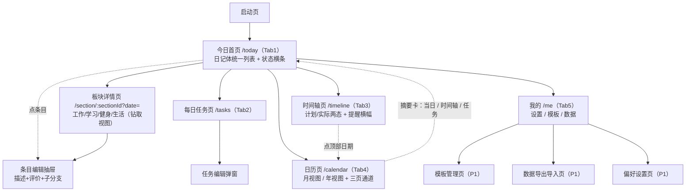
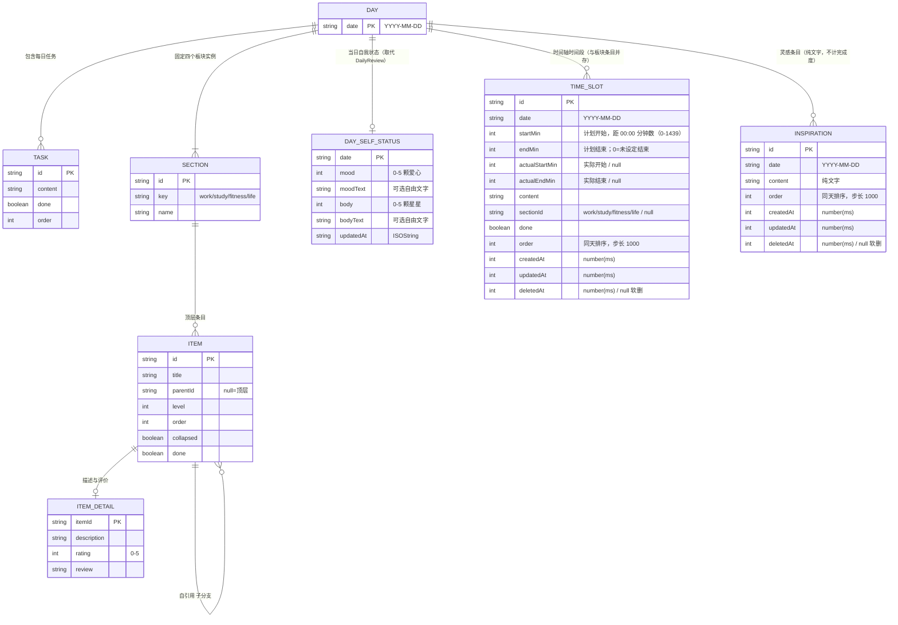

# 日程表软件 · 产品需求文档（PRD）

| 项目信息 | 内容 |
| --- | --- |
| 文档语言 | 中文 |
| 项目名称 | `daily_schedule_app` |
| 技术栈 | Vite + React + Tailwind CSS（移动端优先 H5） |
| 目标平台 | 移动端优先 H5（手机浏览器 / PWA），二期可转微信小程序 |
| 数据存储 | 一期本地优先（IndexedDB + localStorage），数据访问抽象为 Repository 仓储接口，二期无缝切换云端同步 |
| 分支形态 | 缩进树形列表（无限层级），非画布式节点图 |
| 文档版本 | v1.0 |
| 撰写人 | 许清楚（产品经理） |

### 原始需求复述

> 我想做一个日程表的软件，包含每日任务、当日完成情况（分为工作、学习、健身、生活四个板块），其中每个版块都可以增添或删除条目，也可以像思维导图一样引申分支，方便用户填写更细致的完成情况，也支持任务描述、个人评价等等小功能，你有什么建议吗？规划软件开发项目架构和任务分工

### 已确认的三项既定前提（不在本文档内推翻）

| # | 决策项 | 结论 |
| --- | --- | --- |
| 1 | 目标平台 | 移动端优先 H5 / 小程序。一期按移动端 H5 设计，适配 375–430px 视口，支持添加到主屏（PWA） |
| 2 | 数据存储 | 本地优先、预留云端。IndexedDB 存业务数据，localStorage 存轻量偏好；访问层抽象为 Repository 接口，业务代码不感知具体存储实现 |
| 3 | 分支交互 | 缩进树形列表。条目下可无限层级子项，回车新增、Tab/Shift+Tab 调整层级、支持折叠展开；画布图谱视图列为 P2 未来扩展 |

---

## 一、产品目标

**一句话定位**：一款「移动端随手记录 + 树状拆解」的每日日程与完成情况记录工具，让用户在 30 秒内记完今天在**工作 / 学习 / 健身 / 生活**四方面做了什么、做得怎么样。

### 三条核心价值主张

| # | 价值主张 | 说明 | 可衡量指标 |
| --- | --- | --- | --- |
| V1 | **随手可记，低摩擦** | 手机单手操作，从打开到完成一条记录 ≤ 3 次点击；弱网 / 离线可用 | 单条记录录入耗时 ≤ 10 秒；离线状态下 100% 功能可用 |
| V2 | **树状拆解，从粗到细** | 一个条目可无限层级引申子分支，既能只写一句"跑了步"，也能展开到"配速 / 距离 / 心率 / 感受" | 支持 ≥ 5 层级嵌套；单板块条目数无硬上限 |
| V3 | **结构化复盘，看得见成长** | 四大板块完成度可视化 + 条目级描述与自评，日积月累形成个人回顾数据 | 首页一眼看到当日四板块完成率；支持按周 / 月回顾 |

### 非目标（本期明确不做）

- 不做多人协作 / 团队共享日程（一期为纯个人工具）
- 不做复杂甘特图、日历月视图排期（一期以「今日」为核心）
- 不做画布式思维导图（P2 可选）
- 不做强提醒的待办管理（不追求 GTD 全功能）

---

## 二、目标用户与使用场景

### 2.1 典型用户画像

| 画像 | 标签 | 特征 | 核心诉求 | 痛点 |
| --- | --- | --- | --- | --- |
| **A. 自律型职场人**（主力） | 26–35 岁，互联网 / 金融 / 咨询 | 工作节奏快，同时有学习计划与健身习惯，手机上碎片化记录 | 一天结束时快速回填四板块，看到"今天没白过" | 现有待办 App 太重，笔记 App 又太散，无法一眼看完成度 |
| **B. 备考 / 在读学生** | 18–24 岁，考研 / 留学 / 大学生 | 以学习为主板块，需要把"复习数学"拆成章节、题型、错题 | 学习计划可逐层拆解到具体知识点，记录当日有效学习量与自评 | 计划写得很粗，执行完无法追溯到底做了哪些细项 |
| **C. 生活管理爱好者** | 25–40 岁，注重健康与生活品质 | 健身 + 生活板块权重高，习惯打卡并记录感受 | 健身动作 / 组数 / 感受的细颗粒记录 + 生活琐事清单 | 打卡 App 只能勾"完成"，无法记录过程与个人评价 |

### 2.2 具体使用场景（体现"移动端随手记录"）

| # | 场景 | 用户行为路径 | 关键要求 |
| --- | --- | --- | --- |
| S1 | **通勤路上规划今天** | 地铁上打开 App → 今日首页 → 每日任务页 → 3 分钟内列完今日 5 件事 → 关屏 | 冷启动 ≤ 2s；大按钮单手可达；无需登录 |
| S2 | **午休随手补记** | 午饭后想起上午做的事 → 打开 App → 点"工作"板块 → 新增条目 → 回车连续添加 3 条子项 | 新增条目零弹窗打断；回车连续录入 |
| S3 | **健身房边练边记** | 深蹲组间休息 → 打开 App → 健身板块 → 在"腿部训练"下缩进添加"深蹲 60kg×8×4" → 勾选完成 | 单手操作；输入框不被键盘遮挡；快速勾选 |
| S4 | **睡前 3 分钟复盘** | 躺床上 → 首页看四板块完成度环形图 → 逐项勾选完成 → 给今天打 4 星 + 写一句评价 → 睡 | 一键勾选；评价入口显眼；支持深色模式 |
| S5 | **周日回顾这一周** | 周末打开统计页 → 看本周四板块趋势 → 发现"学习"连续 3 天为 0 → 下周调整计划 | 周 / 月维度聚合；板块对比清晰 |

---

## 三、用户故事

> 格式：As a [角色]，I want [能力]，so that [价值]。按能力域分组，共 16 条。

### A. 每日任务（规划今日）

| ID | 用户故事 |
| --- | --- |
| US-01 | As a 职场人，I want 在每日任务页列出今天计划要做的若干件事，so that 早上开工前有明确的行动清单 |
| US-02 | As a 职场人，I want 给每个任务勾选"已完成 / 未完成"并可修改任务文本，so that 随时反映计划的实际执行情况 |
| US-03 | As a 学生，I want 对任务列表进行拖拽排序并按优先级标记，so that 先做最重要的事 |
| US-04 | As a 职场人，I want 一键把昨天未完成的计划继承到今天，so that 不用重复录入未完成事项 |

### B. 当日完成情况 · 四大板块

| ID | 用户故事 |
| --- | --- |
| US-05 | As a 用户，I want 在今日首页看到工作 / 学习 / 健身 / 生活四个板块的入口与各自完成度，so that 一眼掌握今天各方面进展 |
| US-06 | As a 用户，I want 进入任一板块查看并编辑当天该板块的全部条目，so that 分门别类地记录完成情况 |
| US-07 | As a 用户，I want 首页顶部切换日期并查看历史某天的记录，so that 回看过去某天做了什么 |
| US-08 | As a 学生，I want 自定义板块名称与顺序（如把"学习"改名为"考研"），so that 板块更贴合我的生活结构 |

### C. 板块条目增删

| ID | 用户故事 |
| --- | --- |
| US-09 | As a 用户，I want 在任意板块下新增条目并支持连续录入，so that 多条记录可以一口气写完 |
| US-10 | As a 用户，I want 删除误建或过时的条目，并在误删后撤销，so that 维护列表时没有心理负担 |

### D. 思维导图式无限层级分支

| ID | 用户故事 |
| --- | --- |
| US-11 | As a 用户，I want 在任一条目下通过缩进创建子条目、且层级不受限制，so that 像思维导图一样把"做了什么"拆到任意细度 |
| US-12 | As a 用户，I want 用 Tab / Shift+Tab 或拖拽调整条目层级，so that 快速修正记录结构 |
| US-13 | As a 用户，I want 折叠/展开某个有子项的条目，so that 在条目很多时保持界面清爽 |

### E. 任务描述与个人评价

| ID | 用户故事 |
| --- | --- |
| US-14 | As a 用户，I want 给任一条目添加较长的任务描述（长文本 / 轻量富文本），so that 记录过程细节、遇到的问题与产出 |
| US-15 | As a 用户，I want 对某条任务进行个人评价（1–5 星打分 + 简短文字），so that 记录我对这件事完成质量的主观判断 |
| US-16 | As a 用户，I want 在当天结束时对整天做一次总体评价（星级 + 一段文字），so that 形成每日复盘结论并可回看 |

### F. 自我状态 / 时间轴 / 日历年视图（用户新批准 P0）

> 以下 3 条为用户新批准的 P0 功能，对应需求池 §5 的 R-030 / R-031 / R-032。注意：R-030 的批准**同时取代**原 R-004（完成度百分比进度环）与 R-014（每日总评 DailyReview 实体删除，改由 `DailySelfStatus` 承载）。

| ID | 用户故事 |
| --- | --- |
| US-17 | As a 用户，I want 在当日页用「心情♥（0–5 颗）」+「身体★（0–5 颗）」两条自我状态记录今天的状态，并各写一句自由文字，so that 用更低门槛、更贴合感受的方式记录当天的整体状态，而非抽象的完成度百分比 |
| US-18 | As a 用户，I want 有一个独立的时间轴页按时间节点记录「13:00–15:00 跳舞」这类时段活动，so that 我能以「时间线」视角回看一天是怎么度过的（与当日页的「按分类」记录并存，互不替代） |
| US-19 | As a 用户，I want 日历页支持月视图 / 年视图切换，年视图是一整年 12 个月的缩略网格、有数据的月份显示提示，so that 我能一屏纵览全年记录密度并快速跳进某月 |

### G. 主页日记体 / 灵感 / 状态紧凑 / 时间轴双用 / 应用内提醒（用户新批准 P0 续）

> 对应需求池 §5 的 R-033 / R-034 / R-035 / R-036。

| ID | 用户故事 |
| --- | --- |
| US-20 | As a 用户，I want 主页按固定顺序（工作/学习/健身/生活/灵感）以「日记体统一列表」呈现当天所有顶层条目、且跨组连续编号 1~N，so that 像翻日记一样一口气纵览今天做了什么，而非被四张卡片打断 |
| US-21 | As a 用户，I want 有一个「灵感」条目类型（纯文字、无勾选/评分/子项，组底快捷新增），so that 随手记下一闪而过的想法，又不打扰四板块的完成度统计 |
| US-22 | As a 用户，I want 自我状态（mood♥/body★）压缩为列表上方一条小横条，点开才展开编辑，so that 主页信息密度更高、状态记录不再占一整屏 |
| US-23 | As a 用户，I want 同一条时间轴条目既能提前写未来日期的「计划」，也能事后补「实际」完成时间，so that 计划与记录在一个地方闭环、无需重复录入 |
| US-24 | As a 用户，I want 打开 App 时看到当天「已到计划时段且未完成」的顶部横幅提醒，so that 不靠系统通知也能在打开瞬间想起该做的事 |

---

## 四、产品建议（用户"有什么建议吗"的回应）

> 以下 5 条是按「性价比 = 用户价值 ÷ 实现成本」排序、最能提升产品价值的建议，均已落入需求池。

| # | 建议 | 产品理由 | 推荐落地时机 |
| --- | --- | --- | --- |
| **1** | **昨日计划一键继承** | 每日任务最大的流失点是"重复录入"。把昨天未完成 + 每日固定项一键搬到今天，直接决定次日留存 | **P0**（MVP 必做，成本极低、收益极高） |
| **2** | **四大板块完成度环形图** | 把"我记了什么"升级为"我今天完成得怎么样"，是首页从记录工具变成复盘工具的关键，也是本产品区别于普通笔记的核心记忆点 | **P0** |
| **3** | **模板复用（日常 / 工作日 / 休息日）** | 用户每天做的事高度重复（如"晨跑、背单词、周会"）。一套模板一键铺开当天计划，把录入成本从 3 分钟压到 10 秒 | **P1** |
| **4** | **周 / 月回顾统计页** | 记录的价值在于回看。7 日热力条 + 四板块趋势，让"记录"产生长期动力，是留存曲线的第二引擎 | **P1** |
| **5** | **PWA + 本地数据导出备份** | 纯本地存储最大风险是"清缓存 = 数据全没"。提供 JSON 导出 / 导入 + 添加到主屏，用极低成本消除信任顾虑 | **P1**（导出 P0 精简版即可） |

---

## 五、需求池

> 优先级定义：**P0 = MVP 必须有（跑通核心闭环）**、**P1 = 应该有（提升体验与留存）**、**P2 = 可以有（未来扩展）**。

### P0 · MVP 核心闭环（严格收敛）

| 需求ID | 需求描述 | 优先级 | 验收标准 |
| --- | --- | --- | --- |
| R-001 | 应用骨架：移动端优先 H5，底部 5 个 Tab（今日 / 任务 / 时间轴 / 日历 / 我的） | P0 | 375–430px 视口无横向滚动；底部 5 个 Tab 单手可达；冷启动 ≤ 2s |
| R-002 | 今日首页：日期切换（前一天 / 后一天 / 回到今天 / 日期选择器） | P0 | 切换后 4 个板块数据与所选日期严格对应；"回到今天"一键归位 |
| R-003 | 今日首页：四大板块卡片（工作/学习/健身/生活），显示条目数与完成度（**已被 R-033 日记体统一列表取代**——四板块保留为分组与详情页） | P0 | 卡片展示「已完成 / 总数」与百分比；数据变更后实时刷新（无需手动刷新） |
| R-004 | 今日首页：四板块完成度环形图（总览）（**已被 R-030 自我状态取代**） | P0 | 环形图按四板块分段展示当日完成率；无数据时显示空状态占位 |
| R-005 | 板块详情页：查看当天该板块的条目列表 | P0 | 进入即展示该日期该板块的全部顶层条目 |
| R-006 | 条目新增：板块内新增顶层条目，回车连续录入 | P0 | 回车后立即创建新条目并聚焦；空条目失焦自动丢弃（不产生空数据） |
| R-007 | 条目删除：删除条目并提供撤销（Undo） | P0 | 删除后底部出现 5 秒撤销条；撤销可完整恢复条目及其子分支 |
| R-008 | 树形分支：条目下无限层级缩进子项，回车新增同级、Tab 降级、Shift+Tab 升级 | P0 | 支持 ≥ 5 层级；Tab 时自动挂到上一个同级条目之下；首层条目 Shift+Tab 不越界 |
| R-009 | 树形折叠：有子项的条目可折叠 / 展开，状态本地记忆 | P0 | 折叠时显示子项数量徽标；刷新后保持上次的折叠状态 |
| R-010 | 完成态勾选：条目可勾选完成 / 取消，完成态向上影响板块完成度 | P0 | 勾选后条目置灰加删除线；父条目完成态与子项完成数联动展示（父显示 `2/5`） |
| R-011 | 条目详情抽屉：任务描述（长文本）+ 个人评价（1–5 星 + 短文字） | P0 | 底部抽屉弹出；描述与评价实时保存；再次打开完整回填 |
| R-012 | 每日任务页：今日任务清单（增 / 删 / 改 / 勾选 / 排序） | P0 | 支持新增、长按或侧滑删除、双击编辑、勾选完成、拖拽排序 |
| R-013 | 昨日计划一键继承：将昨日未完成任务继承到今日 | P0 | 点击"继承昨日未完成"，未完成任务追加到今日任务列表末尾；重复点击不产生重复数据（有幂等校验） |
| R-014 | 每日总评：当天整体评价（星级 + 一段文字）（**已被 R-030 自我状态取代**） | P0 | 首页底部固定入口；保存后首页显示当日星级；可反复修改 |
| R-015 | 数据持久化：IndexedDB 存储业务数据，通过 Repository 接口访问 | P0 | 刷新 / 关闭浏览器后数据 100% 保留；业务层代码不出现 `indexedDB` / `localStorage` 直接调用（Code Review 校验） |
| R-016 | 数据持久化时机：编辑防抖 500ms 落盘 + 页面隐藏 / 关闭前强制 flush | P0 | 连续输入不卡顿；`visibilitychange` / `pagehide` 时强制写入，数据零丢失 |

### P0 · 用户新批准功能（R-030 / R-031 / R-032）

> 用户于本期新批准的三项 P0 功能，落在 MVP 验收闭环内（与 R-001～R-016 同优先级）。其中 **R-030 同时取代 R-004（完成度百分比进度环）与 R-014（每日总评 DailyReview）**：`DailyReview` 实体删除，改由 `DailySelfStatus` 承载当日整体状态；原环形图不再展示。R-031 时间轴页为底部 Tab「时间轴」（底栏顺序：今日 / 任务 / 时间轴 / 日历 / 我的，见 R-001）。

| 需求ID | 需求描述 | 优先级 | 验收标准 |
| --- | --- | --- | --- |
| R-030 | **自我状态 SelfStatus**：当日页不再显示「完成度百分比进度环」，改为 `mood`（5 颗爱心 ♥，0–5 分）与 `body`（5 颗星星 ★，0–5 分）两条自我状态记录；每条下方各有一个可选的自由文字填写项（如 mood 下写「今天挨训了，不开心」，body 下写「今天健身状态满分」）。`DailyReview` 实体删除，新增 `DailySelfStatus { date, mood, moodText, body, bodyText, updatedAt }` | P0 | ① 原环形图区域改为 mood+body 双评分区，♥ / ★ 各可点按 0–5 颗、默认 0（未评）；② mood、body 各自下方有可选自由文本输入，文本可空；③ 保存经 Repository 落 `DailySelfStatus` 表（PK = date），可反复修改并刷新 `updatedAt`；④ 切换历史日期严格回填该日数据，无数据日显示未评占位（不显示默认评分）；⑤ 全代码库删除 `DailyReview` 实体及引用（见 T22），与 R-014 当日总评互斥——本需求接管原 R-014 验收；⑥ 完成度环形图（R-004）不再展示 |
| R-031 | **时间轴页 Timeline**：新增独立页面 `/timeline`，作为底部 Tab「时间轴」（底栏顺序：今日 / 任务 / 时间轴 / 日历 / 我的）。按时间节点记录（如「13:00–15:00 跳舞」「16:00–18:00 学习」）。每条含计划开始/结束时间（`startMin` / `endMin`，距当天 00:00 的分钟数；`endMin = 0` 视为未设定结束）、内容、可选板块归属（`sectionId`，可空）、完成勾选。与当日页「按分类」记录【并存】（同一天两类数据均可存在，非互斥）。新增 `TimeSlot` 实体 | P0 | ① 底栏 Tab「时间轴」可进入 `/timeline`；② 可新增时间段：填写计划开始/结束、内容、可选板块归属（4 选 1 或空）、完成勾选，离散操作立即落盘；③ 时间轴按计划开始时间（`startMin`）升序展示当天全部时间段；④ 板块归属与四大板块枚举一致（`SectionKey`），可空；⑤ 时间段与当日页四大板块条目【并存】：同一天两类数据各自独立展示、互不替代；⑥ 删除时间段可撤销（沿用现有撤销机制，软删只改 `deletedAt`） |
| R-032 | **日历年视图**：日历页支持 月视图 / 年视图 切换。年视图为全年 12 个月缩略网格（参考 iOS / macOS 日历 App 的年视图），点某月进入该月月视图；每月格显示有数据提示（四色小点 / 「N 天有记录」） | P0 | ① 日历页提供 月 / 年 切换入口，年视图一屏呈现 12 个月缩略网格；② 年视图中某月若含数据（当日页 / 时间轴 / 任务任一类有记录），该月格显示提示：四色小点（按数据类别）或「N 天有记录」文案；③ 点某月格进入该月月视图，月视图保留既有四色打点能力；④ 年视图「有记录天数」聚合口径：以「该日任意一类有记录」计入，提示与实际数据一致 |

### P0 · 用户新批准功能（R-033 / R-034 / R-035 / R-036 / R-037 / R-038 / R-039）

> 用户于本增量新批准的功能，落在 MVP 验收闭环内。**取代关系再澄清**：R-033 日记体统一列表**取代**原 R-003「四板块卡片」——四板块不再以独立卡片出现，但**保留为分组标题与板块详情页**（R-005 钻取视图不变）。原 R-004「完成度百分比进度环」与 R-014「每日总评」仍由 R-030（SelfStatus）取代（维持上轮结论）；R-035 仅改变 SelfStatus 的**呈现密度**，数据模型不变。
>
> **R-033 规则修正（来自本轮用户反馈）**：原「空板块组整组跳过」规则**作废**。改为**四板块组恒显 + 灵感组恒显**——空组也展示组头；编号仍只对四板块顶层条目跨组连续，空组不影响编号（见 R-033 ⑦）。**再修正（最新一轮）**：原空组与有数据组内的「暂无条目 · 点这里添加」跳转行**取消**——四个板块组每组改为**内联快速添加**（组内常驻输入框 + 右侧「添加」按钮，形态与灵感组快捷新增一致），在主页直接新增该组顶层条目、**不再跳转板块详情页**（见 R-033 ⑧ 与 R-039）。
>
> **R-037 / R-038（上轮新增）**：时间轴顶部日期可点击跳日历、且日历从时间轴进入时落在同一天（R-037）；日历某天摘要卡提供「当日 / 时间轴 / 任务」三入口（R-038），取代原单一「去补记 → 当日」。
>
> **R-039（本轮新增）**：四板块组内联快速添加，取代原「暂无条目 · 点这里添加」跳转行；主页即可新增顶层条目，无需进入板块详情页。

| 需求ID | 需求描述 | 优先级 | 验收标准 |
| --- | --- | --- | --- |
| R-033 | **主页改版「日记体统一列表」**：取代四张板块卡片。按固定顺序 工作 / 学习 / 健身 / 生活 / 灵感 分五组，**五组恒显（空组不隐藏）**；组标题为轻量行内小标题（如「工作:」）；顶层条目跨组连续编号 1~N；子项缩进跟随父条目；条目保留勾选完成；点条目开条目编辑抽屉（交互不变）；点组标题进该板块详情页（板块页保留为钻取视图） | P0 | ① 主页不再显示四张板块卡片，改为单一滚动日记列表；② 五组按固定顺序展示，组标题行内显示（如「工作:」）；③ 顶层条目跨组连续编号 1~N（工作 1-2、学习 3-4 依次），子项缩进跟随、不参与顶层编号；④ 条目勾选完成交互与现状一致，点条目打开条目编辑抽屉；⑤ 点组标题跳转该板块详情页（详情页保留为钻取视图、树形编辑不变）；⑥ 条目数据变更后列表实时刷新；⑦ **【本轮修正】五组恒显**：四板块组当天为空时仍显示组头，灵感组恒显；空组既不参与也不打断顶层连续编号。**本修正作废原「空板块组整组隐藏」规则**；⑧ **内联快速添加入口**：四个板块组组内常驻一行内联录入区（输入框 + 右侧「添加」按钮，形态与灵感组快捷新增一致），在主页直接新增该组顶层条目、**不再跳转板块详情页**；原「暂无条目 · 点这里添加」跳转行**取消**（详见 R-039） |
| R-034 | **新增「灵感」条目类型**（第 5 组）：纯文字条目，无勾选、无评分、无子项层级；计入当天「有无记录」（`DaySummary.hasData`），但**不参与**四板块完成度统计、不影响日历四色点；主页灵感组底部可快捷新增 | P0 | ① 主页第 5 组「灵感:」组底有「＋」快捷新增纯文字条目；② 灵感条目无勾选框、无评分、无子项（不可缩进）；③ 灵感计入 `hasData`（有记录提示），但不进入四板块完成度分母、不改变日历四色点；④ 灵感条目删除沿用现有撤销机制 |
| R-035 | **自我状态（mood/body）紧凑化**：从大卡片压缩为列表上方一条小横条（♥×5 ★×5 + 文字摘要一行），点开展开编辑；仍为 `DailySelfStatus`，数据模型不变 | P0 | ① 主页列表顶部（日期栏下方）显示一条紧凑横条：♥×5 ★×5 + moodText/bodyText 摘要一行；② 点横条展开编辑浮层，可改评分与文字；③ 数据仍落 `DailySelfStatus`（date, mood, moodText, body, bodyText, updatedAt），字段与仓储不变；④ 未评分日显示「未记录」占位 |
| R-036 | **时间轴「规划 + 记录」一档两用 + 应用内提醒**（不做系统通知）：同一条 `TimeSlot` 既可提前写未来日期的计划，也可事后标记实际完成情况（含可选的实际开始/结束时间修正）；`TimeSlot` 在原计划字段基础上新增实际开始/结束字段；打开 App 时，若当天存在「已到计划开始时间且未标记完成」的时间块，顶部横幅提醒、可关闭 | P0 | ① 计划字段为 `startMin` / `endMin`（距当天 00:00 的分钟数，**字段名未变**）；新增实际字段 `actualStartMin` / `actualEndMin`（可空，`null` = 尚未记录；老记录读取时归一化为 `null`，**无字段重命名、无迁移**），配合 `done` 表示实际完成；② 可提前给未来日期写计划，也可当天事后补实际时间；③ 打开 App（today）扫描当天时间块，**到期判定 = `deletedAt === null && !done && startMin > 0 && nowMin >= startMin`**（`endMin` 不参与判定——时段过了还没记录，恰恰更该提醒）；④ 提醒仅应用内、不使用系统通知/推送；⑤ 端口方法 `listDueSlots(slots, nowMin)` 为纯函数（`services/reminderService.ts`）、有单测 |
| R-037 | **时间轴顶部日期 → 跳日历选日子**：时间轴页点上方日期（如「10 月 12 日」）跳转日历页；日历页从时间轴进入时应落在同一天（选中优先级：当前全局日期若在该月 → 否则今天若在该月 → 否则该月 1 号） | P0 | ① 时间轴页顶部日期可点击，点击跳转日历页并选中该天；② 日历从时间轴进入时的选中优先级：a) 当前全局日期若落在目标月 → 选它；b) 否则今天若落在该月 → 选今天；c) 否则选该月 1 号；③ 该选中逻辑收敛为纯函数 `resolveCalendarSelection(monthKey, preferredDate, today)`，落点 `services/calendarService.ts`，单测覆盖三种分支 |
| R-038 | **日历 → 三页通道**：日历选中某天的摘要卡提供三个跳转入口「当日 / 时间轴 / 任务」，点击先把全局日期切到该天再跳对应页面（**取代**原来的单一「去补记 → 当日」） | P0 | ① 摘要卡提供「当日」「时间轴」「任务」三个跳转入口；② 点击任一入口先把全局日期切到该天，再跳对应页面；③ 入口文案/图标清晰区分三页；④ 原单一「去补记 ›」入口被本需求取代 |
| R-039 | **主页四板块组内联快速添加**（取代原「暂无条目 · 点这里添加」跳转行）：工作 / 学习 / 健身 / 生活 四个板块组，每组内常驻一行内联录入区（左输入框 + 右侧「添加」按钮），形态与第 5 组灵感快捷新增一致（**形态一致、落库路径不同**，见 §7.3「主页快捷新增」）；在主页直接输入并提交即可新增一条**该组顶层条目**，**不再跳转板块详情页** | P0 | ① 四个板块组每组均显示一行常驻内联录入区（输入框 + 「添加」按钮）；② 支持点「添加」按钮或按 `Enter` 提交；③ 输入为空时「添加」按钮**禁用**（不可提交空条目）；④ 提交成功：清空输入框、**保持输入框聚焦**（便于连续录入）、新条目追加到该组顶层列表**末尾**；⑤ 新增条目为**顶层条目**（`parentId = null`），参与四板块顶层跨组连续编号（编号仍由 `buildDiaryList` 派生，不落库）；**一次性带标题建成**（`useItemStore.addSibling` 透传 `title`，**非**「先建空条目再改名」）；⑥ **移除**原「暂无条目 · 点这里添加」跳转行（空组态与有数据态统一为内联录入区）；⑦ 点组标题仍进该板块详情页（钻取视图不变，R-005）；⑧ 内联录入区的聚焦态/按钮采用该板块主题色：工作 `#3B82F6`（底 `#EFF6FF`）、学习 `#8B5CF6`（底 `#F5F3FF`）、健身 `#F97316`（底 `#FFF7ED`）、生活 `#10B981`（底 `#ECFDF5`） |

### P0 · 用户新批准功能（R-040）

> 用户本轮批准并**已实现**的 P0 功能：主页与日历显示农历日期、二十四节气与节日。**全部数据内置、零联网、零新增 npm 依赖、零新增数据表、零 Dexie schema 变更**。展示位置**仅两处**：今日页日期栏副标题与日历页选中日摘要卡；月历格子与年视图**不显示**节日。

| 需求ID | 需求描述 | 优先级 | 验收标准 |
| --- | --- | --- | --- |
| R-040 | **农历 / 二十四节气 / 节日显示**：内置压缩农历表（覆盖 1900–2100）+ 实时计算节气（求解太阳视黄经 + 北京时间定日，非查表）+ 四类内置节日（农历传统 / 公历 / 西方含规则型 / 节气），**零联网、零新增依赖**。展示位置仅两处：① 今日页日期栏副标题（`DateNavigator` 新增可选 `subtitleText`）；② 日历页选中日摘要卡标题行下方。两处均为「农历月日 · 节日」一行（`text-caption` 13px、语义色 `text-ink-faint`） | P0 | ① **两处展示点**：今日页日期大字下方显示该行（经 `DateNavigator.subtitleText`）；日历页选中日摘要卡标题行下方显示同一行（`DaySummaryCard`，`data-testid="day-summary-festival"`）；`DateNavigator` 不传副标题（或传空串）时**不产生多余 DOM，渲染结果与加此功能前逐字节一致**；② **无节日时只显示农历日期**（如「九月初三」）；农历与节日都有时形如「九月初三 · 中秋节」；③ **超范围年份降级不崩溃**：公历年份 < 1900 或 > 2100 时 `solarToLunar` 返回 `null`，该行降级为空串；`getFestivals` 越界返回 `[]`、`solarTermOf` 越界返回 `null`；绝不抛异常、绝不给出错误日期；④ **除夕按当年腊月实际天数计算**：大月 30 / 小月 29 由农历表决定（`lunarMonthDays`），**不写死 30**；⑤ **清明不重复**：清明既是节气又是传统节日，只由节气通道产出一次，同一天不出现两遍；⑥ **同日最多显示 2 个节日名**，按优先级 农历传统节日 ＞ 公历节日 ＞ 西方节日 ＞ 节气 排序，用 `' · '` 连接；⑦ **不影响月历与年视图**：月历格子（`DayCell` / `MonthGrid`）与年视图（`YearGrid`）**不显示**节日，格子高度与布局保持不变；时间轴页不显示（`DateNavigator` 虽与今日页共用，但只有今日页传副标题数据）；⑧ **零联网、零新增 npm 依赖**、零新增数据表、零 Dexie schema 变更；⑨ **调休（「休 / 班」）标记不在本轮范围**：调休安排依赖外部数据（每年由国务院公布），本轮明确不做——这正是「零联网」得以成立的原因。其余（农历、节气、传统节日、公历节日、规则型西方节日）全部为本地算法 / 查表 |

### P0 · 分期（第二期，本轮未实现）：R-041

> 用户已同意分两期交付：**第一期**（R-040，已实现）+ **第二期**（R-041，**本轮未实现**）。以下需求已批准但**尚未交付**，排期在第二期。

| 需求ID | 需求描述 | 优先级 | 验收标准 |
| --- | --- | --- | --- |
| R-041 | **用户自定义纪念日**（**第二期 · 本轮未实现**）：新增「纪念日」实体（如家人生日、结婚纪念日），并同时提供**两个管理入口**——① 「我的」页纪念日管理列表（增 / 删 / 改）；② 日历选中日摘要卡的快捷添加入口。数据本地存储，沿用现有 Repository / 软删模式 | P0（第二期 · 未实现） | ① 「我的」页可新增 / 删除 / 编辑纪念日，列表持久化；② 日历摘要卡提供快捷添加入口，可直接把当前选中日存为纪念日；③ 自定义纪念日与内置节日同处一行展示时的命名与排序口径待第二期细化；④ **本轮未实现**——以上为第二期验收草案，当前代码库**尚无**对应实体与界面 |

### P0 · 用户新批准功能（R-042）

> 用户提出：「在时间轴里填写的、已经选了板块的条目（如 9:00–10:00 开组会，板块选「工作」），也应该出现在首页今日的对应板块里」。本轮**已实现**。

| 需求ID | 需求描述 | 优先级 | 验收标准 |
| --- | --- | --- | --- |
| R-042 | **时间轴归类时间段同步到今日页板块**：时间轴里 `sectionId !== null` 的时间段，自动出现在今日页对应板块的列表中，与板块条目同构（跨组连续编号 + 可勾选完成）；采用**只读投影**，不复制成 Item，勾选直接写回 `TimeSlot.done` | P0 | ① **投影范围**：只有 `sectionId !== null` 且 `deletedAt === null` 的时间段投影；未归类（`sectionId === null`）的**不出现**在任何板块（时间轴允许「只记一笔时间」而不纳入板块统计）；② **位置**：追加在该板块**现有条目之后**（条目顺序由用户 `order` 决定，不被外部来源顶开），同一板块内多个时间段按 `startMin` 升序；③ **编号**：时间段与顶层条目一起参与跨组连续编号 1~N（它计入完成率，就等价于该板块的一件顶层事项）；④ **完成率**：组头「完成/总数」= 本板块顶层条目 + 归类时间段，口径与日历摘要卡 `DaySummary.sections` **对齐**（后者早先已把归类时间段并进板块完成度，今日页组头原先只数条目，导致同一天两处显示不同的「1/3」与「1/2」）；⑤ **交互**：行内勾选圆框 → 写回时间轴该条 `done`（今日页与时间轴天然一致，无双向同步）；点行标题 → 跳时间轴页编辑（板块页只有条目树，编辑不到时间段）；行内显示开始时间（如 `09:00`）作为「这条来自时间轴」的标记；⑥ **只读投影不落第二条数据**：`DiaryEntry.timeSlot` 是视图引用，`entries[i].item` 恒为 `undefined` —— 不产生需要双向同步的两份记录，撤销语义保持单一；⑦ **零 Dexie schema 变更、零新增依赖**；⑧ **本轮不含「每日任务」归类**：`Task` 实体无 `sectionId` 字段（任务页是独立于四大板块的待办清单），用户已确认本轮不动它 —— 若将来要支持需升到 v4 schema 并做一次性迁移 |

### P0 · 用户新批准功能（R-043）

> 用户提出：「任务页也要有分组，加入四大分组和其他一共五个；加一个『同步』按钮，点了弹框询问是否同步到今日页，确认后把四大分组的内容加到今日页条目后面，『其他』不用管」。本轮**已实现**。
> **改版（用户纠正）**：分组**不是**分段容器 —— 任务页恢复单一列表平铺，分组退化为每条任务
> 行首的一个标记（填写时可选可改）。曾按五分组分段渲染，但那样会连带产生「空组要不要显示」
> 「跨组换位怎么算」两个伪问题，而用户真正要的只是「写这条任务时顺手标一下它属于哪块」。

| 需求ID | 需求描述 | 优先级 | 验收标准 |
| --- | --- | --- | --- |
| R-043 | **任务可选分组 + 同步到今日页**：任务页**保持单一列表平铺**（分组只是每条任务的一个属性，不是分段容器）；填写任务时可通过行首标记选择分组（四大板块 / 其他）；页面提供「同步到今日」按钮，点击后弹确认框，确认即把**四大板块**的任务复制成今日页对应板块的条目（追加在该板块现有条目之后） | P0 | ① **五个分组**：四大板块 + 「其他」（= 没分组，行首画空心圈以区别于四大板块的实心色点），顺序固定、其他垫底；**列表不分段**，所有任务按 `order` 平铺在同一张纸卡里，全部为空时显示空状态；② **改分组**：每条任务行首有一个分组标记（10px），点击弹出分组选择抽屉（五个选项）；**正在填写（聚焦）该行时标记旁展开组名** —— 敲字时要能看见自己选的是什么，不能靠记颜色；③ **同步范围**：只有四大分组的任务参与同步，「其他」**不参与**（今日页没有它的落点）；软删任务、内容为空的任务不同步；④ **幂等**：今日页已存在 `sourceTaskId` 等于该任务 id 的存活条目时跳过 —— 重复点按钮不会堆出第二份；无可同步项时**不弹框**，只提示「四大分组的任务都已经同步到今日了」；⑤ **确认框内容**：写明「将 N 项任务复制到今日页对应板块（追加在现有条目之后）；『其他』不参与；已同步过的不重复添加」；⑥ **落点**：追加在该板块顶层末尾（复用 `createSiblingAfter(items, null, …)`），`done` 跟随任务；⑦ **一次性复制，非持续关联**：同步后两边各自独立（改任务不改条目）；这是「按钮 + 确认」这个交互形态的应有语义；⑧ **换位与分组无关**：「上移 / 下移」按整条列表的相邻关系生效，边界是整条列表的首尾 —— 列表是平铺的，若限制成组内换位，用户按「下移」会毫无反应，而下面明明还有一行（看起来像按钮坏了）；⑨ **老数据兼容**：`Task.sectionId` 缺失时仓储统一归一化为 `'other'`（不作任何板块，**不**默认「工作」—— 否则一次同步会凭空造出一批用户没打算同步的条目）；`Item.sourceTaskId` 缺失归一化为 `null`；⑩ **零 Dexie schema 变更**：新增字段都不是索引，`tasks` 表索引不变，故 `DB_VERSION` 仍为 3，无需迁移 |

### P1 · 体验与留存增强

| 需求ID | 需求描述 | 优先级 | 验收标准 |
| --- | --- | --- | --- |
| R-017 | 模板复用：创建 / 应用日常模板，一键铺开当天计划 | P1 | 支持 ≥ 3 套模板；应用模板后自动合并去重，不覆盖已有条目 |
| R-018 | 拖拽排序：条目与任务支持长按拖拽排序与跨父级移动 | P1 | 拖拽时显示插入位置指示线；松手后层级与顺序正确落库 |
| R-019 | 统计 / 回顾页：7 日 / 30 日四板块完成趋势 + 热力日历 | P1 | 图表适配移动端；支持点击某日跳转到该日详情 |
| R-020 | 数据导出 / 导入：JSON 格式全量备份与恢复 | P1 | 导出文件包含全部日期、板块、条目数据；导入可完整还原 |
| R-021 | PWA：可添加到主屏、离线可用 | P1 | 添加到主屏后全屏启动；断网状态下所有功能正常 |
| R-022 | 板块自定义：重命名板块、调整顺序、设置主题色 | P1 | 修改后全局生效；配置持久化到 localStorage |
| R-023 | 深色模式与字号设置 | P1 | 跟随系统 / 手动切换；偏好持久化 |
| R-024 | 空状态引导：首次使用提示 + 示例数据 | P1 | 首次打开展示引导卡片；提供"载入示例数据"一键体验 |

### P2 · 未来扩展

| 需求ID | 需求描述 | 优先级 | 验收标准 |
| --- | --- | --- | --- |
| R-025 | 云端同步：Repository 切换为云端实现，多设备同步 | P2 | 业务代码零改动；离线编辑后联网自动合并（冲突策略待定） |
| R-026 | 可选图谱视图：树形数据切换为思维导图画布展示 | P2 | 与树形数据双向同步；支持节点缩放与拖动 |
| R-027 | 提醒通知：任务定时提醒（H5 用 Notification，小程序用订阅消息） | P2 | 到点推送；用户可逐条开关 |
| R-028 | 标签系统：跨板块给条目打标签并聚合查看 | P2 | 支持自定义标签；按标签筛选统计 |
| R-029 | 周报自动生成：汇总本周四板块数据与评价，导出图文 | P2 | 一键生成可分享的周报卡片 |

---

## 六、核心页面与 UI 设计稿

### 6.1 页面导航结构（Mermaid）



### 6.2 今日首页（P0，R-033 改版）

```
┌─────────────────────────────────┐
│  10月15日 周三            ⊙ 今天 │  ← 日期栏：‹ 日期 › / 日历图标
│  九月初三 · 中秋节              │  ← 副标题：农历 + 节日（R-040，可选，text-caption 13px）
├─────────────────────────────────┤
│  ♥♥♥♥♥  ★★★★★  状态摘要一行    │  ← 自我状态紧凑横条（R-035，点开展开编辑）
├─────────────────────────────────┤
│  工作:                          │  ← 组标题（轻量行内小标题，点击进详情）
│   1 ☐ 完成需求评审            › │  ← 顶层条目跨组连续编号 1~N
│   2 ☑ 提交周报                › │
│   [ 输入条目… ][ 添加 ]         │  ← 组内联快速添加（R-039，工作主题色）
│  学习:                          │
│   3 ☐ 背单词 100 个           › │
│      ├ ☐ 复习昨天错词          │  ← 子项缩进跟随父条目（不参与编号）
│   4 ☐ 论文阅读                › │
│   [ 输入条目… ][ 添加 ]         │  ← 组内联快速添加（R-039，学习主题色）
│  健身:                          │
│   [ 输入条目… ][ 添加 ]         │  ← 空组恒显 + 内联快速添加（R-033 ⑦ / R-039）
│  生活:                          │
│   5 ☐ 买菜                    › │
│   [ 输入条目… ][ 添加 ]         │  ← 组内联快速添加（R-039，生活主题色）
│  灵感:                          │  ← 第 5 组（纯文字，无勾选/评分/子项）
│     💡 想到一个产品点子         › │
│     ＋ 记一条灵感              │  ← 组底快捷新增（保留形态）
├─────────────────────────────────┤
│  今日 │ 任务 │ 时间轴 │ 日历 │ 我的│  ← 底部 Tab Bar（5 项）
└─────────────────────────────────┘
```

**要点**：五组固定顺序且**恒显**（空组仅显示组头）；四个板块组每组内常驻一行**内联快速添加**（输入框 + 「添加」按钮，R-039：点按钮或 `Enter` 提交、输入为空时按钮禁用、提交后清空并保持聚焦，在主页直接新增该组顶层条目、**不再跳转板块详情页**），原「暂无条目 · 点这里添加」跳转行已取消；顶层条目跨组连续编号 1~N（工作 1-2、学习 3-4…），子项缩进跟随父条目、不参与编号；点组标题进板块详情（钻取视图）；点条目开条目编辑抽屉；顶部自我状态紧凑横条点开展开编辑。原「四板块卡片 + 环形图 + 今日总评」区域被本列表与自我状态横条取代。

### 6.3 每日任务页（P0）

```
┌─────────────────────────────────┐
│  ‹  今日任务            继承昨日 │  ← 右上角：继承昨日未完成
├─────────────────────────────────┤
│  ⣿ 拖动排序 / 左滑删除           │
│                                 │
│  ☐ ─── 完成 Q3 需求评审          │  ← 勾选框 + 任务文本
│  ☐ ─── 提交周报                  │     点击文本行内编辑
│  ☑ ─── 回复客户邮件              │     完成态：置灰+删除线
│  ☐ ─── 预约体检                  │
│                                 │
│  ＋ 添加任务                     │  ← 底部固定新增按钮
├─────────────────────────────────┤
│  今日 │ 任务 │ 时间轴 │ 日历 │ 我的│
└─────────────────────────────────┘
```

**要点**：顶部显示进度条「已完成 1/4」；左滑出现删除；长按拖动排序（P0 可用上下箭头替代，P1 升级为真拖拽）。

### 6.4 板块详情页（树形条目编辑，P0）

```
┌─────────────────────────────────┐
│  ‹  工作 · 10月15日          ＋ │
│      3/5 已完成        展开全部  │
├─────────────────────────────────┤
│                                 │
│  ☑ 完成需求评审            (3) › │  ← 有子项：显示折叠箭头+子项数
│  ☐ 提交周报                    › │
│  ☑ 客户沟通                    › │
│  ☐ 整理文档                     │
│                                 │
│  ＋ 添加条目                    │
├─────────────────────────────────┤
│  今日 │ 任务 │ 时间轴 │ 日历 │ 我的│
└─────────────────────────────────┘
```

**展开子分支后的缩进形态**：

```
│  ▾ ☑ 完成需求评审                │  ← 点击箭头折叠
│    ├ ☑ 整理评审材料              │  ← 第 2 层
│    ├ ☑ 会议记录                  │
│    │  ├ ☑ 记录 3 个待办          │  ← 第 3 层
│    │  └ ☐ 同步给前端             │
│    └ ☐ 跟进修改意见              │
│  ▸ ☐ 提交周报                    │  ← 折叠态
```

**要点**：每行右侧 `›` 打开条目编辑抽屉；长按行可拖动调整层级；竖线（缩进引导线）明确表达层级。

### 6.5 条目编辑抽屉（P0）

```
┌─────────────────────────────────┐
│  ══════  (拖拽条)                │
│  编辑条目                    ✕  │
├─────────────────────────────────┤
│  标题                            │
│  [完成需求评审              ]    │
│                                 │
│  任务描述                        │
│  ┌─────────────────────────┐    │
│  │ 评审了 Q3 三个需求，其中   │    │  ← 长文本，自动增高
│  │ 购物车改版有 2 处待确认…   │    │     P1 支持加粗/列表
│  └─────────────────────────┘    │
│                                 │
│  个人评价                        │
│  ★ ★ ★ ★ ☆   4 分              │  ← 点击星星打分
│  ┌─────────────────────────┐    │
│  │ 讨论效率比上次高，但还是   │    │  ← 简短自评
│  │ 超时了 20 分钟            │    │
│  └─────────────────────────┘    │
│                                 │
│  子分支 (3)                      │
│  ＋ 添加子项                     │
├─────────────────────────────────┤
│  [ 删除条目 ]      [ 完成 ]      │
└─────────────────────────────────┘
```

**要点**：抽屉高度 ≤ 85vh，内部滚动；键盘弹起时抽屉自动上移，输入框不被遮挡；所有编辑实时保存（防抖落盘），无需"完成"按钮兜底（"完成"仅关闭抽屉）。

### 6.6 日历页（P0，R-032）

**月视图**：

```
┌─────────────────────────────────┐
│  ‹  2026 年 10 月            ›  │  ← 月份前后切换
│            [ 月 │ 年 ]           │  ← 月 / 年分段切换（R-032）
├─────────────────────────────────┤
│  一    二    三    四    五    六    日 │  ← 周一为第一列
│                     1     2     3     4 │
│   5     6     7     8     9    10    11 │
│  12    13    14    15●   16    17    18 │  ← 今天高亮
│  19    20    21    22    23    24    25 │
│  26    27    28    29    30    31       │
│  ●工作 ●学习 ●健身 ●生活          │  ← 有记录：数字下方四色小点
├─────────────────────────────────┤
│  10月15日 周三（选中）             │  ← 摘要卡
│  九月初三 · 中秋节                │  ← 农历 + 节日行（R-040）
│  工作3/5 学习2/3 健身1/2 生活4/4    │
│  任务2/4   ♥♥♥··  ★★★★·   68%     │
│  [ 当日 ]  [ 时间轴 ]  [ 任务 ]     │  ← 三入口（R-038）
├─────────────────────────────────┤
│  今日 │ 任务 │ 时间轴 │ 日历 │ 我的│
└─────────────────────────────────┘
```

**年视图**：

```
┌─────────────────────────────────┐
│  ‹  2026 年                  ›  │
│            [ 月 │ 年 ]           │
├─────────────────────────────────┤
│  1 月          2 月          3 月  │
│  12天有记录     8天          20天  │
│  4 月          5 月          6 月  │
│   6天          15天          22天  │
│  7 月          8 月          9 月  │
│  18天          10天          25天  │
│  10 月         11 月         12 月 │
│  15天         ● 今天月         9天  │
├─────────────────────────────────┤
│  今日 │ 任务 │ 时间轴 │ 日历 │ 我的│
└─────────────────────────────────┘
```

**要点**：顶部「月 / 年」分段切换；**月视图**为 7 列 × 6 行网格（周一为第一列），有记录的当天在数字下方显示**四色小点**（工作/学习/健身/生活），今天高亮；**年视图**为 12 个月缩略网格（3 列 × 4 行），每格显示当月「N 天有记录」提示，点某月进入该月月视图；底部**摘要卡**显示选中日的四板块 + 任务完成情况、mood / body、整体完成率，并含「当日 / 时间轴 / 任务」三入口（R-038）。从时间轴进入日历时的选中日落天规则见 R-037。

### 6.7 统计 / 回顾页（P1，标注优先级）

```
┌─────────────────────────────────┐
│  统计回顾            [周│月]    │  ← 维度切换
├─────────────────────────────────┤
│  本周概览                        │
│  工作 ███████░░░ 72%             │  ← 四板块横向条形
│  学习 ████░░░░░░ 41%             │
│  健身 █████████░ 90%             │
│  生活 ██████░░░░ 63%             │
├─────────────────────────────────┤
│  完成趋势（折线 / 柱状）          │
│   100┤      ╭╮                   │
│    50┤  ╭╮ ╭╯╰╮                 │
│     0└──┴┴┴──┴──┴                │
│       一 二 三 四 五 六 日        │
├─────────────────────────────────┤
│  近 4 周热力日历                  │
│  ░░▓▓▓░░  ░▓▓▓▓░  …             │  ← 点击跳某日详情
├─────────────────────────────────┤
│  今日 │ 任务 │ 时间轴 │ 日历 │ 我的│
└─────────────────────────────────┘
```

### 6.8 页面清单汇总

| 页面 | 路由建议 | 优先级 | 说明 |
| --- | --- | --- | --- |
| 今日首页 | `/` 或 `/today` | P0 | 日期切换 + **自我状态紧凑横条（mood♥/body★，点开编辑，R-035）+ 日记体统一列表**（工作/学习/健身/生活/灵感 五组**恒显**、顶层跨组连续编号 1~N、四个板块组内**内联快速添加** R-039；原四板块卡片由 R-033 取代，四板块保留为分组与详情页）；日期栏可显示**农历 / 节气 / 节日**副标题（R-040） |
| 板块详情页 | `/section/:sectionId?date=` | P0 | 树形条目列表编辑（主页点组标题钻取进入，保留为钻取视图；主页新增入口已改为组内联快速添加 R-039，本页仍承担树形编辑 / 钻取） |
| 条目编辑抽屉 | 组件（非路由） | P0 | 描述 + 评价 + 子分支（主页点条目唤起，交互不变） |
| 每日任务页 | `/tasks` | P0 | 今日任务清单（日历摘要卡「任务」入口可达，R-038） |
| 时间轴页 | `/timeline` | P0 | 底栏 Tab「时间轴」（R-031）；按时间段记录、计划/实际两态（R-036）；与板块条目并存；顶部日期可点击跳日历（R-037） |
| 日历页 | `/calendar` | P0 | 底栏 Tab「日历」（Tab4）；月视图 / 年视图切换（R-032）；年视图 12 月缩略网格 + 有数据提示；从时间轴进入时按 R-037 优先级落同一天；某天摘要卡提供「当日 / 时间轴 / 任务」三入口（R-038）；摘要卡显示选中日**农历 / 节气 / 节日**行（R-040）。**月历格子与年视图不显示节日**（`DayCell` / `MonthGrid` / `YearGrid` 均不改动）。**示意见 §6.6** |
| 统计回顾页 | `/stats` | P1（未实现） | 周 / 月维度图表（示意见 §6.7）。**底栏无此 Tab**（底栏第 4 项为「日历」）；P1 实现时经「我的」或日历进入，入口待定 |
| 我的 | `/me` | **P0（Tab 占位）/ P1（完整功能）** | 底栏 Tab5 入口为 P0（可点、可进入；当前占位：版本信息 + 数据存放说明）；完整功能（模板管理 / 数据导出导入 / 偏好设置）为 P1，账号同步为 P2 |

> **脚注（优先级口径）**：底栏 5 个 Tab（今日 / 任务 / 时间轴 / 日历 / 我的）的**入口**均为 **P0**（均已在导航壳中可点、可进入）；其中「我的」的**功能实现**为 **P1**（当前仅占位：版本信息 + 数据存放说明），「账号同步」为 **P2**。故「我的」标为「P0（Tab 占位）/ P1（完整功能）」，既与「日历 / 时间轴」的纯 P0 不冲突，也不夸大 P1 功能。统计回顾页 `/stats`（§6.7）为 **P1（未实现）**，非 `/calendar`，二者不可混淆。

---

## 七、数据模型草案（产品视角）

> 供架构师细化为 TypeScript 类型与 IndexedDB 表结构。核心是「**一天 → 四个板块 → 每板块一棵树**」。

### 7.1 实体关系（Mermaid）



### 7.2 实体自然语言说明

| 实体 | 产品含义 | 关键字段 | 产品约束 |
| --- | --- | --- | --- |
| **日 Day** | 一天的容器，是数据的组织主轴 | `date`（YYYY-MM-DD，主键）、关联的四个板块、当日任务、当日自我状态（DailySelfStatus）、时间轴时段、灵感条目 | 一天对应一条 Day 记录；首次访问某日期时惰性创建 |
| **板块 Section** | 工作 / 学习 / 健身 / 生活四个固定分类 | `key`（枚举）、`name`、`order`、主题色图标 | 一期固定 4 个、不可增删；P1 支持改名与排序（R-022） |
| **条目 Item** | 板块下的具体一条记录，是树的一个节点 | `id`、`title`、`parentId`（自引用）、`level`、`order`、`done`、`collapsed` | 无限层级；`parentId` 为空即顶层条目；排序用同层 `order` |
| **分支（子条目）** | 由 `Item.parentId` 自引用实现，无独立实体 | —— | 同一父节点下子项有序；层级深度产品侧建议 ≤ 8 层（超出提示但不强制拦截） |
| **描述 Description** | 条目的长文本过程记录 | `description`（长文本 / 轻量富文本 JSON） | P0 纯文本；P1 支持加粗、列表、待办 |
| **评价 Review** | 对条目的自评（仅条目级，日级整体状态改由 DailySelfStatus 承载） | 条目级：`rating`（0–5 星）、`review`（短文本） | 评价可为空（不是必填）；可反复修改，保留 `updatedAt`；**日级 `DailyReview` 实体已删除**（R-030），原 R-014 当日总评由 `DailySelfStatus` 取代 |
| **自我状态 DailySelfStatus** | 当天的整体主观状态，取代原 DailyReview | `date`（PK）、`mood`（0–5 颗♥）、`moodText`（可选文字）、`body`（0–5 颗★）、`bodyText`（可选文字）、`updatedAt` | 与「日」一对一；mood/body 默认 0（未评）；两条文字均可空；可反复修改 |
| **时间轴 TimeSlot** | 按时间节点记录的一天时段活动，与板块条目【并存】；「计划 + 记录」一档两用（R-036） | `id`、`date`、`startMin`（计划开始，距 00:00 分钟数）、`endMin`（计划结束；0=未设定）、`actualStartMin` / `actualEndMin`（实际，可空）、`content`、`sectionId`（板块归属，可空）、`done`、`order`、`createdAt`、`updatedAt`、`deletedAt` | 与 Item 同一**软删**模式（软删只改 `deletedAt`，撤销可完整恢复）；与四大板块条目相互独立、非互斥；可提前写未来计划、事后补实际时间；按 `startMin` 升序展示；提醒口径见 R-036（用 `startMin`） |
| **灵感 Inspiration** | 纯文字快速记录，主页第 5 组，不参与完成度统计（R-034） | `id`、`date`、`content`（纯文字）、`order`、`createdAt`、`updatedAt`、`deletedAt` | 与 Item 同一**软删**模式；无勾选、无评分、无子项（不可缩进）；计入当天 `hasData` 但不进四板块完成度分母、不改变日历四色点、**不参与连续编号**（灵感行 `displayNo = null`）；主页灵感组底快捷新增 |
| **任务 Task** | 每日任务页的待办清单（与板块条目相互独立） | `id`、`content`、`done`、`order`、`createdDate` | 独立于四大板块；支持"继承昨日未完成"（R-013） |
| **模板 Template**（P1） | 可复用的一组条目 / 任务预设 | `id`、`name`、`items[]` | 应用时合并去重，不覆盖已有内容 |

### 7.3 关键设计约定（供架构师参考）

| 约定 | 说明 |
| --- | --- |
| 树结构存储 | 采用 **邻接表（`parentId` + 同层 `order`）**，而非嵌套 JSON 或物化路径。理由：移动/改层级只需改单条记录的 `parentId`/`order`，写入成本低，契合 IndexedDB 的 KV 特性 |
| 完成度计算 | 板块完成率 = 该板块**顶层条目**完成数 ÷ 顶层条目总数；父条目显示 `子项完成数/子项总数`，不把子项重复计入板块分母 |
| 软删除 | R-007 撤销需要，条目删除采用 `deletedAt` 软删除 + 延迟清理，避免子树误删不可恢复 |
| 数据隔离键 | 所有业务记录带 `date` 与 `sectionId`，便于二期按用户 + 日期增量同步 |
| Repository 接口 | 业务层只见 `ItemRepository.getByDate(date, sectionId)` / `save(item)` / `delete(id)` 等语义化方法，不得出现存储实现细节 |
| 主页连续编号 | 顶层条目跨组连续编号 1~N 为**展示层派生值**（`services/diaryService.ts` 的 `buildDiaryList` 内临时计算、写入 `DiaryEntry.displayNo`），不落库、不参与 `order` / 折叠 / 树算法；空组跳过编号但组头仍显示（R-033）；子项与灵感行 `displayNo = null`；R-039 组内联新增的板块顶层条目同样纳入此编号 |
| 灵感口径 | 灵感计入 `DaySummary.hasData`（有记录），但不进入四板块完成度分母、不改变日历四色点；仓储方法 `listByDate / listByDateRange / upsertMany / hardDeleteMany`（与 `TimeSlotRepository` 同构）（R-034） |
| 日历选中优先级 | `resolveCalendarSelection(monthKey, preferredDate, today)`（落点 `services/calendarService.ts`）：① 全局日期在该月 → 选它；② 否则今天在该月 → 选今天；③ 否则该月 1 号。纯函数、有单测（R-037） |
| 提醒到期口径 | `services/reminderService.ts` 的 `listDueSlots(slots, nowMin)`：`deletedAt === null && !done && startMin > 0 && nowMin >= startMin`；**`endMin` 不参与判定**（R-036） |
| 主页快捷新增 | **形态一致、落库路径不同**：灵感组走 `useInspirationStore.add(date, content)`；四板块组走 `useItemStore.addSibling(null, date, sectionId, title)`（**一次性带标题建成**顶层条目，**非**「先建空条目再改名」，避免两次落盘）。排序一律复用 `treeService.nextOrder` / `createSiblingAfter`（`order` = `max + ORDER_STEP`、空组 = `ORDER_STEP`；`ORDER_STEP = 1000`），不得在 store / 组件另写排序（R-034 / R-039） |
| 农历 / 节日显示 | 农历、节气、节日均为**派生只读**展示（`src/services/lunar/` + `solarTermService.ts` + `festivalService.ts`，纯函数、零依赖、零联网），不落库、不新增数据表；展示口径 `useDayFestivals(date) → { lunarLine, festivalLine }`：越界（< 1900 / > 2100）或非法日期 → `lunarLine = ''`、`festivalLine = null`，UI 降级不崩溃；同日取优先级最高的至多 2 个节日名、`' · '` 连接；仅今日页日期栏与日历摘要卡两处展示，月历格子 / 年视图 / 时间轴不显示（R-040） |

---

## 八、关键交互细节

### 8.1 树形条目操作总表

| 操作 | 手势 / 按键 | 行为规则 |
| --- | --- | --- |
| 新增条目 | 点底部「＋添加条目」；条目内 `Enter` | 在当前条目**之后**插入同级空条目并聚焦；若当前条目有展开的子项，则插入为其**第一个子项** |
| 连续录入 | 连续 `Enter` | 保持聚焦连续创建同级条目；空条目失焦或再次 `Enter` 时自动丢弃，不写入存储 |
| 降级（成为子项） | `Tab` / 右滑 | 挂到**上一个同级条目**之下成为其最后一个子项；若已是首个同级条目则无操作 |
| 升级（提升层级） | `Shift+Tab` / 左滑 | 成为父节点的下一个同级节点；已是顶层则无操作；原有子项随之上移（保留子树） |
| 折叠 / 展开 | 点左侧箭头 / 点行首空白区 | 折叠后显示子项数徽标 `(3)`；折叠状态本地持久化，刷新后保持 |
| 拖拽排序 | 长按行 200ms 后拖动（P1） | 显示蓝色插入指示线 + 目标层级缩进预览；松手即落库 |
| 完成态勾选 | 点左侧圆形勾选框 | 条目置灰加删除线；父条目显示子项完成进度 `2/5` |

### 8.2 删除行为（含子节点处理）

| 步骤 | 规则 |
| --- | --- |
| 1. 触发 | 条目编辑抽屉内点「删除条目」，或列表行左滑删除 |
| 2. 提示 | 若存在子分支，弹确认框：「该条目下还有 3 个子项，确定一并删除？」 |
| 3. 执行 | 递归软删除整棵子树（`deletedAt` 标记） |
| 4. 撤销 | 底部弹出撤销条「已删除『完成需求评审』等 4 项 · 撤销」，**5 秒后消失** |
| 5. 撤销恢复 | 点击撤销，完整恢复整棵子树及其层级、顺序、折叠状态 |
| 6. 清理 | 撤销窗口结束后，下次启动时物理清理软删除数据 |

> **产品判断**：删除必须连带子项且可撤销。不做"子项上移一层"的选项——移动端小屏下这类选择太重，撤销机制已足够兜底。

### 8.3 其他关键交互

| 交互项 | 细节 |
| --- | --- |
| **日期切换** | 顶部 `‹ 10月15日 周三 ›` 左右箭头切换；点击日期打开原生日期选择器；右侧「今天」按钮一键回到当日。支持左右滑动手势切换（P1）。切换日期即重建页面数据，未保存内容先 flush 再切换 |
| **键盘避让** | 输入框聚焦时，`window.visualViewport` 监听键盘高度，抽屉 / 输入区自动上移，保证输入框可见 |
| **完成度实时性** | 勾选后板块完成度立即更新（乐观更新，先改 UI 再落盘）；主页日记体统一列表与板块详情页同步刷新（原首页环形图已由 R-030 自我状态取代） |
| **数据持久化时机** | ① 输入防抖 **500ms** 落盘；② 页面 `visibilitychange`（切后台 / 锁屏）与 `pagehide` 时**强制 flush**；③ 勾选、删除、折叠等离散操作**立即写入**；④ 应用启动失败时提示"数据加载失败"而非静默白屏 |
| **空状态** | 无任何数据时首页显示引导卡片：「先添加一条今日计划吧」+「载入示例数据」按钮 |
| **首次启动** | 无登录、无引导页强制停留，直接进入今日首页，降低首次使用门槛 |
| **主页组恒显** | 主页五组（工作/学习/健身/生活/灵感）恒定显示；四个板块组每组内常驻一行**内联快速添加**（输入框 + 「添加」按钮，R-039：点按钮或 `Enter` 提交、空输入禁用、提交后清空并保持聚焦，在主页直接新增该组顶层条目、不跳转）；空组仅显示组头，原「暂无条目 · 点这里添加」跳转行已取消；不采用「空组整组隐藏」（R-033 修正） |
| **时间轴日期跳转** | 时间轴页顶部 `10月12日` 可点击；点击跳转日历页并选中该天，同时把全局日期切到该天；日历从时间轴进入时按 `resolveCalendarSelection` 优先级落月内某天（R-037） |
| **日历三页通道** | 日历选中某天的摘要卡提供「当日 / 时间轴 / 任务」三入口；点击先切全局日期到该天，再跳对应页面（取代原单一「去补记 → 当日」，R-038） |
| **日期栏副标题（农历 / 节日）** | 今日页日期栏在日期大字下方多一行副标题（农历月日 + 节日，`text-caption` 13px、`text-ink-faint`）；无节日时只显示农历日期；`DateNavigator` 的 `subtitleText` 不传 / 传空串时完全不渲染（旧调用 DOM 不变）。日历页摘要卡同口径。仅这两处展示，月历格子与年视图不显示（R-040） |

---

## 九、待确认问题

| # | 问题 | 选项 | **产品推荐默认** | 影响 |
| --- | --- | --- | --- | --- |
| Q1 | 是否需要**提醒 / 通知**功能（到点提醒做某任务）？ | 需要 / 不需要 | **一期不需要（P2）**。H5 通知能力受限且需用户授权，投入产出低；一期定位「记录」而非「提醒」 | 影响 P2 排期与权限申请 |
| Q2 | 个人评价用**打分**还是**文字**？ | 仅星级 / 仅文字 / 两者都要 | **两者都要，但都可留空**。星级看趋势（可统计），文字给细节，字段均非必填 | 影响数据模型与统计口径 |
| Q3 | 是否需要**跨天复制**（把昨天/任意一天的计划复制到今天）？ | 仅继承昨日未完成 / 可复制任意历史日 / 不需要 | **P0 做「继承昨日未完成」，P1 做模板复用**。任意历史日复制需求 weaker，用模板覆盖 | R-013 与 R-017 的优先级 |
| Q4 | 是否需要**周 / 月回顾统计**？ | 需要 / 不需要 | **需要，放 P1**。记录类产品缺了回顾就少了长期动力，但 MVP 先跑通记录闭环 | 决定是否引入图表库 |
| Q5 | 四大板块是**固定四个**还是**用户可增删**？ | 固定四个 / 可增删 | **一期固定四个，P1 支持改名 / 排序 / 改色**。保持 MVP 界面结构稳定 | 影响数据模型与首页布局 |
| Q6 | 每日任务与四大板块条目是**独立**还是**联动**（任务完成后自动进板块）？ | 独立 / 联动 | **一期独立**。联动逻辑复杂且易产生理解成本；二期可加「完成任务归档到板块」 | 影响闭环设计与工作量 |
| Q7 | 是否需要**多设备同步 / 云端备份**？ | 一期就要 / 二期再说 | **一期本地，二期云端**。按既定前提 2，Repository 已预留接口，二期替换实现即可 | 影响是否引入账号体系 |
| Q8 | **数据来源与导出**：是否需要 JSON 导出备份？ | 需要 / 不需要 | **需要，P1 必须做**。纯本地存储的最大风险是清缓存丢数据，导出是最低成本的信任兜底 | 影响「我的」页功能范围 |

---

## 十、技术前提与未来扩展

### 10.1 一期技术栈

| 层 | 选型 | 说明 |
| --- | --- | --- |
| 构建 | Vite 5+ | 冷启动快，HMR 体验好 |
| 框架 | React 18+ | 团队通用 |
| UI | Tailwind CSS + 自研组件 | Tailwind 负责布局 / 间距 / 安全区；抽屉 / 对话框等移动端组件自研（`src/components/ui/`），不引入第三方 UI 组件库 |
| 路由 | React Router | 5 个 Tab + 详情页 |
| 状态 | 轻量方案（Zustand 或 Context + useReducer） | 由架构师定，避免过度设计 |
| 存储 | IndexedDB（业务）+ localStorage（偏好） | 统一由 Repository 层封装 |
| 图表 | 环形图用 SVG 手写或轻量库 | 避免引入完整 ECharts 增包体 |

### 10.2 未来转微信小程序注意点

| 关注点 | 说明 |
| --- | --- |
| **存储层替换** | 小程序无 IndexedDB，需实现 `WxStorageRepository`（基于 `wx.setStorageSync` / 文件或云开发数据库）。**Repository 抽象的价值在此刻兑现，业务代码零改动** |
| **UI 组件替换** | 坚持「业务组件与 UI 组件分层」：UI 层为自研组件（`src/components/ui/`），二期用 Taro / uni-app 重编译，或按小程序原生组件重写 UI 层即可，业务代码零改动 |
| **输入体验** | 小程序无 `visualViewport`，需改用 `adjust-position` / `cursor-spacing` 处理键盘避让 |
| **富文本** | 小程序 `rich-text` 能力有限，P0 用纯文本可平滑迁移；若 P1 上富文本需评估 editor 组件兼容性 |
| **通知** | H5 的 Notification API 需替换为小程序订阅消息，且需用户主动授权、一次性订阅 |
| **包体与性能** | 小程序主包限 2MB，需做分包；长列表用 `recycle-view` 或虚拟滚动优化 |
| **导航结构** | 底部 Tab 建议一期就按小程序 `tabBar` 的 2–5 项规范设计（当前 5 项符合） |

### 10.3 建议的项目架构与任务分工（概要）

| 模块 | 职责 | 交付物 |
| --- | --- | --- |
| **数据层** | Repository 接口定义 + IndexedDB 实现 + 数据模型 | `src/repositories/`、`src/models/` |
| **业务层** | 树形操作（增 / 删 / 改层级 / 排序）、完成度计算 | `src/services/treeService.ts`、`progressService.ts` |
| **UI 层** | 页面 + 通用组件（树节点、环形图、抽屉、TabBar） | `src/pages/`、`src/components/` |
| **交互层** | 键盘避让、防抖落盘、手势、撤销机制 | hooks + 工具函数 |

> 详细的技术架构、目录结构与迭代计划由**架构师**进一步细化。

---

## 附录：MVP 核心闭环验收路径


**MVP 成功标准**：新用户可在 **3 分钟内**不借助说明独立完成上述 A → P 全流程，且刷新后数据零丢失。

> 注：原 A→K 闭环中的「完成度百分比环形图」「当日总评」已由 R-030（DailySelfStatus）取代；R-033 将四板块卡片改为日记体统一列表（五组恒显）、R-034 新增灵感条目、R-035 将自我状态压缩为横条、R-036 时间轴支持「计划 + 记录」双用与应用内提醒、R-037 / R-038 打通时间轴 ↔ 日历与日历三页通道、R-039 将四板块组的「暂无条目 · 点这里添加」跳转行改为组内联快速添加（主页直接新增顶层条目），均纳入 MVP 验收。R-040 在今日页日期栏与日历摘要卡增加农历 / 二十四节气 / 节日行（零联网、零新增依赖），同样纳入 MVP 验收；R-041（用户自定义纪念日 + 「我的」页管理列表与日历摘要卡快捷添加入口）为第二期，**本轮未实现**。
