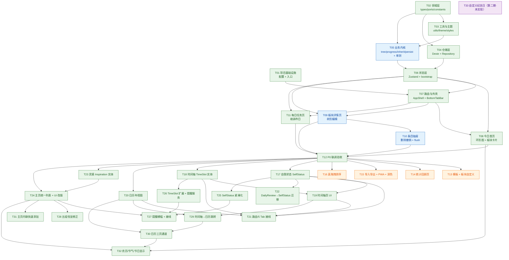

# 日程表软件 · 任务分解与迭代计划

| 项目信息 | 内容 |
| --- | --- |
| 项目名称 | `daily_schedule_app` |
| 文档版本 | v1.0 |
| 撰写人 | 高见远（架构师） |
| 上游输入 | `docs/PRD.md`、`docs/ARCHITECTURE.md` |
| 工作量单位 | 人日（含自测，不含联调等待） |
| P0 总工作量 | **≈ 9.5 人日**（T01–T12） |
| P0 续工作量（用户新批准） | **≈ 5.0 人日**（T17–T22） |
| P0 续工作量（主页改版增量） | **≈ 4.0 人日**（T23–T27） |
| P0 续工作量（恒显 / 日历通道增量） | **≈ 1.6 人日**（T28–T30） |
| P0 续工作量（主页内联快速添加增量） | **≈ 0.6 人日**（T31） |
| P0 续工作量（农历 / 节气 / 节日显示增量） | **≈ 0.8 人日**（T32） |
| 第二期工作量（自定义纪念日，未实现） | **待排期**（T33） |
| P1 总工作量 | **≈ 6.5 人日**（T13–T16） |

---

## 一、任务总览（按实现顺序）

> **粒度说明**：每个任务按「功能模块 / 层次」分组，包含 4–12 个文件。任务内部**按文件清单从上到下依次实现**，不要跳文件。
>
> **并行标记**：🔀 = 该任务可与同批次内其他 🔀 任务并行开发（无代码级依赖冲突）。

### P0 · MVP 核心闭环（T01 – T12）

| 任务ID | 任务名 | 涉及文件（相对路径） | 依赖任务 | 优先级 | 预估工作量 | 并行 |
| --- | --- | --- | --- | --- | --- | --- |
| **T01** | 项目基础设施与构建配置 | `package.json`、`vite.config.ts`、`tsconfig.json`、`tsconfig.node.json`、`tailwind.config.ts`、`postcss.config.js`、`index.html`、`.eslintrc.cjs`、`.prettierrc`、`.gitignore`、`README.md`、`src/main.tsx`、`src/App.tsx`、`src/vite-env.d.ts` | — | P0 | 0.5d | |
| **T02** | 领域层：类型 / 常量 / 端口 / 错误 | `src/domain/types.ts`、`src/domain/enums.ts`、`src/domain/constants.ts`、`src/domain/ports.ts`、`src/domain/errors.ts`、`src/domain/index.ts` | — | P0 | 0.3d | 🔀 |
| **T03** | 工具层与主题样式底座 | `src/utils/date.ts`、`src/utils/debounce.ts`、`src/utils/array.ts`、`src/utils/assert.ts`、`src/theme/muiTheme.ts`、`src/styles/index.css` | T02 | P0 | 0.4d | 🔀 |
| **T04** | 仓储层：Dexie schema + 4 个 Repository 实现 | `src/repositories/db/schema.ts`、`src/repositories/db/DexieDatabase.ts`、`src/repositories/mappers.ts`、`src/repositories/IndexedDbItemRepository.ts`、`src/repositories/IndexedDbTaskRepository.ts`、`src/repositories/IndexedDbDayRepository.ts`、`src/repositories/LocalSettingsRepository.ts`、`src/repositories/CloudRepository.stub.ts`、`src/repositories/index.ts` | T02 | P0 | 0.8d | 🔀 |
| **T05** | 业务服务内核：树 / 进度 / 继承 / 撤销 / 持久化（含单测） | `src/services/idService.ts`、`src/services/clock.ts`、`src/services/treeService.ts`、`src/services/itemMutationService.ts`、`src/services/progressService.ts`、`src/services/inheritService.ts`、`src/services/undoService.ts`、`src/services/persistenceService.ts`、`src/services/index.ts`、`src/services/__tests__/treeService.test.ts`、`src/services/__tests__/progressService.test.ts`、`src/services/__tests__/inheritService.test.ts` | T02、T03 | P0 | 1.2d | |
| **T06** | 状态层：Zustand Stores + 依赖装配 | `src/store/bootstrap.ts`、`src/store/useDayStore.ts`、`src/store/useItemStore.ts`、`src/store/useTaskStore.ts`、`src/store/useUiStore.ts`、`src/store/selectors.ts` | T04、T05 | P0 | 0.6d | |
| **T07** | 路由与应用外壳（4 Tab 骨架可跑） | `src/router/routes.ts`、`src/router/AppRouter.tsx`、`src/components/layout/AppShell.tsx`、`src/components/layout/BottomTabBar.tsx`、`src/components/layout/PageHeader.tsx`、`src/pages/StatsPage.tsx`（占位）、`src/pages/MePage.tsx`（占位） | T01、T06 | P0 | 0.5d | |
| **T08** | 今日首页：日期栏 + 环形图 + 板块卡片 + 总评 | `src/components/date/DateNavigator.tsx`、`src/components/date/DatePickerDialog.tsx`、`src/components/chart/CompletionRing.tsx`、`src/components/chart/RingLegend.tsx`、`src/components/section/SectionCard.tsx`、`src/components/section/SectionIcon.tsx`、`src/components/section/SectionProgressBar.tsx`、`src/components/review/DailyReviewDialog.tsx`、`src/components/feedback/EmptyState.tsx`、`src/pages/TodayPage.tsx` | T06、T07 | P0 | 1.0d | 🔀 |
| **T09** | 板块详情页 + 树形编辑（Enter/Tab/折叠/勾选） | `src/components/tree/TreeList.tsx`、`src/components/tree/TreeRow.tsx`、`src/components/tree/IndentGuides.tsx`、`src/components/tree/ItemTitleInput.tsx`、`src/hooks/useTreeKeyboard.ts`、`src/hooks/useDebouncedPersist.ts`、`src/hooks/useAutoResizeTextarea.ts`、`src/pages/SectionPage.tsx` | T06、T07 | P0 | 1.5d | 🔀 |
| **T10** | 条目抽屉 + 删除撤销 + 生命周期 flush | `src/components/item/ItemDrawer.tsx`、`src/components/item/RatingStars.tsx`、`src/components/item/ItemMetaRow.tsx`、`src/components/item/DescriptionEditor.tsx`、`src/components/feedback/UndoSnackbar.tsx`、`src/components/feedback/ConfirmDialog.tsx`、`src/hooks/useUndoToast.ts`、`src/hooks/usePageLifecycle.ts`、`src/hooks/useKeyboardAvoid.ts` | T09 | P0 | 1.0d | |
| **T11** | 每日任务页 + 昨日一键继承 | `src/components/task/TaskRow.tsx`、`src/pages/TasksPage.tsx` | T06、T07 | P0 | 0.7d | 🔀 |
| **T12** | P0 联调、验收与分层红线检查 | 全量（修复为主）+ `README.md` 补充验收路径 | T08、T09、T10、T11 | P0 | 0.8d | |

### P1 · 体验与留存增强（T13 – T16）

| 任务ID | 任务名 | 涉及文件（相对路径） | 依赖任务 | 优先级 | 预估工作量 | 并行 |
| --- | --- | --- | --- | --- | --- | --- |
| **T13** | 模板复用 + 板块自定义（R-017 / R-022） | `src/domain/types.ts`（增 `Template`）、`src/services/templateService.ts`*、`src/repositories/IndexedDbTemplateRepository.ts`*、`src/pages/MePage.tsx`、`src/pages/TemplatePage.tsx`* | T12 | P1 | 1.5d | 🔀 |
| **T14** | 统计回顾页：周/月趋势 + 热力日历（R-019） | `src/services/statsService.ts`*、`src/components/chart/TrendChart.tsx`*、`src/components/chart/HeatCalendar.tsx`*、`src/pages/StatsPage.tsx` | T12 | P1 | 1.5d | 🔀 |
| **T15** | 数据导入导出 + PWA + 深色模式 + 空状态引导（R-020/021/023/024） | `src/services/exportService.ts`*、`src/repositories/index.ts`、`src/theme/muiTheme.ts`（深色主题）、`src/pages/MePage.tsx`、`vite.config.ts`（PWA 插件）、`src/components/feedback/EmptyState.tsx` | T12 | P1 | 2.0d | 🔀 |
| **T16** | 真拖拽排序 + 图谱视图预留（R-018 / R-026 预研） | `@dnd-kit/*`（新增依赖）、`src/components/tree/TreeRow.tsx`、`src/components/task/TaskRow.tsx`、`src/services/treeService.ts`（`move()` 实现） | T12 | P1 | 1.5d | |

> `*` = P1 阶段新建文件（不在 P0 文件清单内）。

### P0 续 · 用户新批准功能（T17 – T22）

> 用户新批准的三项 P0 功能（PRD R-030 自我状态 / R-031 时间轴页 / R-032 日历年视图）。**依赖闭包内仅含 P0 任务（T12 及其前置）**，不引入 P1/P2 依赖。
>
> **依赖约定**：T17（SelfStatus 模型 + UI）、T18（TimeSlot 实体 + 仓储 + store）为地基，须先于 T19（时间轴页 UI）、T20（日历年视图）；T21（路由 / 底部 Tab / AppShell 接线）靠后，需各页面已就位；T22（DailyReview→SelfStatus 全仓迁移 + 单测）为横切任务，依赖 T17，可与 T19/T20/T21 并行收尾。

| 任务ID | 任务名 | 涉及文件（相对路径） | 依赖任务 | 优先级 | 预估工作量 | 并行 |
| --- | --- | --- | --- | --- | --- | --- |
| **T17** | 自我状态 SelfStatus：领域模型 + 今日页 UI（取代 DailyReview / 进度环） | `src/domain/types.ts`（增 `DailySelfStatus`、删 `DailyReview`）、`src/domain/ports.ts`（新增 `SelfStatusRepository`：`get` / `upsert` / `listBetween`）、`src/repositories/IndexedDbDayRepository.ts`（含 `SelfStatusRepository` 实现）、`src/store/useDayStore.ts`（自我状态 state + action）、`src/components/selfstatus/SelfStatusCard.tsx`（含 ♥ / ★ 子视图）、`src/pages/TodayPage.tsx`（用 SelfStatusCard 替换 CompletionRing + DailyReviewDialog 区域） | T12 | P0 | 1.0d | 🔀 |
| **T18** | 时间轴 TimeSlot：实体 + 仓储 + store | `src/domain/types.ts`（增 `TimeSlot` / `TimeSlotDraft`）、`src/domain/ports.ts`（增 `TimeSlotRepository`：`listByDate` / `listByDateRange` / `upsertMany` / `hardDeleteMany`）、`src/repositories/db/schema.ts`（增 `timeSlots` 表：`&id, date, [date+sectionId], deletedAt`）、`src/repositories/IndexedDbTimeSlotRepository.ts`、`src/repositories/index.ts`、`src/store/useTimeSlotStore.ts`（排序/校验）、`src/store/__tests__/useTimeSlotStore.test.ts` | T12、T02 | P0 | 1.0d | 🔀 |
| **T19** | 时间轴页 UI（R-031，底栏 Tab「时间轴」） | `src/pages/TimelinePage.tsx`（时间段列表 + 新增/编辑：计划开始/结束、内容、板块归属、完成勾选） | T18 | P0 | 0.8d | 🔀 |
| **T20** | 日历年视图：store + 组件（R-032） | `src/store/useCalendarStore.ts`（月/年视图 state + 有记录天数聚合）、`src/components/calendar/MonthGrid.tsx`（月视图网格）、`src/components/calendar/DayCell.tsx`（有数据四色小点）、`src/components/calendar/YearGrid.tsx`（12 月缩略网格 / 「N 天有记录」）、`src/pages/CalendarPage.tsx`（月/年切换容器） | T12 | P0 | 1.0d | 🔀 |
| **T21** | 路由 / 底部 Tab / AppShell 接线（5 Tab） | `src/router/routes.ts`（增 `/timeline`、`/calendar`）、`src/router/AppRouter.tsx`、`src/components/layout/BottomTabBar.tsx`（5 Tab：今日/任务/时间轴/日历/我的）、`src/components/layout/AppShell.tsx`。**优先级口径**：5 个 Tab 入口均为 P0；「我的」`MePage` 当前为占位页（P0 入口 / P1 功能），账号同步 P2 | T17、T18、T19、T20 | P0 | 0.5d | |
| **T22** | 全代码库 DailyReview→SelfStatus 迁移 + 单测更新（横切） | 全局替换 `DailyReview` / `getReview` / `saveReview` / `DailyReviewDialog` 为 SelfStatus 对应；更新 `src/services/__tests__/*` 中涉及 review 的用例；`useDayStore` 引用同步 | T17 | P0 | 0.7d | 🔀（横切，可并行收尾） |

### P0 续 2 · 主页改版与时间轴双用增量（T23 – T27）

> 用户本增量新批准的四项 P0 功能（PRD R-033 主页日记体统一列表 / R-034 灵感条目 / R-035 自我状态紧凑化 / R-036 时间轴规划+记录双用 + 应用内提醒）。依赖闭包仅含已完成的 P0 任务（T12 / T17 / T18 及其前置）。
>
> **依赖约定**：T23（Inspiration 数据地基）、T25（SelfStatus 紧凑化）、T26（TimeSlot 扩展 + 提醒服务）可并行起步（分别依赖 T12 / T17 / T18）；T24（主页统一列表聚合 + UI 改版）依赖 T23；T27（提醒横幅 + 接线）靠后，依赖 T24 / T25 / T26。**T24 与 T25 均改动 `TodayPage.tsx`，建议同一人串行或先后合并**。

| 任务ID | 任务名 | 涉及文件（相对路径） | 依赖任务 | 优先级 | 预估工作量 | 并行 |
| --- | --- | --- | --- | --- | --- | --- |
| **T23** | 灵感 Inspiration：实体 + 仓储 + store | `src/domain/types.ts`（增 `Inspiration`，含软删 `deletedAt`）、`src/domain/ports.ts`（增 `InspirationRepository`：`listByDate` / `listByDateRange` / `upsertMany` / `hardDeleteMany`）、`src/repositories/db/schema.ts`（增 `inspirations` 表：`&id, date, deletedAt`）、`src/repositories/IndexedDbInspirationRepository.ts`、`src/repositories/index.ts`、`src/store/useInspirationStore.ts` | T12、T02 | P0 | 0.8d | 🔀 |
| **T24** | 主页日记体统一列表：聚合服务（跨组连续编号）+ UI 改版 | `src/services/diaryService.ts`（`buildDiaryList`：五组固定顺序 `DIARY_GROUP_ORDER` + 顶层跨组连续编号 `DiaryEntry.displayNo` + 子项 `kind:'child'`）、`src/services/__tests__/diaryService.test.ts`、`src/components/diary/DiaryList.tsx`（分组列表）、`src/pages/TodayPage.tsx`（用统一列表替换 SectionCard 区域） | T23、T12 | P0 | 1.2d | |
| **T25** | 自我状态紧凑化（SelfStatusCard 横条版） | `src/components/selfstatus/SelfStatusCard.tsx`（紧凑横条：♥×5 ★×5 + 摘要一行，点开编辑）、`src/pages/TodayPage.tsx`（用紧凑横条替换大卡片） | T17 | P0 | 0.4d | 🔀 |
| **T26** | TimeSlot 扩展（计划/实际字段）+ 应用内提醒服务 | `src/domain/types.ts`（`TimeSlot` 增 `actualStartMin` / `actualEndMin`；计划字段沿用 `startMin` / `endMin`，**不改名、无迁移**）、`src/services/reminderService.ts`（`listDueSlots(slots, nowMin)` = `deletedAt===null && !done && startMin>0 && nowMin>=startMin`）、`src/services/__tests__/reminderService.test.ts`、`src/store/useTimeSlotStore.ts`（双态 state） | T18 | P0 | 1.0d | 🔀 |
| **T27** | 提醒横幅 UI + 主页 / 时间轴接线 | `src/components/reminder/ReminderBanner.tsx`（顶部横幅 + 关闭）、`src/pages/TodayPage.tsx`（挂载提醒横幅）、`src/pages/TimelinePage.tsx`（计划/实际两态录入与展示） | T24、T25、T26 | P0 | 0.6d | |

### P0 续 3 · 五组恒显与日历联动增量（T28 – T30）

> 用户本轮小增量（PRD R-033 ⑦ 恒显修正 / R-037 时间轴→日历 / R-038 日历三页通道）。依赖 T19 / T20 / T24（时间轴页 / 日历页 / 主页统一列表已就位）。
>
> **依赖约定**：T28 依赖 T24；T29 依赖 T19、T20；T30 依赖 T29、T20。T28（主页）与 T29（时间轴→日历）可并行；T30 在 T29 之后。

| 任务ID | 任务名 | 涉及文件（相对路径） | 依赖任务 | 优先级 | 预估工作量 | 并行 |
| --- | --- | --- | --- | --- | --- | --- |
| **T28** | 主页五组恒显修正 + 空组添加入口（修正 R-033「空组隐藏」）（注：T28 交付的空组跳转行已被 **T31 / PRD R-039** 取代为组内联快速添加，见下文 P0 续 4） | `src/services/diaryService.ts`（空组照常入列 `entries=[]`；编号只在有顶层条目时自增、空组不影响跨组连续编号）、`src/services/__tests__/diaryService.test.ts`（补「空组恒显 + 编号不受空组影响」用例）、`src/components/diary/DiaryList.tsx`（空组「暂无条目 · 点这里添加」入口，点击进板块详情）、`src/pages/TodayPage.tsx` | T24 | P0 | 0.5d | 🔀 |
| **T29** | 时间轴 → 日历跳转 + 日历选中优先级纯函数 | `src/services/calendarService.ts`（`resolveCalendarSelection(monthKey, preferredDate, today)`：全局日期 → 今天 → 该月 1 号）、`src/services/__tests__/calendarService.test.ts`、`src/pages/TimelinePage.tsx`（顶部日期可点击跳日历）、`src/pages/CalendarPage.tsx`（消费 `resolveCalendarSelection` 落天） | T19、T20 | P0 | 0.6d | 🔀 |
| **T30** | 日历 → 三页通道（当日 / 时间轴 / 任务） | `src/components/calendar/DaySummaryCard.tsx`（三跳转入口，点击先切全局日期再跳）、`src/pages/CalendarPage.tsx` | T29、T20 | P0 | 0.5d | |

### P0 续 4 · 主页内联快速添加增量（T31）

> 用户本轮反馈（PRD R-039）：主页四个板块组（工作 / 学习 / 健身 / 生活）改为**内联快速添加**——像灵感组那样，组内常驻「输入框 + 「添加」按钮」，在主页输入并提交即可新增该组顶层条目，**不再跳转板块详情页**；原「暂无条目 · 点这里添加」跳转行取消。
>
> **依赖约定**：T31 依赖 T24（主页统一列表已就位）。T28 已交付并复用（其交付的空组「暂无条目 · 点这里添加」跳转行即由 T31 **替换**为组内联录入区）；T31 与 T28 均改动 `src/components/diary/DiaryList.tsx`，建议由同一人串行或先后合并。

| 任务ID | 任务名 | 涉及文件（相对路径） | 依赖任务 | 优先级 | 预估工作量 | 并行 |
| --- | --- | --- | --- | --- | --- | --- |
| **T31** | 主页四板块组内联快速添加（R-039） | `src/store/useItemStore.ts`（**扩展已有 `addSibling`**：增加**可选**第 4 参 `title?: string`，实现内 `title: ''` → `title: title ?? ''`，把标题透传给 `treeService.createSiblingAfter`；**不新增 action**，并须保持 `src/hooks/useTreeEditor.ts:41` 的三参调用兼容；**不得**实现成「先建空条目再 setTitle」这类两次落盘）、`src/components/diary/DiaryList.tsx`（四个板块组每组常驻内联录入区：输入框 + 右侧「添加」按钮，`Enter`/点按钮提交；空输入禁用按钮；提交后清空并保持聚焦、新条目追加组末尾；采用该板块主题色；移除跳转行；**排序复用 `treeService.nextOrder` / `createSiblingAfter`**（`order` = `max + ORDER_STEP`、空组 = `ORDER_STEP`，`ORDER_STEP = 1000`），**不得在 store 或组件里另写排序逻辑**）、`src/components/diary/__tests__/DiaryList.test.ts`（文件头 `// @vitest-environment jsdom` + `createElement` 代替 JSX，参考 `src/components/__tests__/dateNavigator.test.ts`；或 `src/store/__tests__/useItemStore.test.ts`：覆盖空值禁用、提交新增顶层条目并纳入跨组编号、`addSibling` 第 4 参 `title` 透传） | T24 | P0 | 0.6d | 🔀 |

### P0 续 5 · 农历 / 节气 / 节日显示增量（T32）

> 用户本轮批准并**已实现**的 P0 增量（PRD R-040）：主页与日历显示农历日期、二十四节气与节日，**全部内置、零联网、零新增依赖、零新增数据表、零 Dexie schema 变更**。展示位置仅两处——今日页日期栏副标题（`DateNavigator` 新增可选 `subtitleText`）与日历页选中日摘要卡（`DaySummaryCard` 标题行下方）。
>
> **明确未改动**：`src/components/calendar/DayCell.tsx`、`src/components/calendar/MonthGrid.tsx`、`src/components/calendar/YearGrid.tsx`、`src/pages/TimelinePage.tsx`（月历格子、年视图、时间轴页都不显示节日）。
>
> **依赖约定**：T32 的三个改动点分别归属 T08（`DateNavigator`）、T24（`TodayPage`）、T30（`DaySummaryCard`），三者均已完成，故 T32 可独立并行开发。

| 任务ID | 任务名 | 涉及文件（相对路径） | 依赖任务 | 优先级 | 预估工作量 | 并行 |
| --- | --- | --- | --- | --- | --- | --- |
| **T32** | 农历 / 二十四节气 / 节日显示（R-040，第一期） | `src/services/lunar/lunarData.ts`（内置压缩农历表，1900–2100）、`src/services/lunar/lunarService.ts`（`solarToLunar` / `formatLunarMonthDay` / `lunarMonthDays` / `leapMonthOf`）、`src/services/solarTermService.ts`（`solarTermOf` / `solarTermDayOfMonth`，基于太阳视黄经求解交节时刻 + 北京时间定日）、`src/services/festivalService.ts`（`getFestivals` / `getFestivalLine`）、`src/hooks/useDayFestivals.ts`、`src/components/date/DateNavigator.tsx`（新增可选 `subtitleText`）、`src/pages/TodayPage.tsx`、`src/components/calendar/DaySummaryCard.tsx`；测试 `src/services/__tests__/lunarService.test.ts`、`src/services/__tests__/solarTermService.test.ts`、`src/services/__tests__/festivalService.test.ts`、`src/services/__tests__/lunarBoundary.test.ts`、`src/components/__tests__/dateNavigatorFestival.test.ts` | T08、T24、T30 | P0 | 0.8d | 🔀 |

### 第二期 · 自定义纪念日（T33，未实现 / 待排期）

> 用户已批准但**本轮未实现**（PRD R-041）：用户自定义纪念日（新实体）+ 两个管理入口——「我的」页管理列表 + 日历摘要卡快捷添加。**以下为第二期规划，当前尚未创建任何对应文件**。

| 任务ID | 任务名 | 涉及文件（相对路径） | 依赖任务 | 优先级 | 预估工作量 | 并行 |
| --- | --- | --- | --- | --- | --- | --- |
| **T33** | 自定义纪念日（R-041，**第二期 · 未实现**） | 拟新增：自定义纪念日实体 + 仓储接口与 IndexedDb 实现（沿用现有 Repository / 软删模式）+ store + 「我的」页管理列表 + 日历摘要卡快捷添加入口（**均为第二期规划，尚未创建**） | 待排期（未实现） | P0（第二期 · 未实现） | 待排期 | |

---

## 二、任务详细实现要点

> 每个任务给出「实现顺序 + 关键约束 + 完成判据」，工程师按序执行即可。

### T01 项目基础设施与构建配置（0.5d）

1. `package.json`：按 `ARCHITECTURE.md` §8.1/§8.2 声明依赖（**P1 依赖先不装**），脚本 `dev` / `build` / `preview` / `test` / `lint`。
2. `vite.config.ts`：配置 `@` → `src` 别名、`server.host=true`（手机真机调试）。
3. `tailwind.config.ts`：**必须** `corePlugins: { preflight: false }`（§9.7），content 覆盖 `./src/**/*.{ts,tsx}`。
4. `.eslintrc.cjs`：**必须**写入 §3.3 的分层约束 overrides（domain/services 禁浏览器 API、UI 禁 import repositories）。
5. `index.html`：`viewport` 含 `width=device-width, initial-scale=1, viewport-fit=cover`（刘海屏安全区必需）。
6. `src/main.tsx` / `src/App.tsx`：先渲染一个「Hello」占位，验证 `npm run dev` 可跑。

- **完成判据**：`npm run dev` 启动成功；手机/DevTools 375px 视口无横向滚动；`npm run lint` 通过。

### T02 领域层（0.3d）

1. `types.ts`：严格照 `ARCHITECTURE.md` §5.1 落地（**字段一个不能少**，尤其 `deletedAt`、`level`、`order`）。
2. `constants.ts`：`SECTION_CONFIGS`（4 个板块含图标与色值）、`ORDER_STEP=1000`、`DEBOUNCE_MS=500`、`UNDO_WINDOW_MS=5000`、`MAX_LEVEL=8`。
3. `ports.ts`：照 §5.2 落地 4 个 Repository 接口（**只定义，不实现**）。

- **完成判据**：`tsc --noEmit` 无错误；`domain/` 目录下无任何 import（纯零依赖）。

### T03 工具层与主题（0.4d）

1. `utils/date.ts`：`toDateKey` 必须**基于本地时区**（禁止 `toISOString().slice(0,10)`）。
2. `theme/muiTheme.ts`：圆角、最小点击区 44×44、字号基线 14/16。
3. `styles/index.css`：Tailwind 三指令 + `.safe-bottom { padding-bottom: env(safe-area-inset-bottom) }`。

- **完成判据**：`toDateKey(new Date('2024-10-15T23:30:00'))` 返回 `2024-10-15`（不被 UTC 推移）。

### T04 仓储层（0.8d）

1. `db/schema.ts`：照 §9.9 建 4 张表 + 复合索引 `[date+sectionId]`。
2. `mappers.ts`：**所有读取必须过滤 `deletedAt !== null`**；写入时补默认值。
3. 三个 `IndexedDb*Repository`：批量操作统一用 `bulkPut` + `.transaction('rw', ...)`。
4. `DexieDatabase.ts`：open 失败 → 抛 `StorageError`（由 `bootstrap` 捕获渲染失败页）。
5. `repositories/index.ts`：**唯一装配点**，导出 `createRepositories()`。

- **完成判据**：浏览器 DevTools → Application → IndexedDB 可见 4 张表；控制台手工调 `upsertMany` + `listBySection` 能闭环。

### T05 业务服务内核（1.2d）★ 最核心

1. `treeService.ts`：按 `ARCHITECTURE.md` §7 全量实现（`buildVisibleRows` / `createSibling` / `createChild` / `indent` / `outdent` / `collectSubtreeIds` / `reindexSiblings`）。**全部纯函数，返回 `MutationResult`**。
2. `itemMutationService.ts`：**软删只改 `deletedAt`**（§7.6 红线）。
3. `progressService.ts`：按 §7.7 口径（顶层口径、子项不进分母、父显示直系子项进度）。
4. `inheritService.ts`：`inheritedFrom.taskId` + 内容 hash **双重去重**。
5. `persistenceService.ts`：脏实体 Map（key 去重）+ 500ms debounce + `flush(reason)` + `scheduleImmediate()`。
6. **单测必写**：`treeService.test.ts` 至少覆盖——首层 Shift+Tab 越界、Tab 无前兄弟、子树 level 随迁、递归删除 id 集合、order 精度耗尽重排。

- **完成判据**：`npm run test` 全绿（≥ 15 个 case）；`services/` 目录 ESLint 分层检查零告警。

### T06 状态层（0.6d）

1. `bootstrap.ts`：创建 Repositories → 注入 Service → 注册 `visibilitychange`/`pagehide` → 加载当日数据 → **失败时设置全局错误态**。
2. 四个 Store：所有 action 严格遵守 §9.6 **乐观更新范式**（保存旧值 + 回滚）。
3. `selectors.ts`：`visibleRows` / `sectionProgressMap` / `ringData` 必须 memo 化。

- **完成判据**：控制台调 `useItemStore.getState().indent(id)` 能正确改内存且不触存储报错；切后台触发 flush 日志。

### T07 路由与外壳（0.5d）

1. `routes.ts` + `AppRouter.tsx`：`/today`（默认）、`/section/:sectionId?date=`、`/tasks`、`/stats`、`/me`。
2. `AppShell.tsx`：最大宽度 430px 居中 + 安全区 + 底部 Tab 占位高度。
3. `BottomTabBar.tsx`：4 项，激活态取自路由。

- **完成判据**：4 个 Tab 点击可切换（`/stats`、`/me` 先渲染占位空状态）。

### T08 今日首页（1.0d）

1. `DateNavigator`：`‹ 日期 ›` +「今天」按钮 + 日历图标（**切换日期前先 `flush()`**）。
2. `CompletionRing`：**手写 SVG**，4 段 `stroke-dasharray`，中心 `overallPercent`；`hasData=false` 渲染灰色占位环。
3. `SectionCard`：`3/5` + `60%` + 预览 2 条 + 点击跳板块详情。
4. `DailyReviewDialog`：星级 + 文字，实时保存。
5. `TodayPage` 组装 + `EmptyState`。

- **完成判据**：造 5 条假数据后，环形图百分比与卡片数字一致；点环形图某段跳对应板块。

### T09 板块详情页 + 树形编辑（1.5d）★ 最复杂

1. `TreeList`：`buildVisibleRows()` → 渲染；底部「＋添加条目」。
2. `IndentGuides`：依 `ancestorsIsLast[]` 画 `│ ` / `  `，本级画 `├ ` / `└ `。
3. `TreeRow`：勾选框 + 折叠箭头（带子项数徽标）+ `ItemTitleInput` + `2/5` 徽标 + 右侧 `›` 打开抽屉。
4. `ItemTitleInput`：**非受控 + 局部 state + 500ms 防抖回写 Store**；空值失焦丢弃。
5. `useTreeKeyboard`：Enter → `addSibling`；Tab → `indent`；Shift+Tab → `outdent`；**`ok:false` 时不重渲染**。

- **完成判据**：连续 Enter 建 5 条 → Tab 降级成子项 → Shift+Tab 升回 → 折叠后刷新页面折叠态保持 → 刷新后数据零丢失。

### T10 条目抽屉 + 删除撤销（1.0d）

1. `ItemDrawer`：MUI `Drawer` `anchor="bottom"`，`maxHeight: 85vh`，内部滚动。
2. `useKeyboardAvoid`：`visualViewport` 偏移应用到抽屉 `bottom`。
3. `DescriptionEditor`：自增高 textarea + 防抖落盘；`RatingStars` 1–5 星。
4. `ConfirmDialog`（有子项时提示数量）→ `removeWithSubtree()` → `UndoSnackbar` 5s 倒计时。
5. `usePageLifecycle`：`visibilitychange` / `pagehide` → `flush()`。

- **完成判据**：删含 3 子项的父条目 → 撤销 → 层级/顺序/折叠态**完整恢复**；输入后立刻切后台，重进数据不丢。

### T11 每日任务页（0.7d）

1. `TaskRow`：勾选 + 行内编辑 + 左滑删除 + 上/下移按钮（P0 不上真拖拽）。
2. `TasksPage`：进度条「已完成 1/4」+「继承昨日未完成」按钮 + 底部「＋添加任务」。
3. 继承走 `inheritService.planInherit`，**重复点击不产生重复数据**。

- **完成判据**：连点 3 次「继承昨日」，任务列表只新增一次；Toast 提示无新增。

### T12 P0 联调与验收（0.8d）

1. 按 PRD 附录「MVP 核心闭环 A → K」全流程走查一遍。
2. 分层红线检查：全局搜索 `src/domain`、`src/services` 中是否出现 `window`/`localStorage`/`indexedDB`（必须为零）。
3. 性能：单板块 100 条条目滚动与勾选不掉帧。
4. 375 / 390 / 430px 三档视口走查。

- **完成判据**：PRD §5 中 R-001 ～ R-016 全部验收标准通过。

---

## 三、任务依赖关系图

**并行说明**：
- 🔀 **批次 2**：T03 与 T04 可并行（同依赖 T02，无文件冲突）。
- 🔀 **批次 4**：T08 / T09 / T11 可并行（同依赖 T06+T07，文件完全不重叠）；T10 依赖 T09 的 `TreeRow`，建议 T09 完成后接上，或由同一人串行。
- 🔀 **P1 阶段**：T13 / T14 / T15 / T16 全部可并行。
- 🔀 **新批准 P0 阶段**：T17（SelfStatus）与 T18（TimeSlot 模型 + 仓储）可并行起步；T19（时间轴页）依赖 T18、T20（年视图）依赖 T12，二者可并行；T21（路由/Tab 接线）靠后，需 T17/T18/T19/T20 全部就位；T22（DailyReview→SelfStatus 迁移）横切，依赖 T17，可在 T19/T20/T21 收尾阶段并行推进。
- 🔀 **主页改版增量**：T23（Inspiration）、T25（SelfStatus 紧凑化）、T26（TimeSlot 扩展 + 提醒服务）可并行起步（分别依赖 T12 / T17 / T18）；T24（主页统一列表 + UI）依赖 T23；T27（提醒横幅 + 接线）靠后，依赖 T24 / T25 / T26。
- 🔀 **恒显 / 日历通道增量**：T28（主页恒显修正）依赖 T24、T29（时间轴→日历）依赖 T19 / T20，二者可并行；T30（日历三页通道）在 T29 之后。
- 🔀 **主页内联快速添加增量**：T31 依赖 T24；T28（已交付）与 T31 均改动 `DiaryList.tsx`，T31 会替换 T28 交付的空组跳转行，建议由同一人串行或先后合并。
- 🔀 **农历 / 节气 / 节日显示增量**：T32 的三个改动点（`DateNavigator` / `TodayPage` / `DaySummaryCard`）分别归属 T08 / T24 / T30，均已完成，T32 可独立并行；T33（自定义纪念日）为第二期，未排期。

---

## 四、里程碑划分

| 里程碑 | 名称 | 包含任务 | 完成标准（可验证） |
| --- | --- | --- | --- |
| **M1** | **骨架可跑** | T01、T02、T03、T04 | ① `npm run dev` 启动 < 2s；② DevTools 中 IndexedDB 建库成功（4 张表 + 复合索引）；③ `tsc --noEmit` 与 `npm run lint` 零错误；④ 手工调用 `ItemRepository.upsertMany` → `listBySection` 数据往返成功 |
| **M2** | **树形编辑闭环** | T05、T06、T07、T09、T10 | ① `npm run test` 全绿（树算法 ≥ 15 case）；② 板块详情页可：回车连续新增 5 条 → Tab 降级 → Shift+Tab 升级 → 折叠 → 勾选；③ 删除含子项条目并撤销，层级/顺序/折叠态完整恢复；④ **刷新浏览器后数据 100% 保留**；⑤ 4 个 Tab 可切换 |
| **M3** | **P0 全量完成（原闭环）** | T08、T11、T12 | ① 首页四板块卡片与完成态一致；② 日期切换（前/后/今天/选择器）数据与日期严格对应；③ 每日任务页增删改勾选排序可用，「继承昨日」连点 3 次不产生重复数据；④ 375/390/430px 三档视口无横向滚动；⑤ 分层红线检查：`src/domain` + `src/services` 中 `window`/`localStorage`/`indexedDB` 出现次数 = 0；⑥ PRD R-001～R-016（除被 R-030 取代的 R-004、R-014）全部验收通过。**注**：原「首页完成度环形图（R-004）」「每日总评（R-014）」已由 R-030（SelfStatus 自我状态双评分）取代，其验收改由 M5 承接 |
| **M4** | **P1 增强** | T13、T14、T15、T16 | ① 模板 ≥ 3 套，一键应用合并去重不覆盖；② 统计页周/月趋势 + 热力日历，点击某日跳转详情；③ JSON 导出/导入完整还原；添加到主屏全屏启动、断网可用；深色模式跟随系统 + 手动切换；首次打开引导卡片 + 载入示例数据；④ 真拖拽排序含插入指示线，跨父级移动层级正确 |
| **M5** | **新批准 P0 功能** | T17、T18、T19、T20、T21、T22 | ① 今日页原进度环区域改为 mood♥（0–5）+ body★（0–5）双评分 + 各自可选自由文字，落 `DailySelfStatus` 表、可反复修改、历史日严格回填；② 全代码库无 `DailyReview` / `getReview` / `saveReview` 残留（T22 完成）；③ 底栏 Tab「时间轴」可进入 `/timeline`，新增时间段含计划开始/结束、内容、可选板块归属、完成勾选，按 `startMin` 升序，与板块条目并存；④ 日历页月/年视图可切换，年视图 12 月缩略网格且含数据月份显示四色小点 / 「N 天有记录」；⑤ 分层红线仍成立；⑥ PRD R-030 / R-031 / R-032 全部验收通过 |
| **M6** | **主页改版与时间轴双用增量** | T23、T24、T25、T26、T27 | ① 主页为日记体统一列表（工作/学习/健身/生活/灵感五组固定顺序、顶层跨组连续编号 1~N、子项缩进跟随）；② 灵感组底快捷新增纯文字条目，不计完成度但计入 hasData；③ 自我状态压缩为列表上方紧凑横条，点开编辑，数据模型不变；④ TimeSlot 支持计划/实际两态，可提前写未来计划、事后补实际时间；⑤ 打开 App 当天存在「已到计划时段且未完成」时顶部横幅提醒、可关闭；⑥ PRD R-033 / R-034 / R-035 / R-036 全部验收通过 |
| **M7** | **五组恒显与日历联动增量** | T28、T29、T30 | ① 主页五组恒显：四板块空组**仍显示组头**（原「暂无条目 · 点这里添加」跳转行已移除），灵感组恒显，编号不受空组影响；② 时间轴顶部日期可点击跳日历并落同一天（`resolveCalendarSelection` 纯函数单测覆盖三分支）；③ 日历某天摘要卡提供「当日 / 时间轴 / 任务」三入口，点击先切日期再跳；④ PRD R-033 ⑦ / R-037 / R-038 全部验收通过 |
| **M8** | **主页内联快速添加增量** | T31 | ① 四个板块组每组常驻一行内联录入区（输入框 + 「添加」按钮）；② 输入为空时「添加」按钮禁用；③ 点按钮或 `Enter` 提交后在主页直接新增该组**顶层条目**（`parentId = null`），追加至该组末尾并纳入跨组连续编号；④ 提交后清空输入框且保持聚焦；⑤ 原「暂无条目 · 点这里添加」跳转行已移除；⑥ PRD R-039 全部验收通过 |
| **M9** | **农历 / 节气 / 节日显示增量** | T32 | ① 今日页日期栏在日期大字下方显示一行「农历月日 · 节日」（`DateNavigator.subtitleText`），无节日时只显示农历日期，不传副标题时 DOM 与加此功能前逐字节一致；② 日历页选中日摘要卡标题行下方显示同一行；③ 覆盖 1900–2100，越界 `solarToLunar` 返回 `null`、UI 降级为空串、不崩溃、不给错误日期；④ 除夕按当年腊月实际天数（29/30）计算、不写死 30；⑤ 清明只出现一次、不重复；⑥ 同日最多 2 个名字并按优先级排序；⑦ 月历格子 / 年视图 / 时间轴**不显示**节日；⑧ 零联网、零新增 npm 依赖、零新增数据表；⑨ PRD R-040 全部验收通过 |
| **M10** | **自定义纪念日（第二期）** | T33 | ① 新增自定义纪念日实体，并提供两个管理入口（「我的」页管理列表 + 日历摘要卡快捷添加）；② **本轮未实现**——上述为已批准的第二期目标，当前未交付（与 M4「P1 增强」为未实现的 P1 任务设里程碑的既有做法一致），PRD R-041 待第二期排期与验收 |

---

## 五、给工程师的实现批次建议（P0 分 4 批）

> **每批次结束都应是一个「可运行、可演示」的状态**，不要跨批次留半成品。

### 批次 1：地基（T01 → T02 → T03）｜0.9d

| 项 | 内容 |
| --- | --- |
| **任务** | T01 基础设施、T02 领域层、T03 工具与主题（T03 可与 T02 并行） |
| **产出物** | 一个 `npm run dev` 能跑起来的空壳 App（Hello 页面）；完整的类型契约 `Item/Task/Day/DailyReview` + 4 个 Repository 接口；日期工具与 MUI/Tailwind 主题底座 |
| **验证** | `npm run lint` + `tsc --noEmit` 零错误；`toDateKey` 时区用例正确 |
| **注意** | 此时**不要写任何 UI 业务组件**；`.eslintrc.cjs` 的分层规则必须先落地，否则后面返工 |

### 批次 2：数据与业务内核（T04 → T05）｜2.0d ★ 关键批次

| 项 | 内容 |
| --- | --- |
| **任务** | T04 仓储层（可与 T03 并行）、T05 业务服务内核 + 单测 |
| **产出物** | ① 可用的 IndexedDB 存储（4 表 + 复合索引 + 批量写 + 软删/恢复/清理）；② **一套零 UI、纯函数、有单测保障的业务内核**：树形增删改层级、完成度计算、昨日继承（幂等）、撤销快照、防抖持久化调度器 |
| **验证** | `npm run test` 全绿；浏览器控制台手工调 Repository 能闭环读写；ESLint 分层检查 `services/` 零告警 |
| **注意** | **这是整个项目技术含量最高的批次**，务必先把 `treeService.test.ts` 写全再往上搭 UI。UI 只是这套内核的皮肤 |

### 批次 3：状态与外壳（T06 → T07）｜1.1d

| 项 | 内容 |
| --- | --- |
| **任务** | T06 Zustand Stores + bootstrap 装配、T07 路由 + AppShell + 底部 Tab |
| **产出物** | 一个「4 个 Tab 可切换、能真实读写 IndexedDB」的骨架 App；`/stats` `/me` 为占位页 |
| **验证** | 控制台调 `useItemStore.getState().addSibling()` 数据进 IndexedDB；切后台触发 flush；杀掉进程重开数据还在 |
| **注意** | `bootstrap.ts` 的依赖注入在这批完成，**此后 UI 层再也不应该 import repositories** |

### 批次 4：P0 页面闭环 + 验收（T08 ∥ T09 ∥ T11 → T10 → T12）｜4.0d

| 项 | 内容 |
| --- | --- |
| **任务** | 先并行 T08 今日首页 / T09 板块详情页+树形编辑 / T11 每日任务页；再 T10 条目抽屉+删除撤销+生命周期 flush；最后 T12 联调验收 |
| **产出物** | **完整可交付的 MVP**：PRD 附录 A→K 闭环全通 |
| **验证** | 按 T12 的 6 条完成判据逐项走查 |
| **注意** | T09 与 T10 耦合较紧（抽屉由 `TreeRow` 唤起），建议由同一人串行；T08/T11 可交给另一人并行 |

### 批次工作量汇总

| 批次 | 任务 | 串行工作量 | 并行后（2 人） |
| --- | --- | --- | --- |
| B1 地基 | T01+T02+T03 | 1.2d | ~0.8d |
| B2 内核 | T04+T05 | 2.0d | ~1.4d |
| B3 状态与外壳 | T06+T07 | 1.1d | 1.1d |
| B4 页面闭环 | T08+T09+T10+T11+T12 | 5.0d | ~3.2d |
| **P0 合计** | | **9.3d** | **≈ 6.5d（2 人协作）** |

---

## 六、风险与规避

| # | 风险 | 影响 | 规避措施 |
| --- | --- | --- | --- |
| R1 | `treeService` 边界情况（首层 Shift+Tab、Tab 无前兄弟、order 精度耗尽）漏测 | 数据脏、层级错乱 | T05 强制先写单测；case 覆盖见 T05 完成判据 |
| R2 | MUI + Tailwind 样式互相覆盖，调试耗时 | 样式返工 | 严格遵守 §9.7（关 preflight、布局用 Tailwind、外观用 MUI、类名用 `clsx`） |
| R3 | 防抖落盘漏写导致数据丢失 | P0 验收不通过 | 所有写入唯一出口 `persistenceService`；`usePageLifecycle` 全局注册一次 |
| R4 | 撤销恢复丢失层级/折叠态 | R-007 不通过 | 严守「软删只改 `deletedAt`」+ 撤销用快照覆盖 |
| R5 | 移动端键盘遮挡输入框 | 体验硬伤 | `useKeyboardAvoid` 在 T10 必须完成，且抽屉 `maxHeight ≤ 85vh` |
| R6 | 工程师在 UI 层直接 import repositories | 架构腐化、迁移失败 | ESLint `no-restricted-imports` 卡口 + T12 全局搜索复核 |
| R7 | 一次性实现 P0 全部页面导致调试面过大 | 进度失控 | 严格按 4 批次推进，每批次结束必须可运行 |

---

## 七、与 PRD 优先级的一致性声明

| 检查项 | 结论 |
| --- | --- |
| P0 任务（T01–T12）是否**不依赖**任何 P1/P2 任务？ | ✅ 是。T01–T12 的依赖闭包内仅有 P0 任务 |
| P1 任务是否被写进 P0 的前置依赖？ | ✅ 否。T13–T16 均只依赖 T12，且排在 P0 之后 |
| P1 依赖包是否混入 P0？ | ✅ 否。`@dnd-kit/*`、`vite-plugin-pwa`、`dexie-cloud-addon` 均在 §8.3，P0 不装 |
| P0 是否覆盖 PRD 全部 16 条 P0 需求？ | ✅ 是。映射见 `ARCHITECTURE.md` 附录 B |
| P2（云端同步 / 图谱 / 提醒 / 标签 / 周报）是否进入任务表？ | ✅ 否。仅以 `CloudRepository.stub.ts` 占位（T04）保留扩展点。**注**：P2「提醒通知」指系统通知/推送（R-027）；R-036 的**应用内提醒**为 P0，二者不同 |
| 增量 P0 任务（T17–T32）是否引入 P1/P2 依赖？ | ✅ 否。T17–T32 的依赖闭包仅含 P0 任务（T01–T12 基础 + 增量内部的 T08/T17/T18/T19/T20/T24/T30 等） |
| 本轮增量（T32 农历 / 节气 / 节日）是否引入新依赖 / 新数据表？ | ✅ 否。农历为内置压缩表（1900–2100）、节气为本地算法实时求解（太阳视黄经 + 北京时间定日）、节日为内置查表，**零联网、零新增 npm 依赖、零新增 Dexie 表、零 schema 变更**；T33（自定义纪念日）为第二期，未实现、未排期 |
